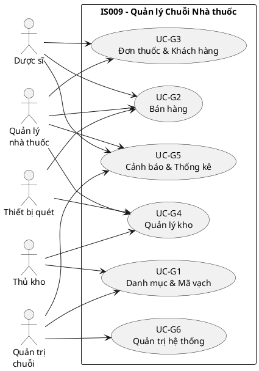
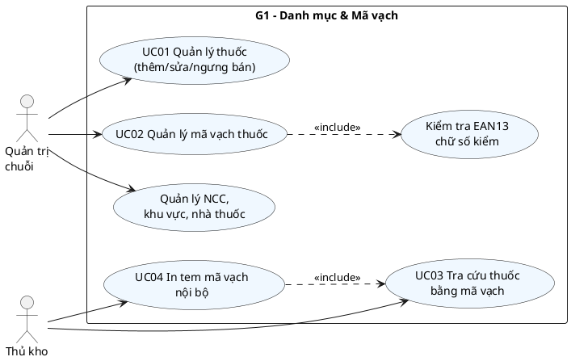
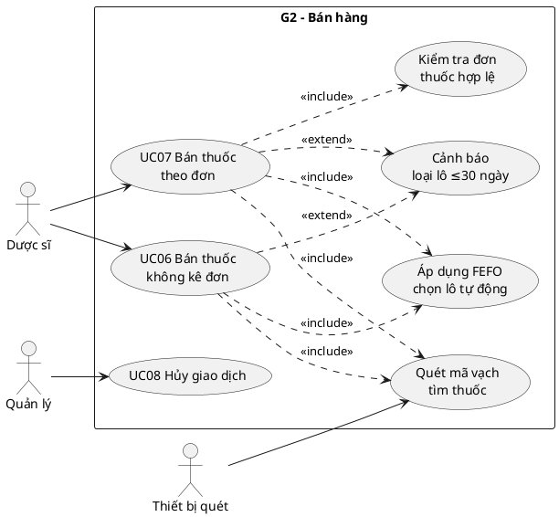
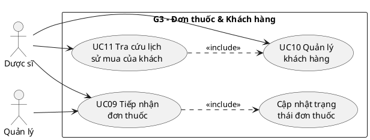
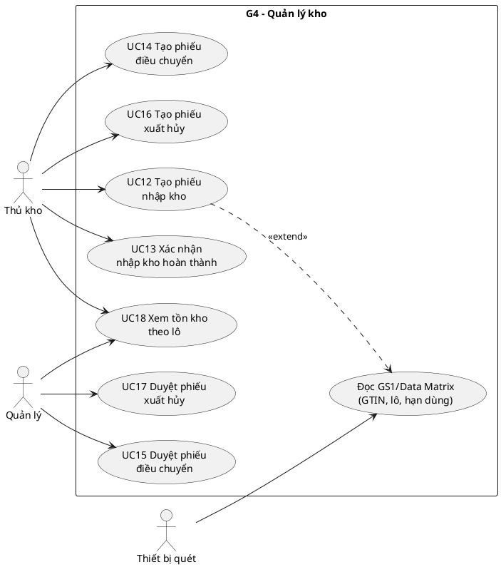
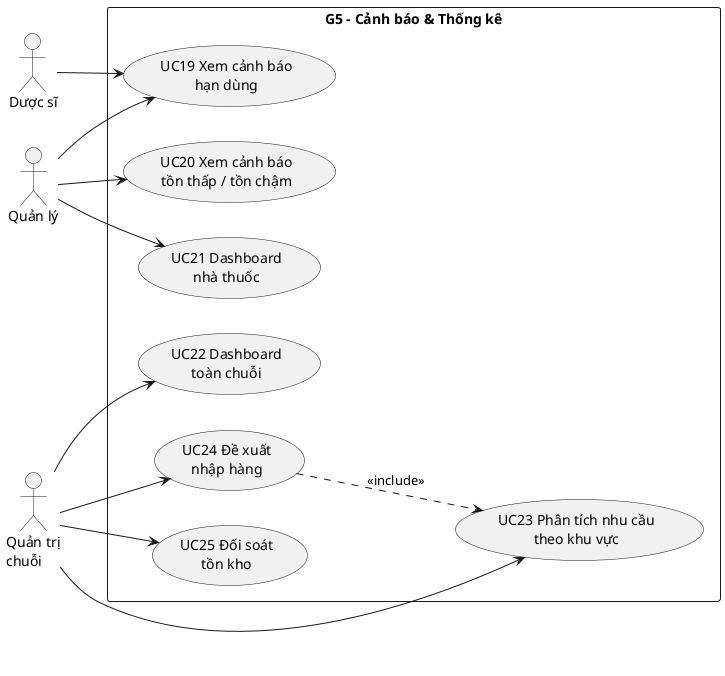
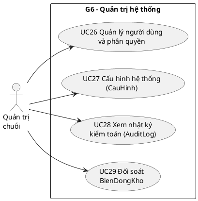

# 02 – Use Case

## 1. Bảng Tác nhân

| Tác nhân | Loại | Mô tả |
|----------|------|-------|
| Dược sĩ (DUOCSI) | Người dùng chính | Bán hàng POS, tiếp nhận đơn, quản lý khách, tra cứu |
| Thủ kho (THUKHO) | Người dùng chính | Nhập kho, điều chuyển, xuất hủy, in tem mã vạch |
| Quản lý nhà thuốc (QUANLY) | Người dùng chính | Kế thừa quyền dược sĩ + duyệt phiếu, hủy GD, cấu hình định mức, dashboard nhà thuốc |
| Quản trị chuỗi (QUANTRI) | Người dùng hệ thống | Toàn bộ danh mục, cấu hình, nhật ký, dashboard chuỗi |
| Thiết bị quét (SCANNER) | Hệ thống kỹ thuật | Đọc mã vạch qua USB/camera; trigger hành động tìm kiếm |

---

## 2. Use Case Cấp 0 – Tổng quan nhóm chức năng

---

## 3. Use Case Cấp 1 – Chi tiết

### G1 – Danh mục & Mã vạch

### G2 – Bán hàng

### G3 – Đơn thuốc & Khách hàng

### G4 – Quản lý kho

### G5 – Cảnh báo & Thống kê

### G6 – Quản trị hệ thống

---

## 4. Ma trận Chức năng – BR

| UC | Tên | FR liên quan | BR liên quan |
|----|-----|--------------|--------------|
| UC06 | Bán thuốc không kê đơn | FR06 | BR02, BR03, BR04, BR12, BR15 |
| UC07 | Bán thuốc theo đơn | FR06, FR07 | BR01, BR02, BR03, BR04, BR05, BR12, BR15 |
| UC08 | Hủy giao dịch | FR11 | BR10, BR12, BR14 |
| UC09 | Tiếp nhận đơn thuốc | FR08 | BR05 |
| UC12 | Tạo phiếu nhập kho | FR05 | BR07, BR12 |
| UC14 | Tạo phiếu điều chuyển | FR09 | BR08, BR12 |
| UC15 | Duyệt phiếu điều chuyển | FR09 | BR08, BR12, BR14 |
| UC16 | Tạo phiếu xuất hủy | FR10 | BR09, BR12 |
| UC17 | Duyệt phiếu xuất hủy | FR10 | BR09, BR12, BR14 |
| UC02 | Quản lý mã vạch | FR02 | BR06 |
| UC19 | Cảnh báo hạn dùng | FR12 | BR11 |
| UC20 | Cảnh báo tồn thấp/chậm | FR12, FR13 | BR11 |
| UC26 | Quản lý người dùng | FR04 | BR13 |

---

## 5. Đặc tả Use Case Chi tiết (10 UC quan trọng)

### UC06 – Bán thuốc không kê đơn

| Trường | Nội dung |
|--------|---------|
| Actor | Dược sĩ, Quản lý nhà thuốc |
| Tiền điều kiện | Dược sĩ đã đăng nhập; nhà thuốc đang hoạt động |
| Luồng chính | 1. Dược sĩ quét mã vạch hoặc tìm kiếm tên thuốc. 2. Hệ thống hiển thị thông tin thuốc, tự chọn lô FEFO (BR02). 3. Nhập số lượng. 4. Hệ thống kiểm tra: lô không hết hạn (BR03), tồn đủ (BR04), giá > 0 (BR15); cảnh báo nếu lô ≤30 ngày. 5. Dược sĩ xác nhận thanh toán; chọn phương thức. 6. Hệ thống lưu GiaoDich, ChiTietGiaoDich, trừ TonKho, ghi BienDongKho (BR12). |
| Luồng thay thế | 3a. Chọn lô thủ công → kiểm tra lại BR03, BR04. |
| Ngoại lệ | Tồn không đủ → thông báo lỗi; lô hết hạn → từ chối, không bán. |
| Hậu điều kiện | GiaoDich trạng thái HOAN_THANH; TonKho giảm đúng lô; BienDongKho ghi nhận. |
| BR | BR02, BR03, BR04, BR12, BR15 |

---

### UC07 – Bán thuốc theo đơn

| Trường | Nội dung |
|--------|---------|
| Actor | Dược sĩ, Quản lý nhà thuốc |
| Tiền điều kiện | Đơn thuốc đã tiếp nhận tại nhà thuốc hiện tại (BR01); đơn còn hiệu lực (BR05) |
| Luồng chính | 1. Dược sĩ mở đơn thuốc theo mã hoặc quét. 2. Hệ thống kiểm tra hiệu lực đơn (BR05). 3. Chọn thuốc trong đơn; nhập số lượng bán (≤ được phép, BR01). 4. Hệ thống áp dụng FEFO (BR02), kiểm tra hạn (BR03), tồn (BR04). 5. Dược sĩ xác nhận; hệ thống cập nhật so_luong_da_ban trong ChiTietDonThuoc, cập nhật trạng thái đơn (BR05). 6. Ghi GiaoDich với don_thuoc_id; trừ kho; BienDongKho. |
| Luồng thay thế | 3a. Bán một phần → trạng thái đơn thành BAN_MOT_PHAN. |
| Ngoại lệ | Đơn hết hiệu lực → từ chối; thuốc không trong đơn → từ chối. |
| Hậu điều kiện | ChiTietDonThuoc cập nhật so_luong_da_ban; DonThuoc cập nhật trạng thái. |
| BR | BR01, BR02, BR03, BR04, BR05, BR12, BR15 |

---

### UC08 – Hủy giao dịch

| Trường | Nội dung |
|--------|---------|
| Actor | Quản lý nhà thuốc |
| Tiền điều kiện | Giao dịch trạng thái HOAN_THANH; trong gio_cho_phep_huy_giao_dich giờ kể từ khi bán (BR10) |
| Luồng chính | 1. Quản lý tìm giao dịch theo mã. 2. Kiểm tra điều kiện thời gian (BR10). 3. Nhập lý do hủy (bắt buộc). 4. Hệ thống cập nhật GiaoDich.trang_thai=DA_HUY; hoàn kho đúng từng lô (BR10); ghi BienDongKho loại HOAN_KHO; nếu bán theo đơn thì hoàn so_luong_da_ban. 5. Ghi AuditLog (BR14). |
| Ngoại lệ | Ngoài thời gian cho phép → từ chối. |
| Hậu điều kiện | GiaoDich DA_HUY; TonKho được hoàn đúng lô. |
| BR | BR10, BR12, BR14 |

---

### UC09 – Tiếp nhận đơn thuốc

| Trường | Nội dung |
|--------|---------|
| Actor | Dược sĩ, Quản lý nhà thuốc |
| Tiền điều kiện | Khách hàng đã có hoặc tạo mới hồ sơ |
| Luồng chính | 1. Dược sĩ nhập thông tin đơn (tên bác sĩ, cơ sở khám, ngày kê). 2. Nhập danh sách thuốc trong đơn (thuoc_id, số lượng kê, liều dùng). 3. Hệ thống tính ngày hết hiệu lực (ngay_ke_don + so_ngay_hieu_luc, BR05). 4. Lưu DonThuoc, ChiTietDonThuoc; trạng thái CHUA_BAN; ghi nha_thuoc_id tiếp nhận (BR01). |
| Ngoại lệ | Thuốc trong đơn không tồn tại trong danh mục → cảnh báo. |
| Hậu điều kiện | DonThuoc trạng thái CHUA_BAN; ràng buộc nhà thuốc tiếp nhận áp dụng khi bán. |
| BR | BR01, BR05 |

---

### UC12 – Tạo phiếu nhập kho

| Trường | Nội dung |
|--------|---------|
| Actor | Thủ kho |
| Tiền điều kiện | Thủ kho đăng nhập; đã chọn nhà cung cấp |
| Luồng chính | 1. Thủ kho tạo phiếu nhập. 2. Quét mã vạch từng sản phẩm hoặc nhập tay. 3. Nếu mã GS1: hệ thống parse GTIN→thuoc_id, lô, hạn dùng tự điền (extend). 4. Nhập số lô, ngày sản xuất, hạn dùng, số lượng, giá nhập. 5. Hệ thống kiểm tra BR07 (han_dung > ngày nhập, UQ(thuoc_id,so_lo) cho lô mới). 6. Xác nhận hoàn thành: cập nhật TonKho (cộng dồn), ghi BienDongKho loại NHAP; PhieuKho trạng thái HOAN_THANH. |
| Luồng thay thế | 5a. Lô đã có → cộng dồn số lượng vào LoThuoc/TonKho. |
| Ngoại lệ | han_dung ≤ ngày nhập → từ chối nhập lô. |
| Hậu điều kiện | TonKho tăng; BienDongKho ghi NHAP; PhieuKho HOAN_THANH. |
| BR | BR07, BR12 |

---

### UC14 – Tạo phiếu điều chuyển

| Trường | Nội dung |
|--------|---------|
| Actor | Thủ kho |
| Tiền điều kiện | Thủ kho đăng nhập; nhà thuốc đích khác nhà thuốc nguồn (BR08) |
| Luồng chính | 1. Thủ kho chọn nhà thuốc đích. 2. Thêm thuốc: quét mã/tìm kiếm, chọn lô, nhập số lượng. 3. Hệ thống kiểm tra tồn đủ theo lô (BR08). 4. Lưu PhieuKho loại DIEU_CHUYEN, trạng thái CHO_DUYET. |
| Ngoại lệ | Tồn không đủ → từ chối thêm dòng. |
| Hậu điều kiện | PhieuKho CHO_DUYET; tồn chưa thay đổi (chờ duyệt). |
| BR | BR08, BR12 |

---

### UC15 – Duyệt phiếu điều chuyển

| Trường | Nội dung |
|--------|---------|
| Actor | Quản lý nhà thuốc (nơi xuất) |
| Tiền điều kiện | PhieuKho DIEU_CHUYEN, trạng thái CHO_DUYET |
| Luồng chính | 1. Quản lý xem danh sách phiếu chờ duyệt. 2. Kiểm tra lại tồn từng lô tại thời điểm duyệt. 3. Duyệt → transaction: trừ TonKho nơi xuất, cộng TonKho nơi nhận; ghi 2 dòng BienDongKho (DIEU_CHUYEN_XUAT, DIEU_CHUYEN_NHAP); cập nhật PhieuKho.trang_thai=HOAN_THANH. 4. Ghi AuditLog (BR14). |
| Luồng thay thế | 3a. Từ chối → PhieuKho.trang_thai=TU_CHOI; ghi lý do vào ghi_chu. |
| Ngoại lệ | Tồn thay đổi trước khi duyệt → cảnh báo, quản lý xem lại. |
| Hậu điều kiện | TonKho hai nhà thuốc cập nhật; BienDongKho ghi nhận. |
| BR | BR08, BR12, BR14 |

---

### UC17 – Duyệt phiếu xuất hủy

| Trường | Nội dung |
|--------|---------|
| Actor | Quản lý nhà thuốc |
| Tiền điều kiện | PhieuKho XUAT_HUY, trạng thái CHO_DUYET; có lý do (BR09) |
| Luồng chính | 1. Quản lý xem phiếu, kiểm tra lý do hủy hợp lệ (BR09). 2. Duyệt → trừ TonKho, ghi BienDongKho loại XUAT_HUY; PhieuKho HOAN_THANH. 3. Ghi AuditLog (BR14). |
| Luồng thay thế | 2a. Từ chối → PhieuKho TU_CHOI; ghi lý do từ chối vào ghi_chu. |
| Hậu điều kiện | TonKho giảm đúng lô; BienDongKho ghi nhận. |
| BR | BR09, BR12, BR14 |

---

### UC19 – Xem cảnh báo hạn dùng

| Trường | Nội dung |
|--------|---------|
| Actor | Dược sĩ, Quản lý nhà thuốc, Quản trị chuỗi |
| Tiền điều kiện | Đã đăng nhập; tồn kho có dữ liệu |
| Luồng chính | 1. Hệ thống truy vấn view vw_CanhBaoHanDung. 2. Hiển thị danh sách lô theo mức cảnh báo: ĐÃ HẾT HẠN (đỏ), ≤30 ngày (cam), ≤60 ngày (vàng), ≤90 ngày (xanh nhạt). 3. Người dùng có thể lọc theo nhà thuốc (QUANTRI) hoặc xem nhà thuốc mình (BR13). 4. Có thể nhấn "Tạo phiếu xuất hủy" từ đây. |
| Hậu điều kiện | Không thay đổi dữ liệu; có thể điều hướng đến UC16. |
| BR | BR11, BR13 |

---

### UC23 – Phân tích nhu cầu theo khu vực

| Trường | Nội dung |
|--------|---------|
| Actor | Quản trị chuỗi |
| Tiền điều kiện | Có dữ liệu bán hàng; khu vực có dân số (cấp QUAN) |
| Luồng chính | 1. QUANTRI chọn khoảng thời gian, khu vực, nhóm thuốc. 2. Hệ thống gọi sp_ThongKeNhuCauKhuVuc(@tu, @den, @khu_vuc_id, @nhom_thuoc_id). 3. Hiển thị: số lượng/1.000 dân, top thuốc theo quận, biểu đồ cột/bản đồ màu. 4. Kết hợp xu hướng theo tháng (SP sp_ThongKeXuHuong). |
| Hậu điều kiện | Chỉ đọc; kết quả hiển thị trên dashboard chuỗi. |
| BR | BR13, BR16 |
