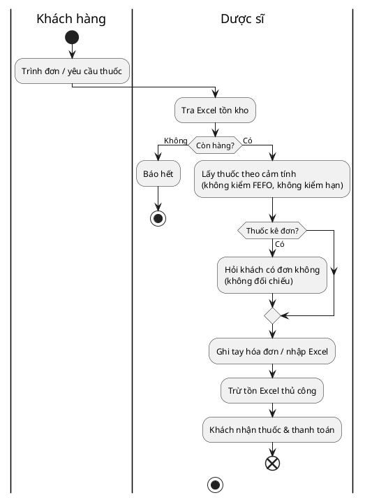
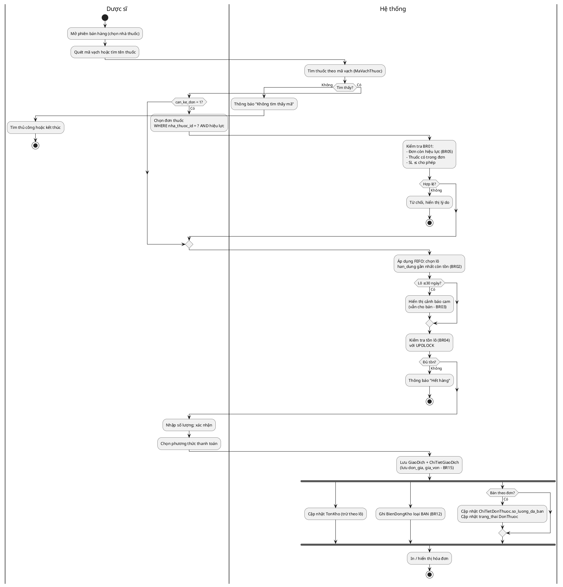
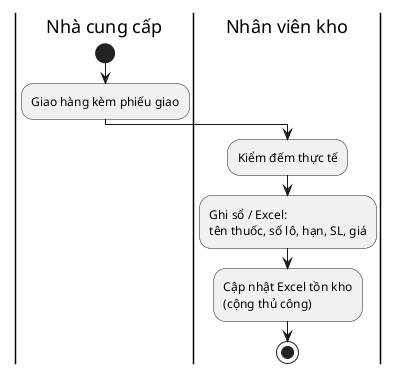
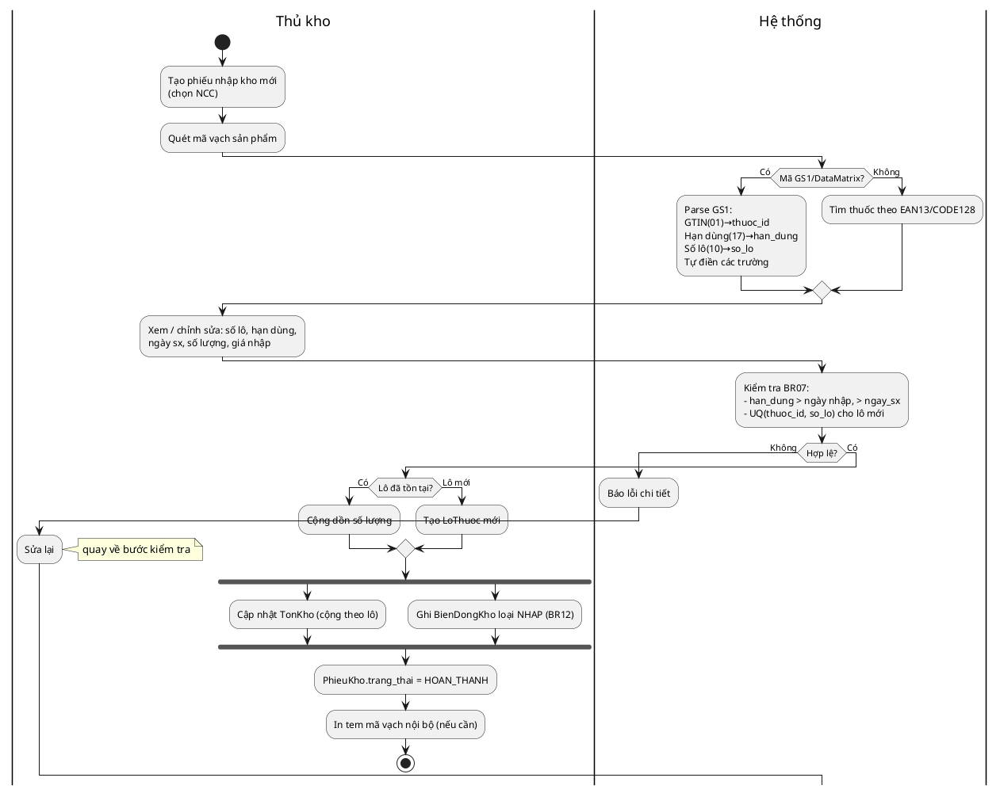
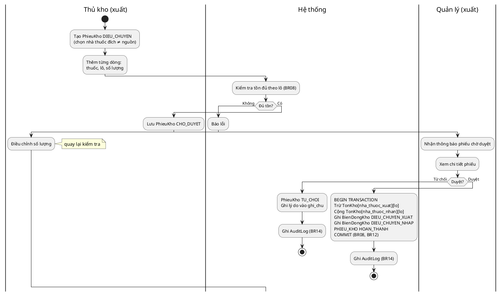
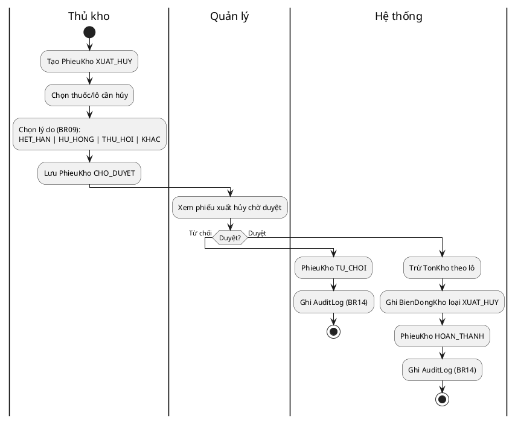
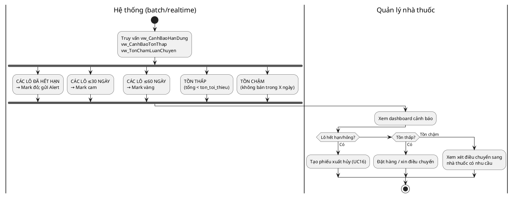

# 03 – Activity Diagram

## Mô tả chung
Mỗi sơ đồ trình bày dạng swimlane PlantUML với start (●), stop (◉), quyết định (<>), fork/join khi cần.  
Kèm "Các bước thực hiện" đánh số để đối chiếu khi đọc sơ đồ.

---

## P3 – Bán thuốc

### 3.1 P3 AS-IS – Bán thuốc thủ công

**Các bước P3 AS-IS:**
1. Khách trình đơn hoặc yêu cầu mua thuốc
2. Dược sĩ tra Excel tồn kho
3. Nếu hết hàng: báo khách, kết thúc
4. Lấy thuốc theo cảm tính (không đảm bảo FEFO, không kiểm hạn dùng)
5. Nếu thuốc kê đơn: hỏi miệng khách, không kiểm tra đơn thật
6. Ghi tay hóa đơn hoặc nhập Excel
7. Trừ tồn Excel thủ công (dễ sai)
8. Khách nhận thuốc, thanh toán

---

### 3.2 P3 TO-BE – Bán thuốc POS (quét mã vạch + FEFO)

**Các bước P3 TO-BE:**
1. Dược sĩ mở phiên bán hàng
2. Quét mã vạch hoặc tìm tên thuốc
3. Hệ thống tra bảng MaVachThuoc → Thuoc
4. Nếu thuốc kê đơn: yêu cầu chọn đơn thuốc, kiểm tra BR01 + BR05
5. Áp dụng FEFO: hệ thống tự chọn lô gần hạn nhất (BR02)
6. Hiển thị cảnh báo nếu lô ≤30 ngày (BR03)
7. Kiểm tra tồn đủ theo lô với UPDLOCK (BR04)
8. Dược sĩ nhập số lượng, xác nhận, chọn thanh toán
9. Hệ thống lưu GiaoDich + ChiTietGiaoDich (BR15)
10. Song song: trừ TonKho, ghi BienDongKho (BR12), cập nhật đơn thuốc nếu có

---

## P2 – Nhập kho

### 3.3 P2 AS-IS

**Các bước P2 AS-IS:** NCC giao hàng → kiểm đếm thực tế → ghi sổ/Excel (số lô, hạn, NCC không đầy đủ) → cập nhật tồn thủ công.

---

### 3.4 P2 TO-BE – Nhập kho (có đọc GS1)

**Các bước P2 TO-BE:**
1. Thủ kho tạo phiếu nhập, chọn NCC
2. Quét mã vạch từng sản phẩm
3. Nếu GS1/DataMatrix: hệ thống parse tự động GTIN, hạn, lô
4. Thủ kho xem lại, chỉnh sửa nếu cần
5. Hệ thống kiểm tra BR07; báo lỗi nếu vi phạm
6. Nếu lô đã có: cộng dồn; lô mới: tạo LoThuoc
7. Cập nhật TonKho + ghi BienDongKho song song (BR12)
8. PhieuKho → HOAN_THANH; thủ kho in tem nếu cần

---

## P4 – Điều chuyển và Xuất hủy

### 3.5 P4 TO-BE – Điều chuyển (swimlane 3 vai trò)

### 3.6 P4 TO-BE – Xuất hủy

---

## P5 – Xử lý cảnh báo hạn dùng

### 3.7 P5 TO-BE

---

## Bảng So sánh AS-IS / TO-BE

| Quy trình | AS-IS (vấn đề) | TO-BE (cải tiến) |
|-----------|----------------|------------------|
| P3 – Bán | Không FEFO, không kiểm hạn, không kiểm đơn kê toa | FEFO tự động, kiểm hạn, bắt buộc đơn với can_ke_don=1 |
| P2 – Nhập | Ghi sổ tay, thiếu số lô/hạn dùng | Quét mã vạch (GS1 tự điền), kiểm tra BR07, ghi lô đầy đủ |
| P4 – Điều chuyển | Nhắn tin, không có xác nhận điện tử | Phiếu điều chuyển có duyệt, transaction 2 chiều, AuditLog |
| P4 – Xuất hủy | Ghi sổ đơn giản | Phiếu xuất hủy có lý do, duyệt, BienDongKho |
| P5 – Cảnh báo | Kiểm tra thủ công hàng tháng | View tự động, dashboard real-time 5 loại cảnh báo |
