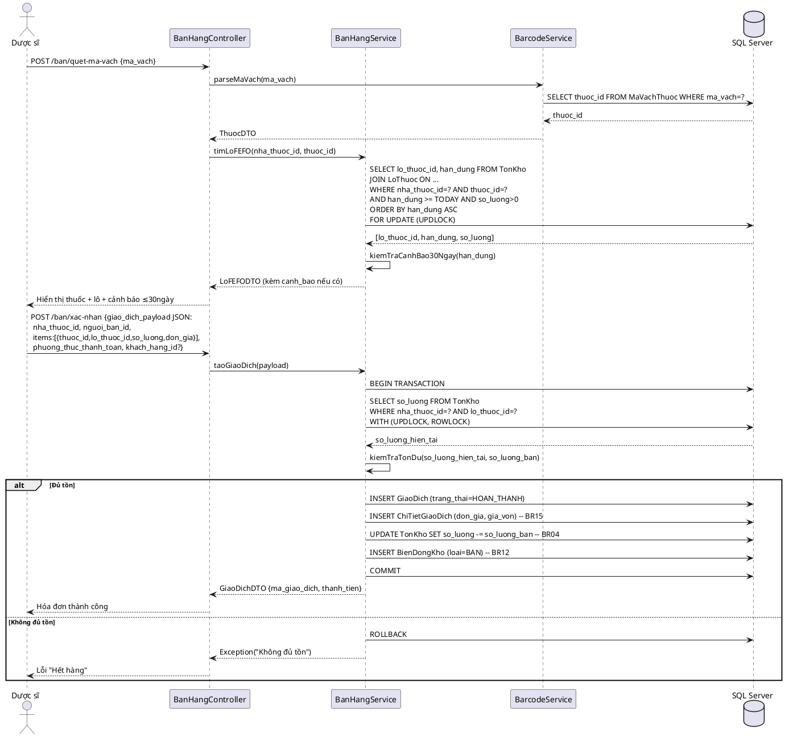
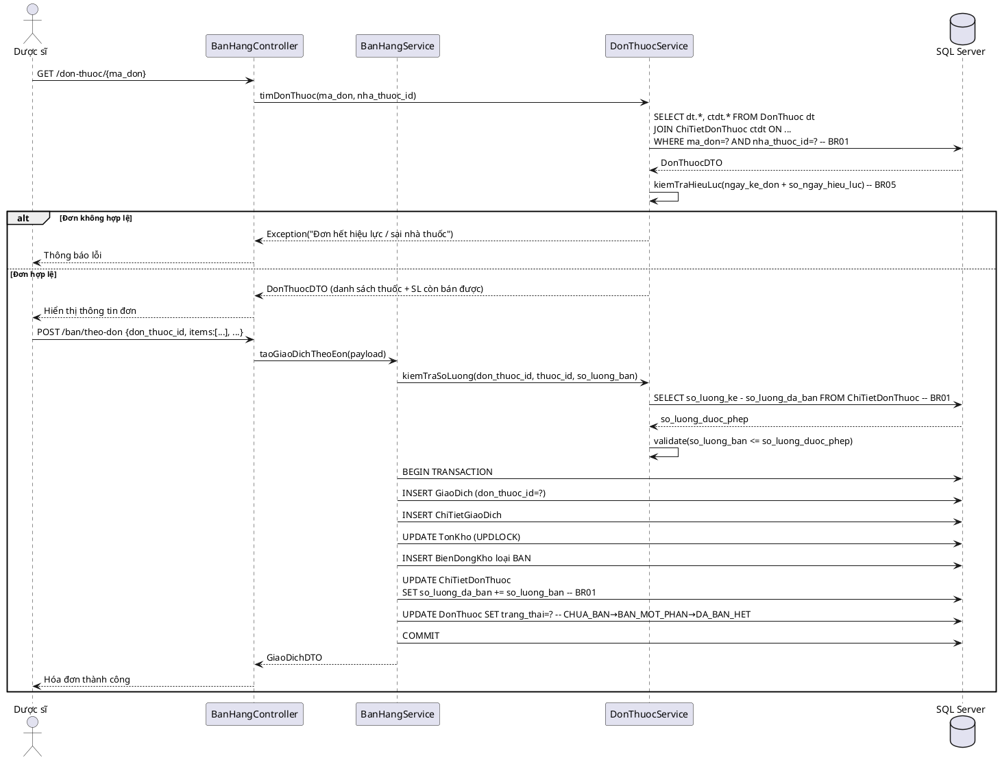
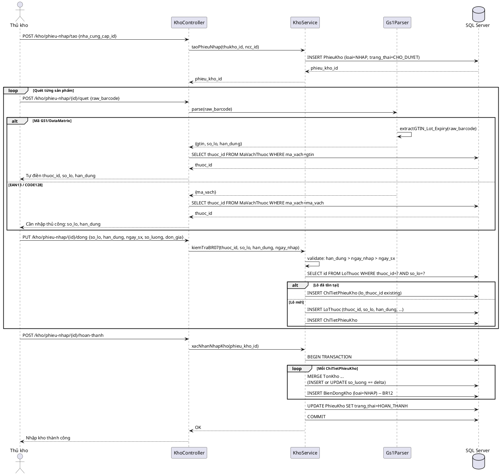
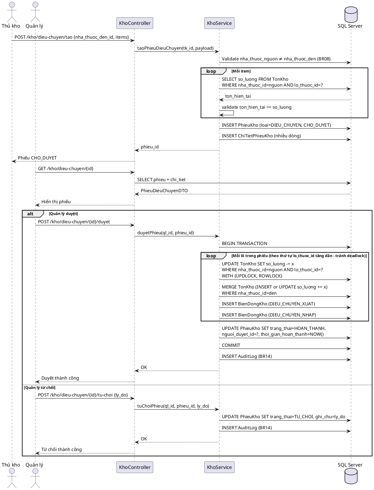
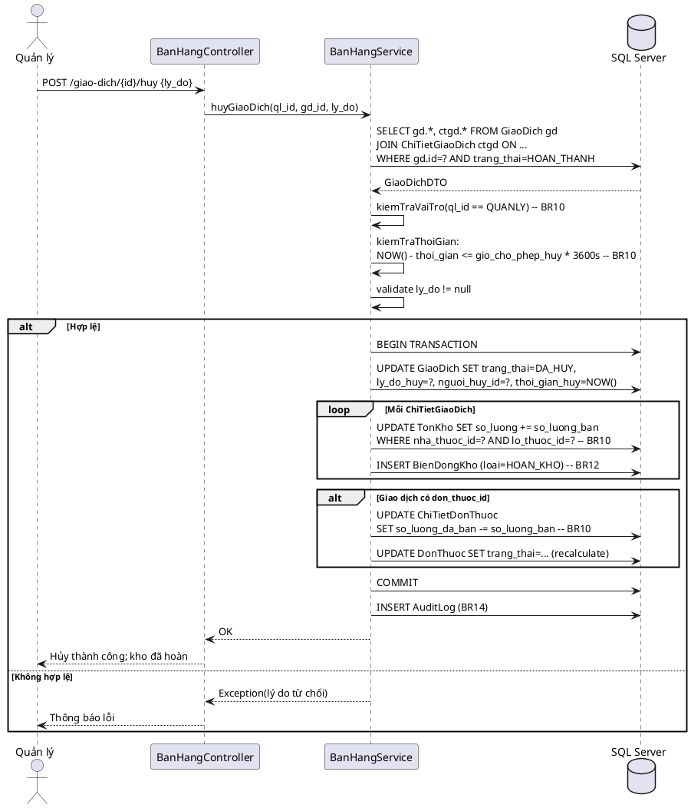
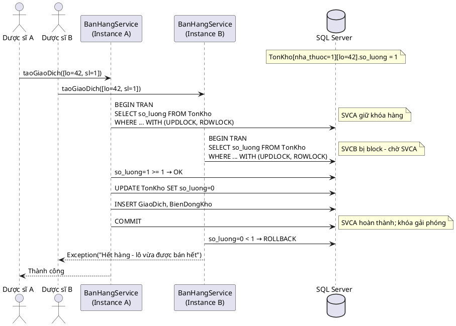

# 04 – Sequence Diagram

## SD01 – Bán thuốc quét mã vạch + FEFO (không kê đơn)

---

## SD02 – Bán thuốc theo đơn

---

## SD03 – Nhập kho (có đọc GS1 Data Matrix)

---

## SD04 – Điều chuyển (tạo → duyệt)

---

## SD05 – Hủy giao dịch

---

## SD06 – Hai dược sĩ bán lô cuối (xử lý đồng thời)

