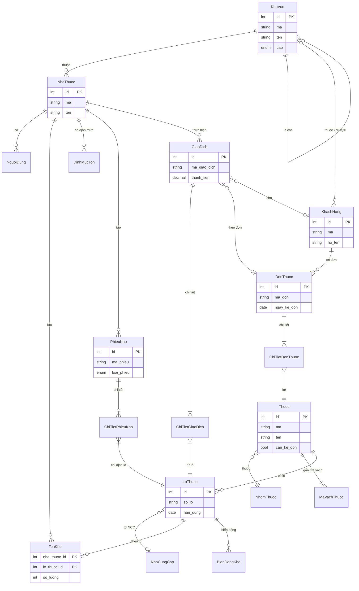
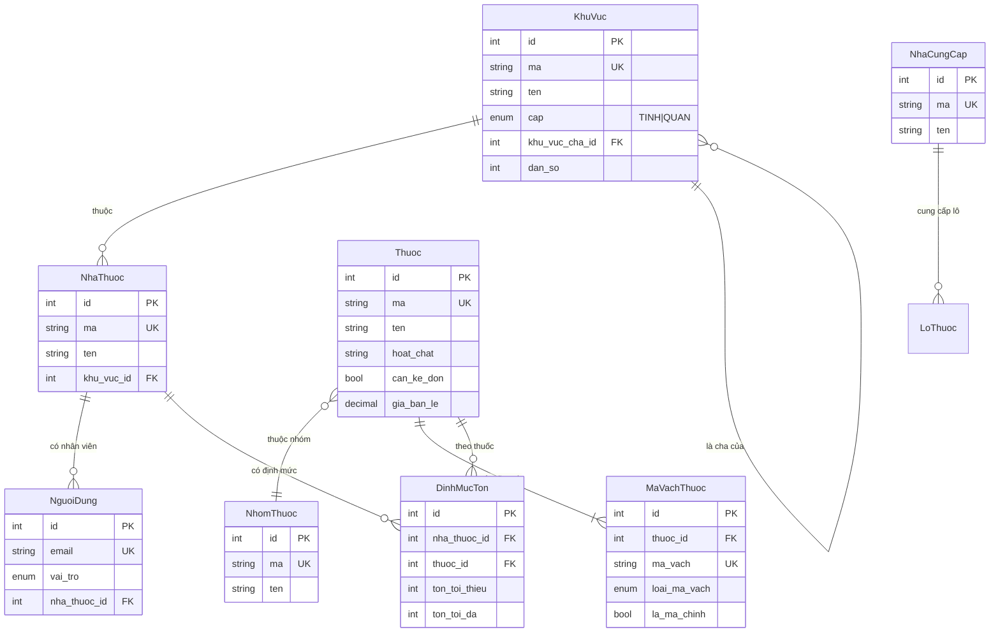
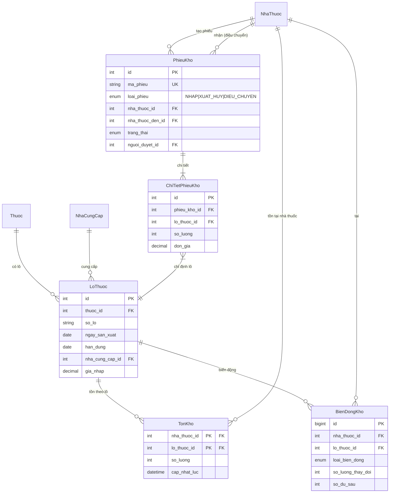
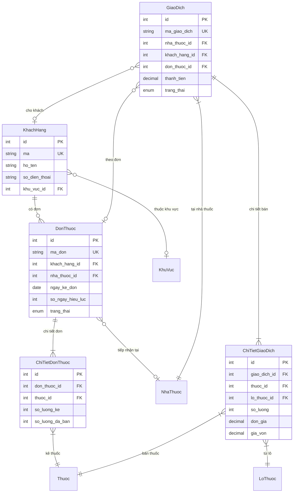

# 05 – ERD (Entity-Relationship Diagram)

## 1. Nhận diện Thực thể

| Thực thể | Căn cứ trích từ mô tả | Thuộc tính chính | Khóa chính |
|----------|----------------------|------------------|------------|
| KhuVuc | "xu hướng mua theo địa bàn", "chuỗi nhiều khu vực" | ma, ten, cap, dan_so | id |
| NhaThuoc | "chuỗi nhà thuốc nhiều chi nhánh" | ma, ten, dia_chi, khu_vuc_id | id |
| NguoiDung | "dược sĩ bán, thủ kho nhập, quản lý xem cảnh báo" | email, vai_tro, nha_thuoc_id | id |
| NhomThuoc | "phân nhóm thuốc" (ngầm định từ "nhóm thuốc" trong báo cáo N&C) | ma, ten | id |
| Thuoc | Bảng gợi ý GV – "danh mục thuốc" | ma, ten, hoat_chat, can_ke_don, gia_ban_le | id |
| MaVachThuoc | "barcode, EAN-13, Code128, mã nội bộ" | ma_vach, loai_ma_vach | id |
| NhaCungCap | "nhập hàng theo cảm tính" → cần quản lý NCC | ma, ten, ma_so_thue | id |
| LoThuoc | Bảng gợi ý GV – "lô hàng, hạn dùng, số lô" | so_lo, han_dung, gia_nhap | id |
| TonKho | "tồn kho" – tồn theo (nhà thuốc, lô) | so_luong | PK(nha_thuoc_id, lo_thuoc_id) |
| DinhMucTon | "định mức tồn tối thiểu/tối đa" | ton_toi_thieu, ton_toi_da | id |
| PhieuKho | "phiếu nhập, điều chuyển, xuất hủy có duyệt" | ma_phieu, loai_phieu, trang_thai | id |
| ChiTietPhieuKho | Thực thể liên kết PhieuKho–LoThuoc | so_luong, don_gia | id |
| BienDongKho | "mọi biến động tồn ghi lại" (BR12) | loai_bien_dong, so_luong_thay_doi, so_du_sau | id BIGINT |
| KhachHang | Bảng gợi ý GV – "bán theo đơn, quản lý khách" | ma, ho_ten, so_dien_thoai | id |
| DonThuoc | Bảng gợi ý GV – "đơn thuốc, kê đơn" | ma_don, ngay_ke_don, so_ngay_hieu_luc | id |
| ChiTietDonThuoc | Thực thể liên kết DonThuoc–Thuoc | so_luong_ke, so_luong_da_ban | id |
| GiaoDich | Bảng gợi ý GV – "giao dịch bán" | ma_giao_dich, tong_tien, thanh_tien | id |
| ChiTietGiaoDich | Thực thể liên kết GiaoDich–(Thuoc+LoThuoc) | so_luong, don_gia, gia_von | id |
| CauHinh | "cấu hình ngưỡng cảnh báo" | khoa, gia_tri | khoa PK |
| AuditLog | "nhật ký kiểm toán" (BR14) | hanh_dong, doi_tuong, du_lieu_cu, du_lieu_moi | id BIGINT |

> **6 bảng gợi ý của giảng viên trong mô hình mở rộng:**
> - `Thuoc` → bảng #5 (mở rộng thêm: hoat_chat, ham_luong, dang_bao_che, can_ke_don, trang_thai)
> - `LoThuoc` → bảng #8 (mở rộng: gia_nhap, nha_cung_cap_id, dùng chung toàn chuỗi)
> - `DonThuoc` → bảng #15 (mở rộng: nha_thuoc_id, nguoi_tiep_nhan_id, trang_thai)
> - `KhachHang` → bảng #14 (mở rộng: khu_vuc_id, ghi_chu_di_ung)
> - `GiaoDich` → bảng #17 (mở rộng: don_thuoc_id, trang_thai, nguoi_huy_id, ...)
> - `TonKho` → bảng #9 (PK kép, cap_nhat_luc; không có bảng GV thuần đơn giản)

---

## 2. Nhận diện Mối kết hợp

| Thực thể 1 | Động từ | Thực thể 2 | Bản số | Giải thích |
|------------|---------|------------|--------|------------|
| KhuVuc | chứa | NhaThuoc | 1..* | Mỗi nhà thuốc thuộc 1 khu vực |
| KhuVuc | là cha của | KhuVuc | 0..1 → * | Tỉnh → nhiều Quận |
| NhaThuoc | có | NguoiDung | 1..* | Nhân viên thuộc nhà thuốc |
| NhaThuoc | lưu | TonKho | 1..* | Mỗi nhà thuốc có nhiều dòng tồn kho |
| Thuoc | gắn | MaVachThuoc | 1..* | Một thuốc có nhiều mã vạch |
| Thuoc | thuộc | NhomThuoc | *..1 | Nhiều thuốc, 1 nhóm |
| LoThuoc | là lô của | Thuoc | *..1 | Nhiều lô của 1 thuốc |
| LoThuoc | từ | NhaCungCap | *..0..1 | Lô có thể có NCC |
| TonKho | theo | LoThuoc | *..1 | Tồn kho gắn với lô cụ thể |
| TonKho | tại | NhaThuoc | *..1 | — |
| DinhMucTon | cho | NhaThuoc-Thuoc | * .. UQ | Định mức theo cặp (nhà thuốc, thuốc) |
| PhieuKho | tạo bởi | NguoiDung | *..1 | nguoi_lap_id |
| PhieuKho | duyệt bởi | NguoiDung | *..0..1 | nguoi_duyet_id |
| PhieuKho | có chi tiết | ChiTietPhieuKho | 1..* | Quan hệ nhiều-nhiều PhieuKho–LoThuoc |
| ChiTietPhieuKho | chỉ định | LoThuoc | *..1 | — |
| BienDongKho | liên quan | NhaThuoc | *..1 | — |
| BienDongKho | liên quan | LoThuoc | *..1 | — |
| KhachHang | có | DonThuoc | 1..* | — |
| KhachHang | thuộc khu vực | KhuVuc | *..0..1 | Phục vụ phân tích |
| DonThuoc | tiếp nhận tại | NhaThuoc | *..1 | Ràng buộc bán (BR01) |
| DonThuoc | có chi tiết | ChiTietDonThuoc | 1..* | Quan hệ nhiều-nhiều DonThuoc–Thuoc |
| ChiTietDonThuoc | kê | Thuoc | *..1 | — |
| GiaoDich | thực hiện tại | NhaThuoc | *..1 | — |
| GiaoDich | bởi | NguoiDung | *..1 | nguoi_ban_id |
| GiaoDich | cho | KhachHang | *..0..1 | Có thể bán không tên |
| GiaoDich | theo | DonThuoc | *..0..1 | Nếu bán theo đơn |
| GiaoDich | có chi tiết | ChiTietGiaoDich | 1..* | Quan hệ nhiều-nhiều GiaoDich–(Thuoc+LoThuoc) |
| ChiTietGiaoDich | bán | Thuoc | *..1 | Lưu phi chuẩn hóa thuoc_id |
| ChiTietGiaoDich | lấy từ lô | LoThuoc | *..1 | — |

**Quan hệ nhiều-nhiều và thực thể liên kết:**
- `PhieuKho ↔ LoThuoc` → **ChiTietPhieuKho**
- `DonThuoc ↔ Thuoc` → **ChiTietDonThuoc**
- `GiaoDich ↔ (Thuoc + LoThuoc)` → **ChiTietGiaoDich**
- `NhaThuoc ↔ LoThuoc` (với số lượng) → **TonKho**
- `NhaThuoc ↔ Thuoc` (với định mức) → **DinhMucTon**

---

## 3. ERD Mức Khái niệm

### 3.1 Hình tổng quát

---

### 3.2 Nhóm 1 – Tổ chức và Danh mục Thuốc

---

### 3.3 Nhóm 2 – Lô, Tồn kho, Phiếu kho

---

### 3.4 Nhóm 3 – Khách hàng, Đơn thuốc, Bán hàng

---

## 4. ERD Mức Logic (đủ thuộc tính – xem file 06_mo_hinh_quan_he.md)

ERD mức logic được thể hiện trong từ điển dữ liệu tại **06_mo_hinh_quan_he.md** (đầy đủ kiểu dữ liệu, ràng buộc, index).

---

## 5. Giải thích thiết kế

### 5.1 Vì sao LoThuoc dùng chung toàn chuỗi, còn TonKho theo (nhà thuốc, lô)?
- Một số lô (ví dụ thuốc A, lô "ABC123") có thể tồn tại ở nhiều nhà thuốc khác nhau (sau điều chuyển).
- Nếu LoThuoc theo nhà thuốc thì sau điều chuyển phải nhân bản lô → không rõ nguồn gốc, không truy vết được.
- Giải pháp: `LoThuoc` là thực thể toàn chuỗi (UQ thuoc_id+so_lo), còn `TonKho` là bảng trung gian riêng track số lượng tại từng nhà thuốc.

### 5.2 Vì sao một thuốc nhiều mã vạch?
- Cùng một thuốc có thể được phân phối bởi nhiều NCC với mã vạch khác nhau, hoặc có mã nội bộ Code128 cho in tem và mã nhà sản xuất EAN13.
- Bảng `MaVachThuoc` cho phép tra ngược từ bất kỳ mã vạch nào → `thuoc_id`.

### 5.3 Vì sao có BienDongKho?
- `TonKho` chỉ lưu số lượng hiện tại (snapshot). Muốn truy vết lịch sử biến động (nhập bao nhiêu, bán bao nhiêu, điều chuyển từ đâu) cần bảng sự kiện riêng.
- `BienDongKho` là append-only log → không thể sửa/xóa, phục vụ đối soát (BR12), kiểm toán.
- `so_du_sau` phi chuẩn hóa tại thời điểm ghi để truy vết nhanh không cần tổng cộng lại.

---

> **Giả định:**
> 1. Một lô thuốc (thuoc_id, so_lo) là duy nhất toàn chuỗi; nếu cùng số lô mua từ 2 NCC khác nhau sẽ có so_lo phân biệt.
> 2. KhachHang.khu_vuc_id là cấp QUAN (địa chỉ chi tiết nhất).
> 3. BienDongKho.so_du_sau là tồn tại nhà thuốc đó; không phải tồn toàn chuỗi.
