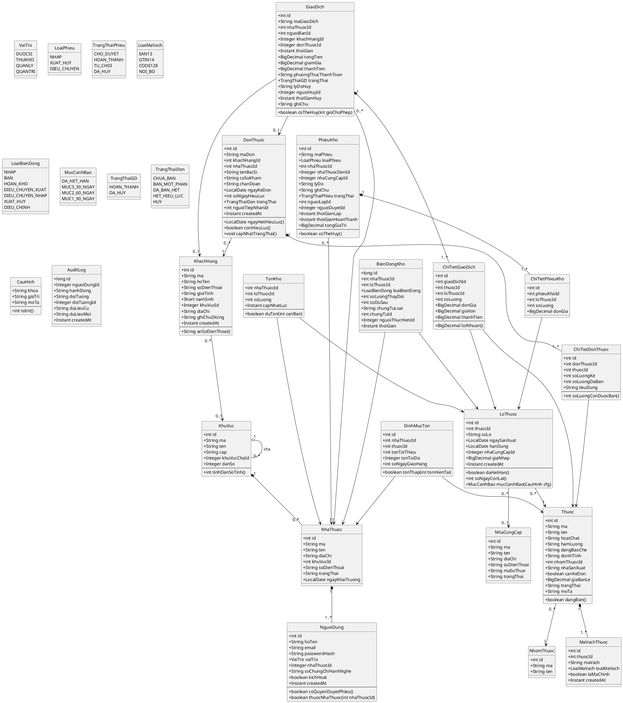

# 07 – Class Diagram

## 1. Class Diagram Miền Dữ liệu

*(20 lớp tương ứng 20 bảng, phương thức nghiệp vụ chính, enum)*

---

## 2. Class Diagram Lớp Ứng dụng

```plantuml
@startuml CD_Application
skinparam classAttributeIconSize 0
skinparam packageStyle frame

package "BanHang" {
  class BanHangController {
    +ResponseEntity quetMaVach(String maVach, int nhaThuocId)
    +ResponseEntity xacNhanBan(GioHangDTO dto)
    +ResponseEntity huyGiaoDich(int id, HuyGDRequest req)
    +ResponseEntity lichSuGiaoDich(int nhaThuocId, LocalDate tu, LocalDate den)
  }

  class BanHangService {
    -TonKhoRepository tonKhoRepo
    -GiaoDichRepository gdRepo
    -DonThuocService donThuocSvc
    -BarcodeService barcodeSvc
    --
    +LoFEFODTO timLoFEFO(int nhaThuocId, int thuocId)
    +GiaoDichDTO taoGiaoDich(GioHangDTO dto)
    +void huyGiaoDich(int giaoDichId, int quanLyId, String lyDo)
    -void kiemTraBR01(int donThuocId, int thuocId, int soLuong)
    -void kiemTraBR10(GiaoDich gd, int quanLyId)
  }

  class GioHangDTO {
    +int nhaThuocId
    +int nguoiBanId
    +Integer khachHangId
    +Integer donThuocId
    +String phuongThucThanhToan
    +BigDecimal giamGia
    +List<GioHangItemDTO> items
  }

  class GioHangItemDTO {
    +int thuocId
    +int loThuocId
    +int soLuong
    +BigDecimal donGia
  }
}

package "Kho" {
  class KhoController {
    +ResponseEntity taoPhieuNhap(PhieuNhapDTO dto)
    +ResponseEntity hoanThanhNhap(int id, NhapKhoJSON json)
    +ResponseEntity taoPhieuDieuChuyen(PhieuDCDTO dto)
    +ResponseEntity duyetPhieu(int id, DuyetRequest req)
    +ResponseEntity tuChoiPhieu(int id, TuChoiRequest req)
    +ResponseEntity taoPhieuXuatHuy(PhieuXHDTO dto)
    +ResponseEntity xemTonKho(int nhaThuocId)
  }

  class KhoService {
    -TonKhoRepository tonKhoRepo
    -BienDongKhoRepository bdkRepo
    -PhieuKhoRepository phieuRepo
    --
    +void nhapKho(int phieuId, List<NhapKhoItem> items)
    +void duyetDieuChuyen(int phieuId, int quanLyId)
    +void duyetXuatHuy(int phieuId, int quanLyId)
    -void capNhatTonKho(int nhaThuocId, int loThuocId, int delta, LoaiBienDong loai, int chungTuId)
  }
}

package "Barcode" {
  class BarcodeService {
    -MaVachThuocRepository mvtRepo
    --
    +ThuocDTO timTheoMaVach(String maVach)
    +Gs1Data parseGs1(String rawBarcode)
    +void inTemNoiBo(int loThuocId, int nhaThuocId)
  }

  class Ean13Validator {
    +{static} boolean isValid(String ean13)
    +{static} char tinhCheckDigit(String ean12)
  }

  class Gs1Parser {
    +Gs1Data parse(String gs1String)
    -String extractAI(String gs1, String ai)
  }

  class Gs1Data {
    +String gtin
    +LocalDate hanDung
    +String soLo
  }
}

package "ThongKe" {
  class ThongKeController {
    +ResponseEntity nhuCauKhuVuc(int khuVucId, LocalDate tu, LocalDate den, Integer nhomThuocId)
    +ResponseEntity xuHuong(LocalDate tu, LocalDate den, Integer nhaThuocId)
    +ResponseEntity deXuatNhapHang(int nhaThuocId)
    +ResponseEntity canhBaoHanDung(int nhaThuocId)
    +ResponseEntity canhBaoTonThap(int nhaThuocId)
  }

  class ThongKeService {
    -SqlServerTemplate jdbcTemplate
    --
    +List<NhuCauKhuVucDTO> thongKeNhuCau(ThongKeParam params)
    +List<XuHuongDTO> thongKeXuHuong(ThongKeParam params)
    +List<DeXuatNhapHangDTO> tinhDeXuat(int nhaThuocId)
    -BigDecimal banTrungBinhNgay(int thuocId, int nhaThuocId, int soNgay)
  }
}

package "Common" {
  class ErrorCodeMapper {
    +{static} ResponseEntity mapException(NghiepVuException ex)
  }

  class NghiepVuException {
    +String errorCode
    +String message
    +NghiepVuException(String code, String msg)
  }

  interface Repository<T, ID> {
    +T findById(ID id)
    +void save(T entity)
    +void delete(ID id)
  }

  class TonKhoRepository {
    +TonKho timTheoNhaThuocVaLo(int nhaThuocId, int loThuocId)
    +List<TonKho> timTheoNhaThuoc(int nhaThuocId)
    +void capNhat(TonKho tonKho)
  }

  class GiaoDichRepository {
    +GiaoDich timById(int id)
    +void luu(GiaoDich gd)
  }

  class MaVachThuocRepository {
    +MaVachThuoc timTheoMaVach(String maVach)
  }

  class BienDongKhoRepository {
    +void ghi(BienDongKho bdk)
    +List<BienDongKho> timTheoLoVaNhaThuoc(int nhaThuocId, int loThuocId)
  }
}

BanHangController --> BanHangService
BanHangController --> ErrorCodeMapper
BanHangService --> TonKhoRepository
BanHangService --> GiaoDichRepository
BanHangService --> BarcodeService
BanHangService ..> NghiepVuException : throws
KhoController --> KhoService
KhoService --> TonKhoRepository
KhoService --> BienDongKhoRepository
BarcodeService --> Ean13Validator
BarcodeService --> Gs1Parser
BarcodeService --> MaVachThuocRepository
ThongKeController --> ThongKeService
@enduml
```

---

## 3. Bảng Trách nhiệm Lớp

| Lớp | Trách nhiệm | Ghi chú |
|-----|-------------|---------|
| BanHangController | Nhận request HTTP, validate đầu vào, trả response | REST endpoint |
| BanHangService | Orchestrate luồng bán hàng, áp dụng BR02–BR15 | Transaction boundary |
| KhoController | Endpoint quản lý phiếu kho | — |
| KhoService | Nghiệp vụ nhập/điều chuyển/xuất hủy, cập nhật tồn | Transaction boundary |
| BarcodeService | Tra cứu mã vạch, parse GS1, in tem | Wrap BR06 |
| Ean13Validator | Validate EAN13 (13 ký tự, checkdigit) | Tĩnh, testable |
| Gs1Parser | Parse chuỗi GS1/DataMatrix → GTIN, lô, hạn | Tĩnh, testable |
| ThongKeController | Endpoint báo cáo K1–K7 | Delegate sang SP |
| ThongKeService | Gọi stored procedure, tính đề xuất K5 | Read-only |
| TonKhoRepository | CRUD + lock TonKho | UPDLOCK, ROWLOCK |
| BienDongKhoRepository | Append-only BienDongKho | INSERT only |
| ErrorCodeMapper | Map exception → HTTP response code + JSON | Tập trung xử lý lỗi |
| NghiepVuException | Lỗi nghiệp vụ có mã (BR01, BR03...) | Checked exception |
