# BÁO CÁO PHÂN TÍCH & THIẾT KẾ ĐỒ ÁN CHUYÊN NGÀNH
## IS009 – Hệ thống Quản lý Chuỗi Nhà thuốc và Phân tích Nhu cầu Dược phẩm theo Khu vực (có Quét Mã Vạch)

**Môn học:** Hệ thống thông tin  
**Vai trò:** BA/SA – Phân tích & Thiết kế  
**Năm học:** 2025–2026  

---

## LỜI MỞ ĐẦU

*(Để trống – sinh viên tự viết)*

---

## MỤC LỤC

- Chương 1 – Tổng quan
- Chương 2 – Khảo sát và Phân tích Nghiệp vụ
- Chương 3 – Phân tích và Thiết kế Hệ thống
- Chương 4 – Xây dựng Hệ thống *(để trống, bổ sung sau)*
- Chương 5 – Kiểm thử và Đánh giá
- Chương 6 – Kết luận và Hướng phát triển

---

# CHƯƠNG 1 – TỔNG QUAN

*(Trích từ 01_khao_sat_nghiep_vu.md: Mục 1.1, 1.2, 1.3, 1.4, 1.5)*

# 01 – Khảo sát Nghiệp vụ

## 1.1 Bối cảnh

Chuỗi nhà thuốc hoạt động tại nhiều tỉnh/quận, hiện quản lý bằng sổ tay và Excel. Tình trạng tồn kho lệch sổ, bán nhầm thuốc cận/hết hạn, không kiểm tra đơn kê toa, điều chuyển bằng tin nhắn, nhập hàng theo cảm tính và không có số liệu phân tích theo khu vực là các vấn đề cấp bách cần giải quyết. Hệ thống IS009 được xây dựng để số hóa toàn bộ nghiệp vụ và cung cấp nền tảng phân tích nhu cầu dược phẩm theo địa bàn.

## 1.2 Mục tiêu hệ thống

| Mã | Mục tiêu |
|----|----------|
| OB01 | Quản lý danh mục thuốc và mã vạch tập trung toàn chuỗi |
| OB02 | Bán thuốc qua POS quét mã vạch, áp dụng FEFO tự động |
| OB03 | Kiểm soát tồn kho theo lô, không cho âm, cảnh báo hạn/tồn thấp |
| OB04 | Kiểm tra đơn thuốc kê toa trước khi bán thuốc bắt buộc kê đơn |
| OB05 | Quy trình duyệt cho điều chuyển và xuất hủy |
| OB06 | Phân tích nhu cầu dược phẩm theo khu vực (tỉnh/quận) |
| OB07 | Đề xuất nhập hàng dựa trên quy tắc nghiệp vụ |
| OB08 | Cung cấp dashboard cho quản lý nhà thuốc và quản trị chuỗi |

## 1.3 Phạm vi

### Trong phạm vi
- Danh mục thuốc, mã vạch, nhà cung cấp, khu vực, nhà thuốc
- Bán thuốc (không kê đơn và theo đơn), quét mã vạch POS
- Nhập kho, điều chuyển, xuất hủy (có luồng duyệt)
- Cảnh báo hạn dùng, tồn thấp, tồn chậm
- Phân tích nhu cầu theo khu vực; đề xuất nhập hàng bằng quy tắc
- Hủy giao dịch có kiểm soát; nhật ký kiểm toán
- Đọc GS1/Data Matrix khi nhập kho (bonus)

### Ngoài phạm vi
- Bảo hiểm y tế, trả hàng nhà cung cấp
- Thuốc gây nghiện/hướng thần (quản lý theo quy định riêng)
- Thanh toán thật (cổng thanh toán), kế toán/VAT
- Đơn vị quy đổi hộp–vỉ–viên

## 1.4 Stakeholder

| Stakeholder | Vai trò trong hệ thống | Quyền lợi/Mong đợi |
|-------------|------------------------|---------------------|
| Dược sĩ | Bán hàng POS, tiếp nhận đơn thuốc, tra cứu | Bán nhanh, cảnh báo hạn rõ ràng |
| Thủ kho | Nhập kho, điều chuyển, xuất hủy, in tem | Phiếu kho chính xác, in tem nhanh |
| Quản lý nhà thuốc | Duyệt phiếu, hủy giao dịch, dashboard nhà thuốc | Số liệu thời gian thực, cảnh báo kịp thời |
| Quản trị chuỗi | Danh mục, cấu hình hệ thống, dashboard toàn chuỗi | Thống nhất dữ liệu, phân tích khu vực |
| Khách hàng | Mua thuốc, xuất trình đơn | Phục vụ nhanh, đúng thuốc |
| Nhà cung cấp | Cung cấp thuốc, thông tin lô | Đặt hàng chính xác |
| Bộ phận CNTT | Vận hành hệ thống | Hệ thống ổn định, dễ bảo trì |

## 1.5 Phương pháp thực hiện

- **Phỏng vấn**: dược sĩ trưởng, thủ kho, quản lý 2 chi nhánh (mô phỏng)
- **Quan sát**: quy trình bán và nhập kho tại quầy
- **Phân tích tài liệu**: danh mục thuốc Excel, phiếu nhập kho giấy, Thông tư 52/2017/TT-BYT, 26/2025/TT-BYT
- **Mô hình hóa**: UML Use Case, Activity, Sequence, Class Diagram; ERD Mermaid

---


---

# CHƯƠNG 2 – KHẢO SÁT VÀ PHÂN TÍCH NGHIỆP VỤ

*(Trích từ 01_khao_sat_nghiep_vu.md: Mục 2–9)*

## 2. AS-IS – Mô tả quy trình hiện tại

### P1 – Quản lý danh mục thuốc
1. Nhân viên nhập thông tin thuốc vào file Excel riêng từng nhà thuốc
2. Cập nhật giá bán thủ công; không có mã vạch thống nhất
3. Tra cứu bằng cách tìm trong Excel; dễ nhầm tên biệt dược
4. Không có trường "thuốc kê đơn"; nhân viên nhớ theo kinh nghiệm

### P2 – Nhập kho
1. Nhà cung cấp giao hàng, nhân viên kiểm đếm thực tế
2. Ghi tay vào sổ nhập kho hoặc Excel: tên thuốc, số lô, hạn dùng, số lượng, giá
3. Cập nhật tồn trong file Excel tồn kho (dễ sai công thức)
4. Không lưu hệ thống: số lô, ngày sản xuất, nhà cung cấp

### P3 – Bán thuốc
1. Khách đưa đơn hoặc hỏi thuốc
2. Nhân viên tra Excel để biết tồn còn không
3. Lấy thuốc theo thứ tự cảm tính (không đảm bảo FEFO)
4. Ghi tay hóa đơn hoặc nhập Excel; trừ tồn thủ công
5. Thuốc kê đơn: không kiểm tra đơn; bán theo lời khách

### P4 – Điều chuyển và xuất hủy
1. Quản lý nhắn tin/gọi điện cho nhà thuốc kia
2. Xuất kho và nhập kho ghi vào sổ mỗi bên
3. Không có xác nhận điện tử; dễ sai lệch số lượng
4. Thuốc hết hạn: lập danh sách Excel, tiêu hủy và ghi sổ

### P5 – Theo dõi hạn dùng và tồn kho
1. Hàng tháng kiểm tra Excel từng nhà thuốc để tìm thuốc cận hạn
2. Tồn kho tổng hợp thủ công, không có con số tức thời
3. Không có định mức tồn tối thiểu; nhập theo cảm tính

### P6 – Phân tích nhu cầu và đề xuất nhập hàng
1. Xem lịch sử xuất kho Excel để ước lượng nhu cầu
2. Không phân tích theo khu vực; không theo mùa/xu hướng
3. Đặt hàng dựa hoàn toàn vào kinh nghiệm quản lý

---

## 3. Pain Points

| # | Nhóm | Vấn đề | Hậu quả |
|---|------|---------|---------|
| PP01 | Tồn kho | Tồn lệch giữa sổ và thực tế | Mất doanh thu, kiểm kê mất nhiều giờ |
| PP02 | An toàn dược | Bán thuốc kê đơn không kiểm tra đơn | Vi phạm TT52; rủi ro pháp lý |
| PP03 | An toàn dược | Bán thuốc cận/hết hạn do không kiểm tra FEFO | Nguy hiểm cho sức khỏe khách |
| PP04 | Liên chi nhánh | Điều chuyển bằng tin nhắn, không xác nhận | Sai lệch số lượng, tranh chấp |
| PP05 | Phân tích | Không có số liệu theo khu vực | Nhập hàng không đúng nhu cầu địa bàn |
| PP06 | Mã vạch | Không có mã vạch thống nhất | Sai sót khi bán; không tra cứu được nhanh |
| PP07 | Nhân sự | Tốn thời gian kiểm kê, cập nhật sổ tay | Giảm thời gian phục vụ khách |
| PP08 | Kiểm soát | Không có nhật ký; không truy vết hủy giao dịch | Gian lận không phát hiện được |

---

## 4. Vai trò và Trách nhiệm

| Vai trò | Trách nhiệm chính | Phạm vi dữ liệu |
|---------|-------------------|-----------------|
| Dược sĩ (DUOCSI) | Bán hàng POS, tiếp nhận đơn thuốc, quản lý khách hàng, tra cứu | Nhà thuốc mình |
| Thủ kho (THUKHO) | Tạo phiếu nhập/điều chuyển/xuất hủy, nhận hàng điều chuyển, in tem | Nhà thuốc mình |
| Quản lý (QUANLY) | Duyệt phiếu, hủy giao dịch, cảnh báo, định mức tồn, dashboard | Nhà thuốc mình |
| Quản trị chuỗi (QUANTRI) | Danh mục, mã vạch, NCC, khu vực, người dùng, cấu hình, nhật ký, dashboard | Toàn chuỗi |
| Thiết bị quét | Đọc mã vạch (USB bàn phím / camera) | Actor kỹ thuật |

---

## 5. Yêu cầu chức năng (FR)

| Mã | Mô tả | Ưu tiên |
|----|-------|---------|
| FR01 | Quản lý danh mục thuốc (thêm/sửa/ngưng bán) | Cao |
| FR02 | Quản lý mã vạch thuốc (EAN13, CODE128, nội bộ); in tem | Cao |
| FR03 | Quản lý nhà cung cấp, khu vực, nhà thuốc | Cao |
| FR04 | Quản lý người dùng và phân quyền RBAC | Cao |
| FR05 | Nhập kho: tạo phiếu, đọc GS1 (bonus), xác nhận hoàn thành | Cao |
| FR06 | Bán hàng POS: quét mã vạch, FEFO tự động, tính tiền | Cao |
| FR07 | Bán theo đơn thuốc: kiểm tra hiệu lực, số lượng cho phép | Cao |
| FR08 | Quản lý khách hàng và đơn thuốc | Cao |
| FR09 | Điều chuyển kho: tạo, duyệt, hoàn thành | Cao |
| FR10 | Xuất hủy: tạo, duyệt, ghi lý do | Cao |
| FR11 | Hủy giao dịch bán: kiểm soát thời gian, hoàn kho | Cao |
| FR12 | Cảnh báo hạn dùng (3 mức); tồn thấp; tồn chậm | Cao |
| FR13 | Định mức tồn tối thiểu / tối đa theo nhà thuốc | Trung |
| FR14 | Dashboard nhà thuốc (doanh thu, tồn, cảnh báo) | Cao |
| FR15 | Dashboard chuỗi (toàn bộ, phân tích khu vực) | Cao |
| FR16 | Phân tích nhu cầu theo khu vực; K1–K7 | Cao |
| FR17 | Đề xuất nhập hàng theo quy tắc (K5) | Trung |
| FR18 | Nhật ký kiểm toán (AuditLog) | Cao |
| FR19 | Đối soát tồn kho (BienDongKho vs TonKho) | Trung |
| FR20 | Cấu hình hệ thống (CauHinh) | Trung |

## 6. Yêu cầu phi chức năng (NFR)

| Mã | Mô tả |
|----|-------|
| NFR01 | Thời gian phản hồi POS ≤ 2 giây (quét → hiển thị thuốc) |
| NFR02 | Tính toàn vẹn dữ liệu tồn kho: transaction ACID; không âm |
| NFR03 | Phân quyền theo vai trò; dữ liệu nhà thuốc cách ly (BR13) |
| NFR04 | Che số điện thoại khách trên báo cáo (BR16) |
| NFR05 | Hỗ trợ đồng thời ≥ 10 người bán cùng lúc toàn chuỗi |
| NFR06 | Dữ liệu y tế giả lập; không dùng thông tin cá nhân thật |
| NFR07 | Giao diện web responsive; tương thích Chrome/Edge |
| NFR08 | Nhật ký kiểm toán không xóa được (chỉ thêm) |

---

## 7. Quy tắc Nghiệp vụ (BR)

| Mã | Mô tả | Ngoại lệ / Ghi chú | Nơi áp dụng |
|----|-------|---------------------|-------------|
| BR01 | Thuốc kê đơn chỉ bán khi gắn DonThuoc còn hiệu lực; thuốc có trong đơn; SL ≤ được phép; chỉ bán tại nhà thuốc tiếp nhận | — | FR06, FR07 |
| BR02 | FEFO: hệ thống tự chọn lô gần hạn nhất còn tồn; có thể chọn thủ công | — | FR06 |
| BR03 | Không bán lô hết hạn (han_dung < hôm nay VN); cảnh báo ≤30 ngày | — | FR06 |
| BR04 | Không bán vượt tồn lô; tồn không âm; xử lý bằng transaction + khóa | Hai người bán lô cuối: UPDLOCK | FR06 |
| BR05 | Đơn hết hiệu lực sau so_ngay_hieu_luc ngày từ ngay_ke_don; mặc định 5 ngày (TT52/2017, 26/2025) | Cần đối chiếu văn bản gốc | FR07, FR08 |
| BR06 | Mã vạch duy nhất toàn hệ thống; EAN13 đủ 13 chữ số và đúng chữ số kiểm | — | FR02 |
| BR07 | Nhập kho: han_dung > ngày nhập > ngay_san_xuat; (thuoc_id, so_lo) duy nhất; nhập lô đã có thì cộng dồn | — | FR05 |
| BR08 | Điều chuyển: hai nhà thuốc khác nhau; đủ tồn lô; quản lý nơi xuất duyệt; hoàn thành xử lý theo transaction | — | FR09 |
| BR09 | Xuất hủy cần lý do (HET_HAN, HU_HONG, THU_HOI, KHAC) và quản lý duyệt | — | FR10 |
| BR10 | Hủy GD: chỉ QUANLY; trong gio_cho_phep_huy_giao_dich giờ (mặc định 24h); bắt buộc lý do; hoàn kho đúng lô | — | FR11 |
| BR11 | Cảnh báo hạn: đã hết / ≤30 / ≤60 / ≤90 ngày (cấu hình). Tồn thấp: tổng tồn < ton_toi_thieu. Tồn chậm: có tồn, không bán trong so_ngay_ton_cham ngày | — | FR12 |
| BR12 | Mọi biến động tồn ghi BienDongKho; TonKho khớp tổng BienDongKho (đối soát) | — | FR05–FR11, FR19 |
| BR13 | DUOCSI/THUKHO/QUANLY chỉ thấy dữ liệu nhà thuốc mình; QUANTRI xem toàn chuỗi | — | NFR03 |
| BR14 | Đổi giá, hủy GD, duyệt/từ chối phiếu, xuất hủy ghi AuditLog | — | FR18 |
| BR15 | Giá bán lẻ > 0; ChiTietGiaoDich lưu đơn giá và giá vốn tại thời điểm bán | — | FR06 |
| BR16 | Che bớt số điện thoại khách trên báo cáo, dashboard | — | NFR04 |

---

## 8. Yêu cầu Dashboard

| Dashboard | Người xem | Chỉ số chính |
|-----------|-----------|--------------|
| Dashboard nhà thuốc | QUANLY, DUOCSI | Doanh thu hôm nay/tuần, tồn theo lô, cảnh báo hạn/tồn thấp, top thuốc bán |
| Dashboard chuỗi | QUANTRI | Doanh thu toàn chuỗi, phân tích khu vực, xu hướng theo tháng, hiệu suất từng nhà thuốc, đề xuất nhập hàng |

---

## 9. Kế hoạch Dữ liệu Giả lập và Bảo vệ Nhạy cảm

- Toàn bộ dữ liệu khách hàng, SĐT, đơn thuốc, bác sĩ, chứng chỉ, số lô do script sinh ngẫu nhiên
- Tên biệt dược là tên giả (không trùng thuốc thật đang lưu hành)
- SĐT khách: ẩn 4 chữ số giữa trên báo cáo/dashboard (BR16)
- Script sinh dữ liệu: tham chiếu file `scripts/seed_fake_data.sql`
- Không lưu trữ thông tin cá nhân thật trong hệ thống demo/kiểm thử

---

> **Giả định:**
> 1. Chuỗi có khoảng 5–20 nhà thuốc, hoạt động tại 3–5 tỉnh/thành.
> 2. Mỗi nhà thuốc có 1 quản lý, 1–3 dược sĩ, 1 thủ kho.
> 3. Các nhà thuốc dùng chung catalog thuốc (danh mục tập trung tại QUANTRI).
> 4. Kết nối internet ổn định; không cần chế độ offline.
> 5. Thông tư 26/2025/TT-BYT áp dụng tương tự TT52/2017 về thời hạn đơn; cần đối chiếu bản chính.

---

# CHƯƠNG 3 – PHÂN TÍCH VÀ THIẾT KẾ HỆ THỐNG


## 3.1 – Use Case (02_use_case.md)

# 02 – Use Case

## 1. Bảng Tác nhân

| Tác nhân | Loại | Mô tả |
|----------|------|-------|
| Dược sĩ (DUOCSI) | Người dùng chính | Bán hàng POS, tiếp nhận đơn, quản lý khách, tra cứu |
| Thủ kho (THUKHO) | Người dùng chính | Nhập kho, điều chuyển, xuất hủy, in tem mã vạch |
| Quản lý nhà thuốc (QUANLY) | Người dùng chính | Kế thừa quyền dược sĩ + duyệt phiếu, hủy GD, cấu hình định mức, dashboard nhà thuốc |
| Quản trị chuỗi (QUANTRI) | Người dùng hệ thống | Toàn bộ danh mục, cấu hình, nhật ký, dashboard chuỗi |
| Thiết bị quét (SCANNER) | Hệ thống kỹ thuật | Đọc mã vạch qua USB/camera; trigger hành động tìm kiếm |

---

## 2. Use Case Cấp 0 – Tổng quan nhóm chức năng

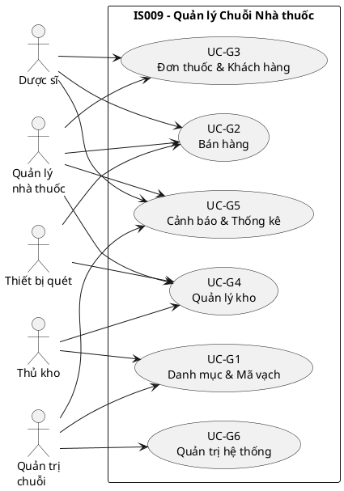

---

## 3. Use Case Cấp 1 – Chi tiết

### G1 – Danh mục & Mã vạch

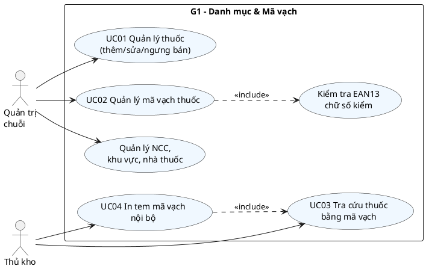

### G2 – Bán hàng

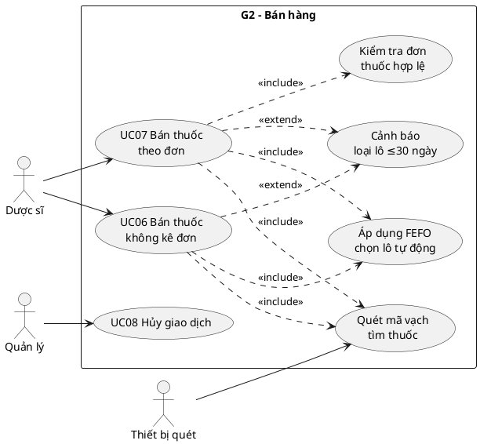

### G3 – Đơn thuốc & Khách hàng

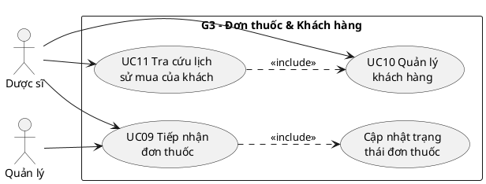

### G4 – Quản lý kho

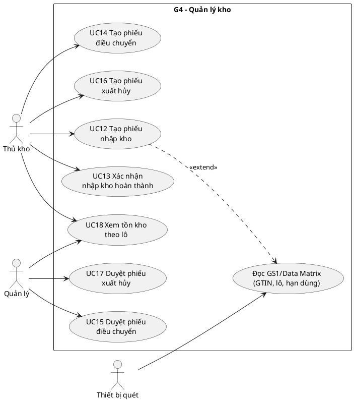

### G5 – Cảnh báo & Thống kê

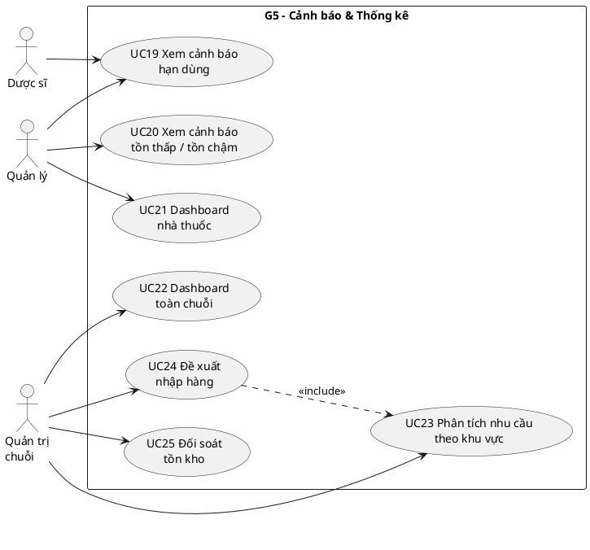

### G6 – Quản trị hệ thống

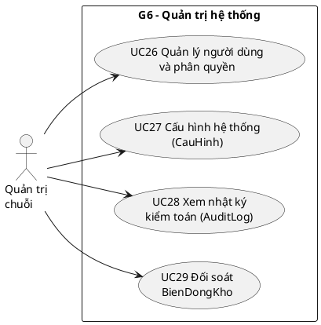

---

## 4. Ma trận Chức năng – BR

| UC | Tên | FR liên quan | BR liên quan |
|----|-----|--------------|--------------|
| UC06 | Bán thuốc không kê đơn | FR06 | BR02, BR03, BR04, BR12, BR15 |
| UC07 | Bán thuốc theo đơn | FR06, FR07 | BR01, BR02, BR03, BR04, BR05, BR12, BR15 |
| UC08 | Hủy giao dịch | FR11 | BR10, BR12, BR14 |
| UC09 | Tiếp nhận đơn thuốc | FR08 | BR05 |
| UC12 | Tạo phiếu nhập kho | FR05 | BR07, BR12 |
| UC14 | Tạo phiếu điều chuyển | FR09 | BR08, BR12 |
| UC15 | Duyệt phiếu điều chuyển | FR09 | BR08, BR12, BR14 |
| UC16 | Tạo phiếu xuất hủy | FR10 | BR09, BR12 |
| UC17 | Duyệt phiếu xuất hủy | FR10 | BR09, BR12, BR14 |
| UC02 | Quản lý mã vạch | FR02 | BR06 |
| UC19 | Cảnh báo hạn dùng | FR12 | BR11 |
| UC20 | Cảnh báo tồn thấp/chậm | FR12, FR13 | BR11 |
| UC26 | Quản lý người dùng | FR04 | BR13 |

---

## 5. Đặc tả Use Case Chi tiết (10 UC quan trọng)

### UC06 – Bán thuốc không kê đơn

| Trường | Nội dung |
|--------|---------|
| Actor | Dược sĩ, Quản lý nhà thuốc |
| Tiền điều kiện | Dược sĩ đã đăng nhập; nhà thuốc đang hoạt động |
| Luồng chính | 1. Dược sĩ quét mã vạch hoặc tìm kiếm tên thuốc. 2. Hệ thống hiển thị thông tin thuốc, tự chọn lô FEFO (BR02). 3. Nhập số lượng. 4. Hệ thống kiểm tra: lô không hết hạn (BR03), tồn đủ (BR04), giá > 0 (BR15); cảnh báo nếu lô ≤30 ngày. 5. Dược sĩ xác nhận thanh toán; chọn phương thức. 6. Hệ thống lưu GiaoDich, ChiTietGiaoDich, trừ TonKho, ghi BienDongKho (BR12). |
| Luồng thay thế | 3a. Chọn lô thủ công → kiểm tra lại BR03, BR04. |
| Ngoại lệ | Tồn không đủ → thông báo lỗi; lô hết hạn → từ chối, không bán. |
| Hậu điều kiện | GiaoDich trạng thái HOAN_THANH; TonKho giảm đúng lô; BienDongKho ghi nhận. |
| BR | BR02, BR03, BR04, BR12, BR15 |

---

### UC07 – Bán thuốc theo đơn

| Trường | Nội dung |
|--------|---------|
| Actor | Dược sĩ, Quản lý nhà thuốc |
| Tiền điều kiện | Đơn thuốc đã tiếp nhận tại nhà thuốc hiện tại (BR01); đơn còn hiệu lực (BR05) |
| Luồng chính | 1. Dược sĩ mở đơn thuốc theo mã hoặc quét. 2. Hệ thống kiểm tra hiệu lực đơn (BR05). 3. Chọn thuốc trong đơn; nhập số lượng bán (≤ được phép, BR01). 4. Hệ thống áp dụng FEFO (BR02), kiểm tra hạn (BR03), tồn (BR04). 5. Dược sĩ xác nhận; hệ thống cập nhật so_luong_da_ban trong ChiTietDonThuoc, cập nhật trạng thái đơn (BR05). 6. Ghi GiaoDich với don_thuoc_id; trừ kho; BienDongKho. |
| Luồng thay thế | 3a. Bán một phần → trạng thái đơn thành BAN_MOT_PHAN. |
| Ngoại lệ | Đơn hết hiệu lực → từ chối; thuốc không trong đơn → từ chối. |
| Hậu điều kiện | ChiTietDonThuoc cập nhật so_luong_da_ban; DonThuoc cập nhật trạng thái. |
| BR | BR01, BR02, BR03, BR04, BR05, BR12, BR15 |

---

### UC08 – Hủy giao dịch

| Trường | Nội dung |
|--------|---------|
| Actor | Quản lý nhà thuốc |
| Tiền điều kiện | Giao dịch trạng thái HOAN_THANH; trong gio_cho_phep_huy_giao_dich giờ kể từ khi bán (BR10) |
| Luồng chính | 1. Quản lý tìm giao dịch theo mã. 2. Kiểm tra điều kiện thời gian (BR10). 3. Nhập lý do hủy (bắt buộc). 4. Hệ thống cập nhật GiaoDich.trang_thai=DA_HUY; hoàn kho đúng từng lô (BR10); ghi BienDongKho loại HOAN_KHO; nếu bán theo đơn thì hoàn so_luong_da_ban. 5. Ghi AuditLog (BR14). |
| Ngoại lệ | Ngoài thời gian cho phép → từ chối. |
| Hậu điều kiện | GiaoDich DA_HUY; TonKho được hoàn đúng lô. |
| BR | BR10, BR12, BR14 |

---

### UC09 – Tiếp nhận đơn thuốc

| Trường | Nội dung |
|--------|---------|
| Actor | Dược sĩ, Quản lý nhà thuốc |
| Tiền điều kiện | Khách hàng đã có hoặc tạo mới hồ sơ |
| Luồng chính | 1. Dược sĩ nhập thông tin đơn (tên bác sĩ, cơ sở khám, ngày kê). 2. Nhập danh sách thuốc trong đơn (thuoc_id, số lượng kê, liều dùng). 3. Hệ thống tính ngày hết hiệu lực (ngay_ke_don + so_ngay_hieu_luc, BR05). 4. Lưu DonThuoc, ChiTietDonThuoc; trạng thái CHUA_BAN; ghi nha_thuoc_id tiếp nhận (BR01). |
| Ngoại lệ | Thuốc trong đơn không tồn tại trong danh mục → cảnh báo. |
| Hậu điều kiện | DonThuoc trạng thái CHUA_BAN; ràng buộc nhà thuốc tiếp nhận áp dụng khi bán. |
| BR | BR01, BR05 |

---

### UC12 – Tạo phiếu nhập kho

| Trường | Nội dung |
|--------|---------|
| Actor | Thủ kho |
| Tiền điều kiện | Thủ kho đăng nhập; đã chọn nhà cung cấp |
| Luồng chính | 1. Thủ kho tạo phiếu nhập. 2. Quét mã vạch từng sản phẩm hoặc nhập tay. 3. Nếu mã GS1: hệ thống parse GTIN→thuoc_id, lô, hạn dùng tự điền (extend). 4. Nhập số lô, ngày sản xuất, hạn dùng, số lượng, giá nhập. 5. Hệ thống kiểm tra BR07 (han_dung > ngày nhập, UQ(thuoc_id,so_lo) cho lô mới). 6. Xác nhận hoàn thành: cập nhật TonKho (cộng dồn), ghi BienDongKho loại NHAP; PhieuKho trạng thái HOAN_THANH. |
| Luồng thay thế | 5a. Lô đã có → cộng dồn số lượng vào LoThuoc/TonKho. |
| Ngoại lệ | han_dung ≤ ngày nhập → từ chối nhập lô. |
| Hậu điều kiện | TonKho tăng; BienDongKho ghi NHAP; PhieuKho HOAN_THANH. |
| BR | BR07, BR12 |

---

### UC14 – Tạo phiếu điều chuyển

| Trường | Nội dung |
|--------|---------|
| Actor | Thủ kho |
| Tiền điều kiện | Thủ kho đăng nhập; nhà thuốc đích khác nhà thuốc nguồn (BR08) |
| Luồng chính | 1. Thủ kho chọn nhà thuốc đích. 2. Thêm thuốc: quét mã/tìm kiếm, chọn lô, nhập số lượng. 3. Hệ thống kiểm tra tồn đủ theo lô (BR08). 4. Lưu PhieuKho loại DIEU_CHUYEN, trạng thái CHO_DUYET. |
| Ngoại lệ | Tồn không đủ → từ chối thêm dòng. |
| Hậu điều kiện | PhieuKho CHO_DUYET; tồn chưa thay đổi (chờ duyệt). |
| BR | BR08, BR12 |

---

### UC15 – Duyệt phiếu điều chuyển

| Trường | Nội dung |
|--------|---------|
| Actor | Quản lý nhà thuốc (nơi xuất) |
| Tiền điều kiện | PhieuKho DIEU_CHUYEN, trạng thái CHO_DUYET |
| Luồng chính | 1. Quản lý xem danh sách phiếu chờ duyệt. 2. Kiểm tra lại tồn từng lô tại thời điểm duyệt. 3. Duyệt → transaction: trừ TonKho nơi xuất, cộng TonKho nơi nhận; ghi 2 dòng BienDongKho (DIEU_CHUYEN_XUAT, DIEU_CHUYEN_NHAP); cập nhật PhieuKho.trang_thai=HOAN_THANH. 4. Ghi AuditLog (BR14). |
| Luồng thay thế | 3a. Từ chối → PhieuKho.trang_thai=TU_CHOI; ghi lý do vào ghi_chu. |
| Ngoại lệ | Tồn thay đổi trước khi duyệt → cảnh báo, quản lý xem lại. |
| Hậu điều kiện | TonKho hai nhà thuốc cập nhật; BienDongKho ghi nhận. |
| BR | BR08, BR12, BR14 |

---

### UC17 – Duyệt phiếu xuất hủy

| Trường | Nội dung |
|--------|---------|
| Actor | Quản lý nhà thuốc |
| Tiền điều kiện | PhieuKho XUAT_HUY, trạng thái CHO_DUYET; có lý do (BR09) |
| Luồng chính | 1. Quản lý xem phiếu, kiểm tra lý do hủy hợp lệ (BR09). 2. Duyệt → trừ TonKho, ghi BienDongKho loại XUAT_HUY; PhieuKho HOAN_THANH. 3. Ghi AuditLog (BR14). |
| Luồng thay thế | 2a. Từ chối → PhieuKho TU_CHOI; ghi lý do từ chối vào ghi_chu. |
| Hậu điều kiện | TonKho giảm đúng lô; BienDongKho ghi nhận. |
| BR | BR09, BR12, BR14 |

---

### UC19 – Xem cảnh báo hạn dùng

| Trường | Nội dung |
|--------|---------|
| Actor | Dược sĩ, Quản lý nhà thuốc, Quản trị chuỗi |
| Tiền điều kiện | Đã đăng nhập; tồn kho có dữ liệu |
| Luồng chính | 1. Hệ thống truy vấn view vw_CanhBaoHanDung. 2. Hiển thị danh sách lô theo mức cảnh báo: ĐÃ HẾT HẠN (đỏ), ≤30 ngày (cam), ≤60 ngày (vàng), ≤90 ngày (xanh nhạt). 3. Người dùng có thể lọc theo nhà thuốc (QUANTRI) hoặc xem nhà thuốc mình (BR13). 4. Có thể nhấn "Tạo phiếu xuất hủy" từ đây. |
| Hậu điều kiện | Không thay đổi dữ liệu; có thể điều hướng đến UC16. |
| BR | BR11, BR13 |

---

### UC23 – Phân tích nhu cầu theo khu vực

| Trường | Nội dung |
|--------|---------|
| Actor | Quản trị chuỗi |
| Tiền điều kiện | Có dữ liệu bán hàng; khu vực có dân số (cấp QUAN) |
| Luồng chính | 1. QUANTRI chọn khoảng thời gian, khu vực, nhóm thuốc. 2. Hệ thống gọi sp_ThongKeNhuCauKhuVuc(@tu, @den, @khu_vuc_id, @nhom_thuoc_id). 3. Hiển thị: số lượng/1.000 dân, top thuốc theo quận, biểu đồ cột/bản đồ màu. 4. Kết hợp xu hướng theo tháng (SP sp_ThongKeXuHuong). |
| Hậu điều kiện | Chỉ đọc; kết quả hiển thị trên dashboard chuỗi. |
| BR | BR13, BR16 |


## 3.2 – Activity Diagram (03_activity_diagram.md)

# 03 – Activity Diagram

## Mô tả chung
Mỗi sơ đồ trình bày dạng swimlane PlantUML với start (●), stop (◉), quyết định (<>), fork/join khi cần.  
Kèm "Các bước thực hiện" đánh số để đối chiếu khi đọc sơ đồ.

---

## P3 – Bán thuốc

### 3.1 P3 AS-IS – Bán thuốc thủ công

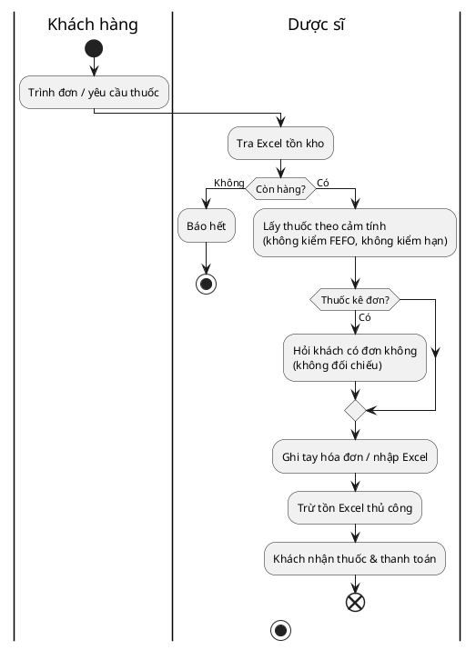

**Các bước P3 AS-IS:**
1. Khách trình đơn hoặc yêu cầu mua thuốc
2. Dược sĩ tra Excel tồn kho
3. Nếu hết hàng: báo khách, kết thúc
4. Lấy thuốc theo cảm tính (không đảm bảo FEFO, không kiểm hạn dùng)
5. Nếu thuốc kê đơn: hỏi miệng khách, không kiểm tra đơn thật
6. Ghi tay hóa đơn hoặc nhập Excel
7. Trừ tồn Excel thủ công (dễ sai)
8. Khách nhận thuốc, thanh toán

---

### 3.2 P3 TO-BE – Bán thuốc POS (quét mã vạch + FEFO)

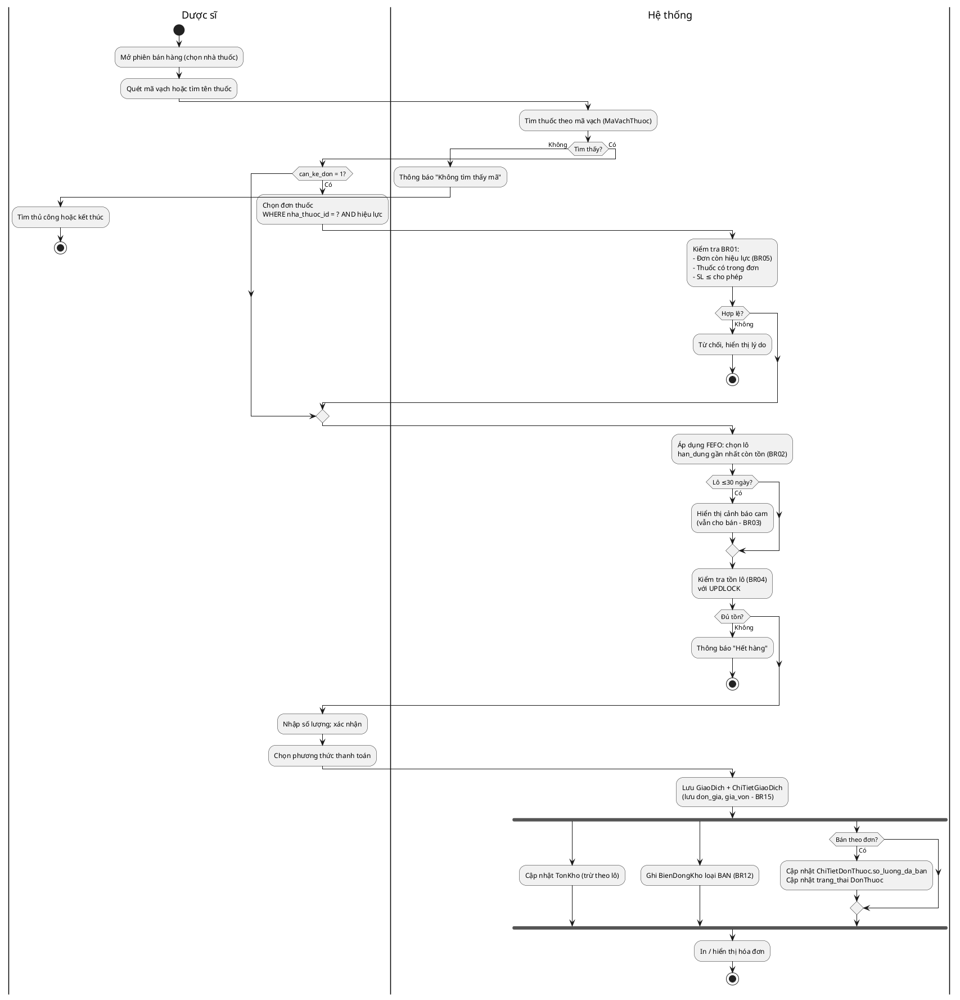

**Các bước P3 TO-BE:**
1. Dược sĩ mở phiên bán hàng
2. Quét mã vạch hoặc tìm tên thuốc
3. Hệ thống tra bảng MaVachThuoc → Thuoc
4. Nếu thuốc kê đơn: yêu cầu chọn đơn thuốc, kiểm tra BR01 + BR05
5. Áp dụng FEFO: hệ thống tự chọn lô gần hạn nhất (BR02)
6. Hiển thị cảnh báo nếu lô ≤30 ngày (BR03)
7. Kiểm tra tồn đủ theo lô với UPDLOCK (BR04)
8. Dược sĩ nhập số lượng, xác nhận, chọn thanh toán
9. Hệ thống lưu GiaoDich + ChiTietGiaoDich (BR15)
10. Song song: trừ TonKho, ghi BienDongKho (BR12), cập nhật đơn thuốc nếu có

---

## P2 – Nhập kho

### 3.3 P2 AS-IS

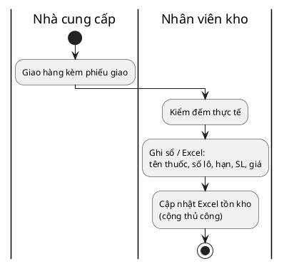

**Các bước P2 AS-IS:** NCC giao hàng → kiểm đếm thực tế → ghi sổ/Excel (số lô, hạn, NCC không đầy đủ) → cập nhật tồn thủ công.

---

### 3.4 P2 TO-BE – Nhập kho (có đọc GS1)

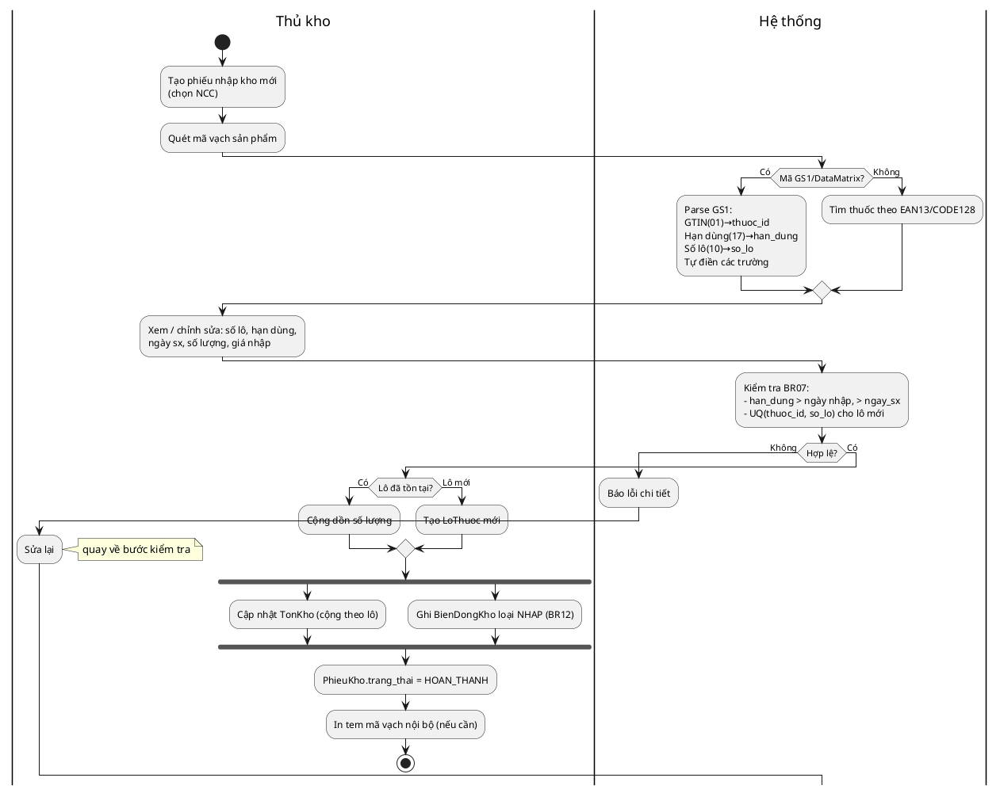

**Các bước P2 TO-BE:**
1. Thủ kho tạo phiếu nhập, chọn NCC
2. Quét mã vạch từng sản phẩm
3. Nếu GS1/DataMatrix: hệ thống parse tự động GTIN, hạn, lô
4. Thủ kho xem lại, chỉnh sửa nếu cần
5. Hệ thống kiểm tra BR07; báo lỗi nếu vi phạm
6. Nếu lô đã có: cộng dồn; lô mới: tạo LoThuoc
7. Cập nhật TonKho + ghi BienDongKho song song (BR12)
8. PhieuKho → HOAN_THANH; thủ kho in tem nếu cần

---

## P4 – Điều chuyển và Xuất hủy

### 3.5 P4 TO-BE – Điều chuyển (swimlane 3 vai trò)

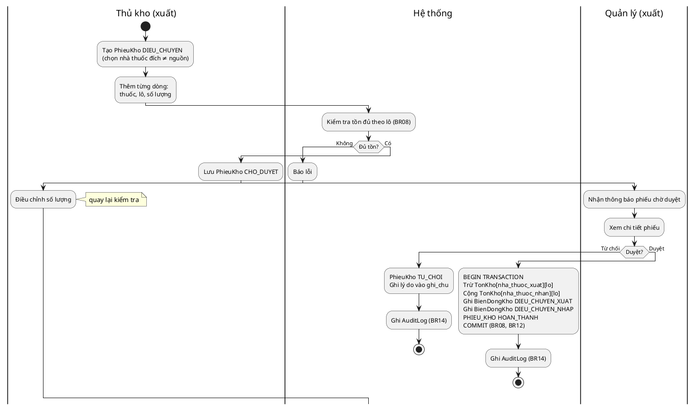

### 3.6 P4 TO-BE – Xuất hủy

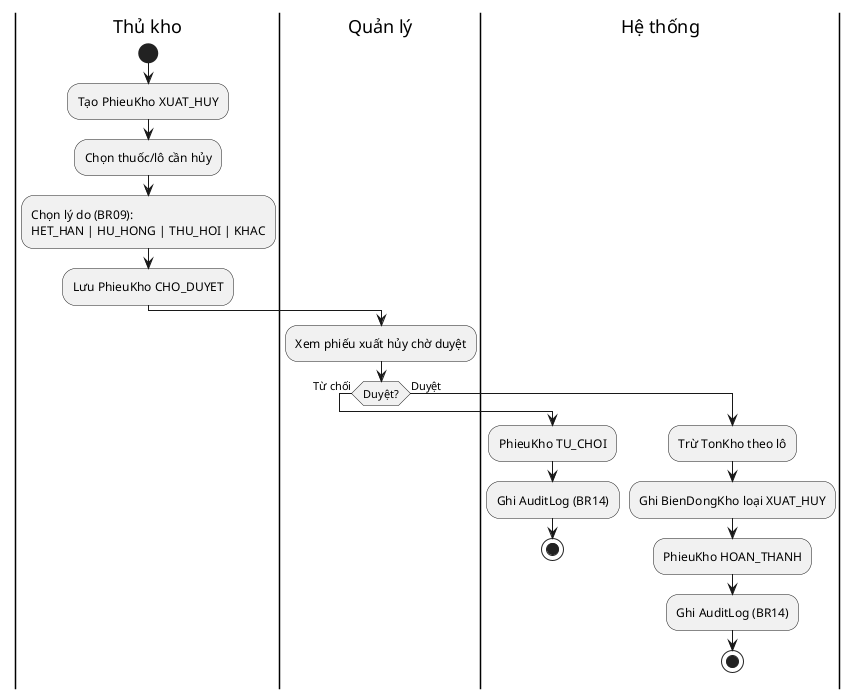

---

## P5 – Xử lý cảnh báo hạn dùng

### 3.7 P5 TO-BE

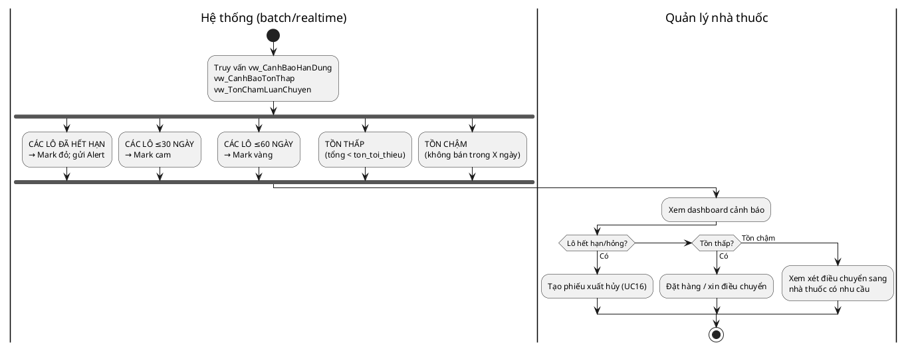

---

## Bảng So sánh AS-IS / TO-BE

| Quy trình | AS-IS (vấn đề) | TO-BE (cải tiến) |
|-----------|----------------|------------------|
| P3 – Bán | Không FEFO, không kiểm hạn, không kiểm đơn kê toa | FEFO tự động, kiểm hạn, bắt buộc đơn với can_ke_don=1 |
| P2 – Nhập | Ghi sổ tay, thiếu số lô/hạn dùng | Quét mã vạch (GS1 tự điền), kiểm tra BR07, ghi lô đầy đủ |
| P4 – Điều chuyển | Nhắn tin, không có xác nhận điện tử | Phiếu điều chuyển có duyệt, transaction 2 chiều, AuditLog |
| P4 – Xuất hủy | Ghi sổ đơn giản | Phiếu xuất hủy có lý do, duyệt, BienDongKho |
| P5 – Cảnh báo | Kiểm tra thủ công hàng tháng | View tự động, dashboard real-time 5 loại cảnh báo |


## 3.3 – Sequence Diagram (04_sequence.md)

# 04 – Sequence Diagram

## SD01 – Bán thuốc quét mã vạch + FEFO (không kê đơn)

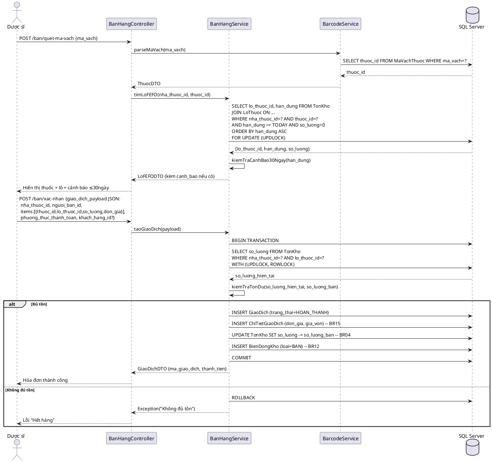

---

## SD02 – Bán thuốc theo đơn

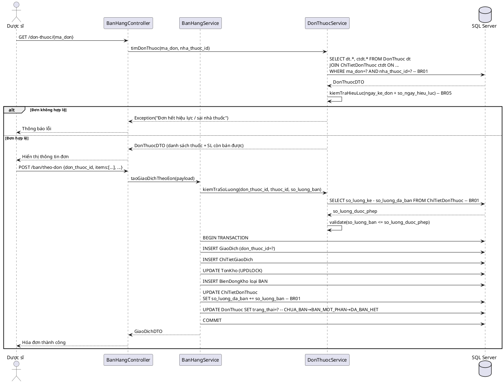

---

## SD03 – Nhập kho (có đọc GS1 Data Matrix)

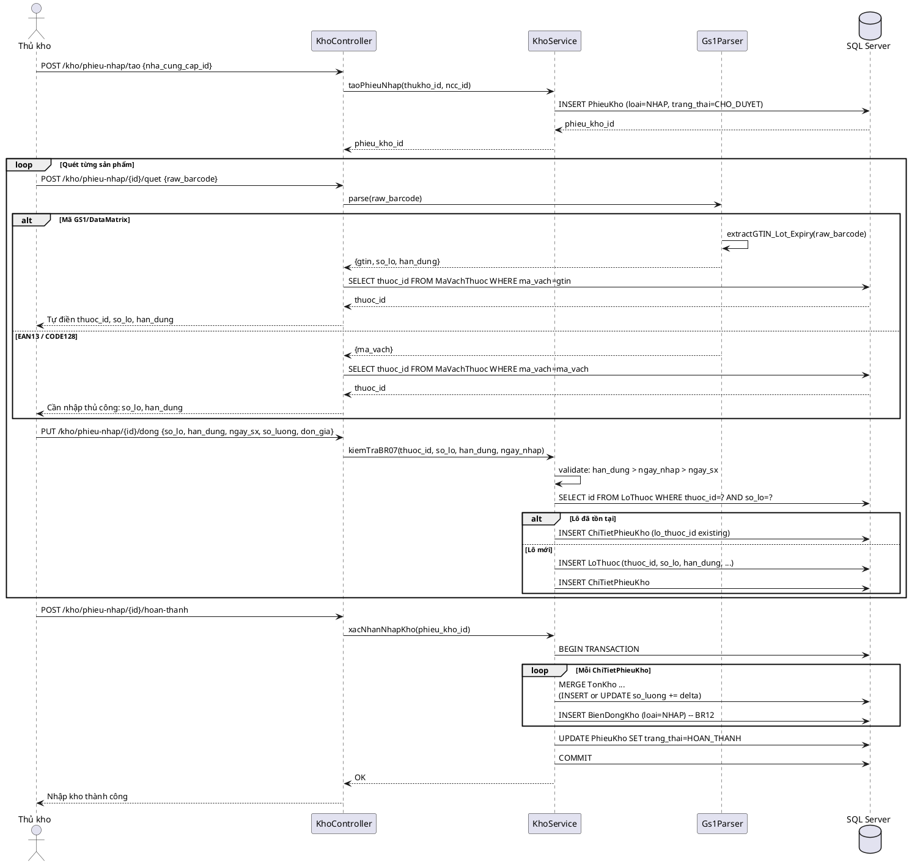

---

## SD04 – Điều chuyển (tạo → duyệt)

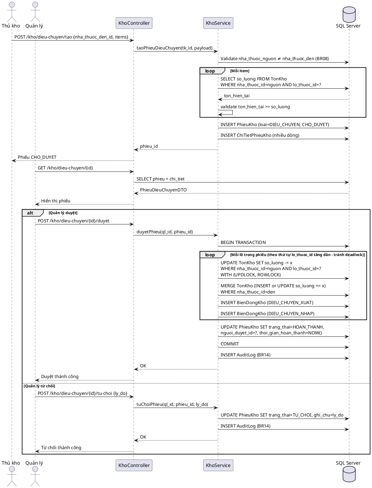

---

## SD05 – Hủy giao dịch

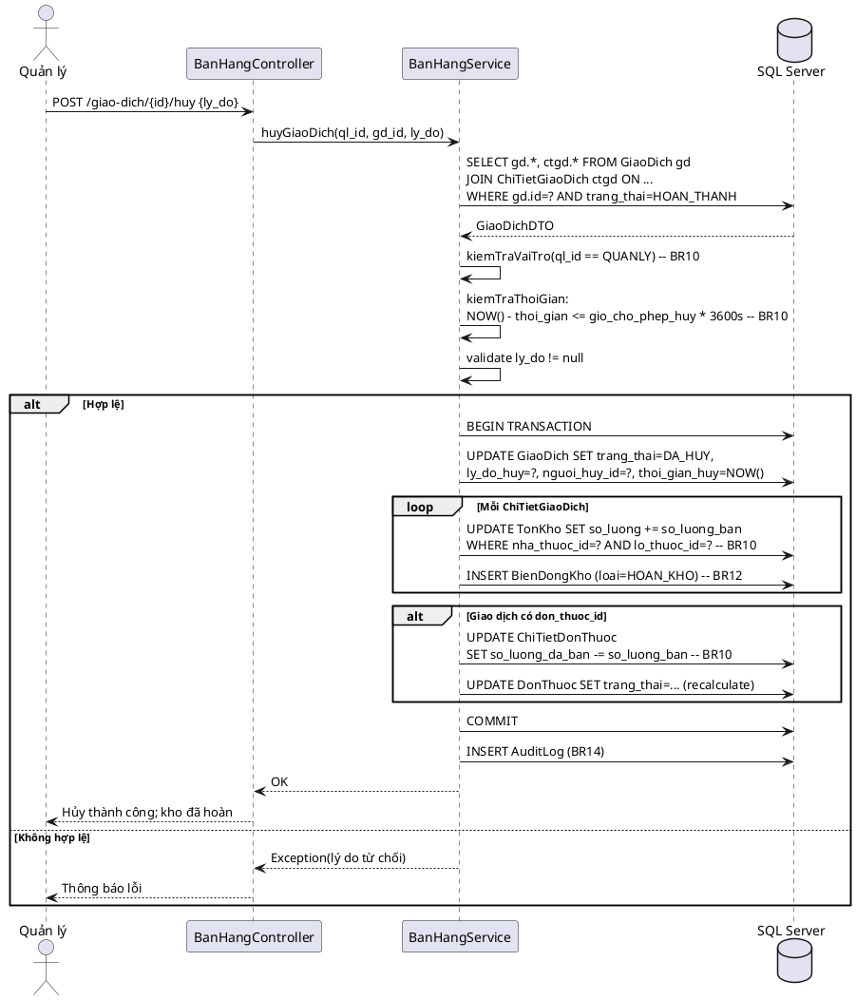

---

## SD06 – Hai dược sĩ bán lô cuối (xử lý đồng thời)

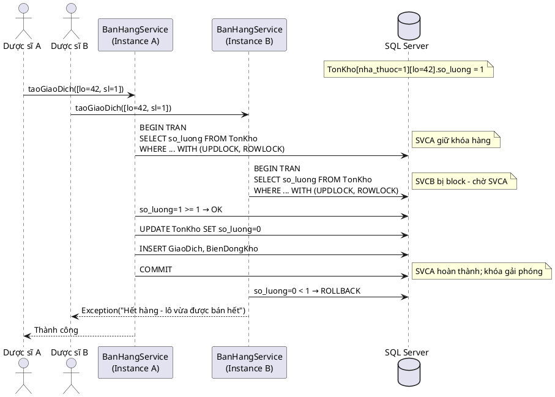


## 3.4 – ERD (05_erd.md)

# 05 – ERD (Entity-Relationship Diagram)

## 1. Nhận diện Thực thể

| Thực thể | Căn cứ trích từ mô tả | Thuộc tính chính | Khóa chính |
|----------|----------------------|------------------|------------|
| KhuVuc | "xu hướng mua theo địa bàn", "chuỗi nhiều khu vực" | ma, ten, cap, dan_so | id |
| NhaThuoc | "chuỗi nhà thuốc nhiều chi nhánh" | ma, ten, dia_chi, khu_vuc_id | id |
| NguoiDung | "dược sĩ bán, thủ kho nhập, quản lý xem cảnh báo" | email, vai_tro, nha_thuoc_id | id |
| NhomThuoc | "phân nhóm thuốc" (ngầm định từ "nhóm thuốc" trong báo cáo N&C) | ma, ten | id |
| Thuoc | Bảng gợi ý GV – "danh mục thuốc" | ma, ten, hoat_chat, can_ke_don, gia_ban_le | id |
| MaVachThuoc | "barcode, EAN-13, Code128, mã nội bộ" | ma_vach, loai_ma_vach | id |
| NhaCungCap | "nhập hàng theo cảm tính" → cần quản lý NCC | ma, ten, ma_so_thue | id |
| LoThuoc | Bảng gợi ý GV – "lô hàng, hạn dùng, số lô" | so_lo, han_dung, gia_nhap | id |
| TonKho | "tồn kho" – tồn theo (nhà thuốc, lô) | so_luong | PK(nha_thuoc_id, lo_thuoc_id) |
| DinhMucTon | "định mức tồn tối thiểu/tối đa" | ton_toi_thieu, ton_toi_da | id |
| PhieuKho | "phiếu nhập, điều chuyển, xuất hủy có duyệt" | ma_phieu, loai_phieu, trang_thai | id |
| ChiTietPhieuKho | Thực thể liên kết PhieuKho–LoThuoc | so_luong, don_gia | id |
| BienDongKho | "mọi biến động tồn ghi lại" (BR12) | loai_bien_dong, so_luong_thay_doi, so_du_sau | id BIGINT |
| KhachHang | Bảng gợi ý GV – "bán theo đơn, quản lý khách" | ma, ho_ten, so_dien_thoai | id |
| DonThuoc | Bảng gợi ý GV – "đơn thuốc, kê đơn" | ma_don, ngay_ke_don, so_ngay_hieu_luc | id |
| ChiTietDonThuoc | Thực thể liên kết DonThuoc–Thuoc | so_luong_ke, so_luong_da_ban | id |
| GiaoDich | Bảng gợi ý GV – "giao dịch bán" | ma_giao_dich, tong_tien, thanh_tien | id |
| ChiTietGiaoDich | Thực thể liên kết GiaoDich–(Thuoc+LoThuoc) | so_luong, don_gia, gia_von | id |
| CauHinh | "cấu hình ngưỡng cảnh báo" | khoa, gia_tri | khoa PK |
| AuditLog | "nhật ký kiểm toán" (BR14) | hanh_dong, doi_tuong, du_lieu_cu, du_lieu_moi | id BIGINT |

> **6 bảng gợi ý của giảng viên trong mô hình mở rộng:**
> - `Thuoc` → bảng #5 (mở rộng thêm: hoat_chat, ham_luong, dang_bao_che, can_ke_don, trang_thai)
> - `LoThuoc` → bảng #8 (mở rộng: gia_nhap, nha_cung_cap_id, dùng chung toàn chuỗi)
> - `DonThuoc` → bảng #15 (mở rộng: nha_thuoc_id, nguoi_tiep_nhan_id, trang_thai)
> - `KhachHang` → bảng #14 (mở rộng: khu_vuc_id, ghi_chu_di_ung)
> - `GiaoDich` → bảng #17 (mở rộng: don_thuoc_id, trang_thai, nguoi_huy_id, ...)
> - `TonKho` → bảng #9 (PK kép, cap_nhat_luc; không có bảng GV thuần đơn giản)

---

## 2. Nhận diện Mối kết hợp

| Thực thể 1 | Động từ | Thực thể 2 | Bản số | Giải thích |
|------------|---------|------------|--------|------------|
| KhuVuc | chứa | NhaThuoc | 1..* | Mỗi nhà thuốc thuộc 1 khu vực |
| KhuVuc | là cha của | KhuVuc | 0..1 → * | Tỉnh → nhiều Quận |
| NhaThuoc | có | NguoiDung | 1..* | Nhân viên thuộc nhà thuốc |
| NhaThuoc | lưu | TonKho | 1..* | Mỗi nhà thuốc có nhiều dòng tồn kho |
| Thuoc | gắn | MaVachThuoc | 1..* | Một thuốc có nhiều mã vạch |
| Thuoc | thuộc | NhomThuoc | *..1 | Nhiều thuốc, 1 nhóm |
| LoThuoc | là lô của | Thuoc | *..1 | Nhiều lô của 1 thuốc |
| LoThuoc | từ | NhaCungCap | *..0..1 | Lô có thể có NCC |
| TonKho | theo | LoThuoc | *..1 | Tồn kho gắn với lô cụ thể |
| TonKho | tại | NhaThuoc | *..1 | — |
| DinhMucTon | cho | NhaThuoc-Thuoc | * .. UQ | Định mức theo cặp (nhà thuốc, thuốc) |
| PhieuKho | tạo bởi | NguoiDung | *..1 | nguoi_lap_id |
| PhieuKho | duyệt bởi | NguoiDung | *..0..1 | nguoi_duyet_id |
| PhieuKho | có chi tiết | ChiTietPhieuKho | 1..* | Quan hệ nhiều-nhiều PhieuKho–LoThuoc |
| ChiTietPhieuKho | chỉ định | LoThuoc | *..1 | — |
| BienDongKho | liên quan | NhaThuoc | *..1 | — |
| BienDongKho | liên quan | LoThuoc | *..1 | — |
| KhachHang | có | DonThuoc | 1..* | — |
| KhachHang | thuộc khu vực | KhuVuc | *..0..1 | Phục vụ phân tích |
| DonThuoc | tiếp nhận tại | NhaThuoc | *..1 | Ràng buộc bán (BR01) |
| DonThuoc | có chi tiết | ChiTietDonThuoc | 1..* | Quan hệ nhiều-nhiều DonThuoc–Thuoc |
| ChiTietDonThuoc | kê | Thuoc | *..1 | — |
| GiaoDich | thực hiện tại | NhaThuoc | *..1 | — |
| GiaoDich | bởi | NguoiDung | *..1 | nguoi_ban_id |
| GiaoDich | cho | KhachHang | *..0..1 | Có thể bán không tên |
| GiaoDich | theo | DonThuoc | *..0..1 | Nếu bán theo đơn |
| GiaoDich | có chi tiết | ChiTietGiaoDich | 1..* | Quan hệ nhiều-nhiều GiaoDich–(Thuoc+LoThuoc) |
| ChiTietGiaoDich | bán | Thuoc | *..1 | Lưu phi chuẩn hóa thuoc_id |
| ChiTietGiaoDich | lấy từ lô | LoThuoc | *..1 | — |

**Quan hệ nhiều-nhiều và thực thể liên kết:**
- `PhieuKho ↔ LoThuoc` → **ChiTietPhieuKho**
- `DonThuoc ↔ Thuoc` → **ChiTietDonThuoc**
- `GiaoDich ↔ (Thuoc + LoThuoc)` → **ChiTietGiaoDich**
- `NhaThuoc ↔ LoThuoc` (với số lượng) → **TonKho**
- `NhaThuoc ↔ Thuoc` (với định mức) → **DinhMucTon**

---

## 3. ERD Mức Khái niệm

### 3.1 Hình tổng quát

```mermaid
erDiagram
    KhuVuc ||--o{ NhaThuoc : "thuộc"
    KhuVuc ||--o{ KhuVuc : "là cha"
    NhaThuoc ||--o{ NguoiDung : "có"
    NhaThuoc ||--o{ TonKho : "lưu"
    NhaThuoc ||--o{ DinhMucTon : "có định mức"
    NhaThuoc ||--o{ PhieuKho : "tạo"
    NhaThuoc ||--o{ GiaoDich : "thực hiện"

    Thuoc }o--|| NhomThuoc : "thuộc"
    Thuoc ||--|{ MaVachThuoc : "gắn mã vạch"
    Thuoc ||--o{ LoThuoc : "có lô"
    LoThuoc }o--o| NhaCungCap : "từ NCC"
    LoThuoc ||--o{ TonKho : "theo lô"
    LoThuoc ||--o{ BienDongKho : "biến động"

    KhachHang ||--o{ DonThuoc : "có đơn"
    KhachHang }o--o| KhuVuc : "thuộc khu vực"
    DonThuoc ||--|{ ChiTietDonThuoc : "chi tiết"
    ChiTietDonThuoc }|--|| Thuoc : "kê"

    GiaoDich ||--|{ ChiTietGiaoDich : "chi tiết"
    ChiTietGiaoDich }|--|| LoThuoc : "từ lô"
    GiaoDich }o--o| DonThuoc : "theo đơn"
    GiaoDich }o--o| KhachHang : "cho"

    PhieuKho ||--o{ ChiTietPhieuKho : "chi tiết"
    ChiTietPhieuKho }|--|| LoThuoc : "chỉ định lô"

    KhuVuc {
        int id PK
        string ma
        string ten
        enum cap
    }
    NhaThuoc {
        int id PK
        string ma
        string ten
    }
    Thuoc {
        int id PK
        string ma
        string ten
        bool can_ke_don
    }
    LoThuoc {
        int id PK
        string so_lo
        date han_dung
    }
    TonKho {
        int nha_thuoc_id PK
        int lo_thuoc_id PK
        int so_luong
    }
    GiaoDich {
        int id PK
        string ma_giao_dich
        decimal thanh_tien
    }
    DonThuoc {
        int id PK
        string ma_don
        date ngay_ke_don
    }
    KhachHang {
        int id PK
        string ma
        string ho_ten
    }
    PhieuKho {
        int id PK
        string ma_phieu
        enum loai_phieu
    }
```

---

### 3.2 Nhóm 1 – Tổ chức và Danh mục Thuốc

```mermaid
erDiagram
    KhuVuc ||--o{ NhaThuoc : "thuộc"
    KhuVuc ||--o{ KhuVuc : "là cha của"
    NhaThuoc ||--o{ NguoiDung : "có nhân viên"
    NhaThuoc ||--o{ DinhMucTon : "có định mức"
    Thuoc }o--|| NhomThuoc : "thuộc nhóm"
    Thuoc ||--|{ MaVachThuoc : "có mã vạch"
    Thuoc ||--o{ DinhMucTon : "theo thuốc"
    NhaCungCap ||--o{ LoThuoc : "cung cấp lô"

    KhuVuc {
        int id PK
        string ma UK
        string ten
        enum cap "TINH|QUAN"
        int khu_vuc_cha_id FK
        int dan_so
    }
    NhaThuoc {
        int id PK
        string ma UK
        string ten
        int khu_vuc_id FK
    }
    NguoiDung {
        int id PK
        string email UK
        enum vai_tro
        int nha_thuoc_id FK
    }
    NhomThuoc {
        int id PK
        string ma UK
        string ten
    }
    Thuoc {
        int id PK
        string ma UK
        string ten
        string hoat_chat
        bool can_ke_don
        decimal gia_ban_le
    }
    MaVachThuoc {
        int id PK
        int thuoc_id FK
        string ma_vach UK
        enum loai_ma_vach
        bool la_ma_chinh
    }
    NhaCungCap {
        int id PK
        string ma UK
        string ten
    }
    DinhMucTon {
        int id PK
        int nha_thuoc_id FK
        int thuoc_id FK
        int ton_toi_thieu
        int ton_toi_da
    }
```

---

### 3.3 Nhóm 2 – Lô, Tồn kho, Phiếu kho

```mermaid
erDiagram
    Thuoc ||--o{ LoThuoc : "có lô"
    NhaCungCap ||--o{ LoThuoc : "cung cấp"
    LoThuoc ||--o{ TonKho : "tồn theo lô"
    NhaThuoc ||--o{ TonKho : "tồn tại nhà thuốc"
    NhaThuoc ||--o{ PhieuKho : "tạo phiếu"
    NhaThuoc ||--o{ PhieuKho : "nhận (điều chuyển)"
    PhieuKho ||--|{ ChiTietPhieuKho : "chi tiết"
    ChiTietPhieuKho }|--|| LoThuoc : "chỉ định lô"
    LoThuoc ||--o{ BienDongKho : "biến động"
    NhaThuoc ||--o{ BienDongKho : "tại"

    LoThuoc {
        int id PK
        int thuoc_id FK
        string so_lo
        date ngay_san_xuat
        date han_dung
        int nha_cung_cap_id FK
        decimal gia_nhap
    }
    TonKho {
        int nha_thuoc_id PK "FK"
        int lo_thuoc_id PK "FK"
        int so_luong
        datetime cap_nhat_luc
    }
    PhieuKho {
        int id PK
        string ma_phieu UK
        enum loai_phieu "NHAP|XUAT_HUY|DIEU_CHUYEN"
        int nha_thuoc_id FK
        int nha_thuoc_den_id FK
        enum trang_thai
        int nguoi_duyet_id FK
    }
    ChiTietPhieuKho {
        int id PK
        int phieu_kho_id FK
        int lo_thuoc_id FK
        int so_luong
        decimal don_gia
    }
    BienDongKho {
        bigint id PK
        int nha_thuoc_id FK
        int lo_thuoc_id FK
        enum loai_bien_dong
        int so_luong_thay_doi
        int so_du_sau
    }
```

---

### 3.4 Nhóm 3 – Khách hàng, Đơn thuốc, Bán hàng

```mermaid
erDiagram
    KhachHang ||--o{ DonThuoc : "có đơn"
    KhachHang }o--o| KhuVuc : "thuộc khu vực"
    DonThuoc ||--|{ ChiTietDonThuoc : "chi tiết đơn"
    ChiTietDonThuoc }|--|| Thuoc : "kê thuốc"
    DonThuoc }o--o| NhaThuoc : "tiếp nhận tại"
    GiaoDich }o--o| DonThuoc : "theo đơn"
    GiaoDich }o--o| KhachHang : "cho khách"
    GiaoDich }|--|| NhaThuoc : "tại nhà thuốc"
    GiaoDich ||--|{ ChiTietGiaoDich : "chi tiết bán"
    ChiTietGiaoDich }|--|| LoThuoc : "từ lô"
    ChiTietGiaoDich }|--|| Thuoc : "bán thuốc"

    KhachHang {
        int id PK
        string ma UK
        string ho_ten
        string so_dien_thoai
        int khu_vuc_id FK
    }
    DonThuoc {
        int id PK
        string ma_don UK
        int khach_hang_id FK
        int nha_thuoc_id FK
        date ngay_ke_don
        int so_ngay_hieu_luc
        enum trang_thai
    }
    ChiTietDonThuoc {
        int id PK
        int don_thuoc_id FK
        int thuoc_id FK
        int so_luong_ke
        int so_luong_da_ban
    }
    GiaoDich {
        int id PK
        string ma_giao_dich UK
        int nha_thuoc_id FK
        int khach_hang_id FK
        int don_thuoc_id FK
        decimal thanh_tien
        enum trang_thai
    }
    ChiTietGiaoDich {
        int id PK
        int giao_dich_id FK
        int thuoc_id FK
        int lo_thuoc_id FK
        int so_luong
        decimal don_gia
        decimal gia_von
    }
```

---

## 4. ERD Mức Logic (đủ thuộc tính – xem file 06_mo_hinh_quan_he.md)

ERD mức logic được thể hiện trong từ điển dữ liệu tại **06_mo_hinh_quan_he.md** (đầy đủ kiểu dữ liệu, ràng buộc, index).

---

## 5. Giải thích thiết kế

### 5.1 Vì sao LoThuoc dùng chung toàn chuỗi, còn TonKho theo (nhà thuốc, lô)?
- Một số lô (ví dụ thuốc A, lô "ABC123") có thể tồn tại ở nhiều nhà thuốc khác nhau (sau điều chuyển).
- Nếu LoThuoc theo nhà thuốc thì sau điều chuyển phải nhân bản lô → không rõ nguồn gốc, không truy vết được.
- Giải pháp: `LoThuoc` là thực thể toàn chuỗi (UQ thuoc_id+so_lo), còn `TonKho` là bảng trung gian riêng track số lượng tại từng nhà thuốc.

### 5.2 Vì sao một thuốc nhiều mã vạch?
- Cùng một thuốc có thể được phân phối bởi nhiều NCC với mã vạch khác nhau, hoặc có mã nội bộ Code128 cho in tem và mã nhà sản xuất EAN13.
- Bảng `MaVachThuoc` cho phép tra ngược từ bất kỳ mã vạch nào → `thuoc_id`.

### 5.3 Vì sao có BienDongKho?
- `TonKho` chỉ lưu số lượng hiện tại (snapshot). Muốn truy vết lịch sử biến động (nhập bao nhiêu, bán bao nhiêu, điều chuyển từ đâu) cần bảng sự kiện riêng.
- `BienDongKho` là append-only log → không thể sửa/xóa, phục vụ đối soát (BR12), kiểm toán.
- `so_du_sau` phi chuẩn hóa tại thời điểm ghi để truy vết nhanh không cần tổng cộng lại.

---

> **Giả định:**
> 1. Một lô thuốc (thuoc_id, so_lo) là duy nhất toàn chuỗi; nếu cùng số lô mua từ 2 NCC khác nhau sẽ có so_lo phân biệt.
> 2. KhachHang.khu_vuc_id là cấp QUAN (địa chỉ chi tiết nhất).
> 3. BienDongKho.so_du_sau là tồn tại nhà thuốc đó; không phải tồn toàn chuỗi.


## 3.5 – Mô hình Quan hệ (06_mo_hinh_quan_he.md)

# 06 – Mô hình Quan hệ

## 1. Quy tắc chuyển ERD → Quan hệ

| Trường hợp | Quy tắc |
|------------|---------|
| Thực thể mạnh | Mỗi thực thể → 1 bảng; PK giữ nguyên |
| Quan hệ 1-nhiều | FK thêm vào bảng "nhiều" |
| Quan hệ nhiều-nhiều | Tạo bảng liên kết (ChiTietPhieuKho, ChiTietDonThuoc, ChiTietGiaoDich, TonKho, DinhMucTon) |
| Thuộc tính đa trị | Bảng riêng (MaVachThuoc) |
| Kế thừa / tự tham chiếu | Thêm FK cùng bảng (KhuVuc.khu_vuc_cha_id) |

---

## 2. Lược đồ Quan hệ (tên bảng và PK)

```
KhuVuc(id*, ma, ten, cap, khu_vuc_cha_id→KhuVuc, dan_so)
NhaThuoc(id*, ma, ten, dia_chi, khu_vuc_id→KhuVuc, so_dien_thoai, trang_thai, ngay_khai_truong)
NguoiDung(id*, ho_ten, email, password_hash, vai_tro, nha_thuoc_id→NhaThuoc, so_chung_chi_hanh_nghe, kich_hoat, created_at)
NhomThuoc(id*, ma, ten)
Thuoc(id*, ma, ten, hoat_chat, ham_luong, dang_bao_che, don_vi_tinh, nhom_thuoc_id→NhomThuoc, nha_san_xuat, can_ke_don, gia_ban_le, trang_thai, mo_ta)
MaVachThuoc(id*, thuoc_id→Thuoc, ma_vach, loai_ma_vach, la_ma_chinh, created_at)
NhaCungCap(id*, ma, ten, dia_chi, so_dien_thoai, ma_so_thue, trang_thai)
LoThuoc(id*, thuoc_id→Thuoc, so_lo, ngay_san_xuat, han_dung, nha_cung_cap_id→NhaCungCap, gia_nhap, created_at)
TonKho(nha_thuoc_id→NhaThuoc*, lo_thuoc_id→LoThuoc*, so_luong, cap_nhat_luc)
DinhMucTon(id*, nha_thuoc_id→NhaThuoc, thuoc_id→Thuoc, ton_toi_thieu, ton_toi_da, so_ngay_giao_hang)
PhieuKho(id*, ma_phieu, loai_phieu, nha_thuoc_id→NhaThuoc, nha_thuoc_den_id→NhaThuoc, nha_cung_cap_id→NhaCungCap, ly_do, ghi_chu, trang_thai, nguoi_lap_id→NguoiDung, nguoi_duyet_id→NguoiDung, thoi_gian_lap, thoi_gian_hoan_thanh, tong_gia_tri)
ChiTietPhieuKho(id*, phieu_kho_id→PhieuKho, lo_thuoc_id→LoThuoc, so_luong, don_gia)
BienDongKho(id BIGINT*, nha_thuoc_id→NhaThuoc, lo_thuoc_id→LoThuoc, loai_bien_dong, so_luong_thay_doi, so_du_sau, chung_tu_loai, chung_tu_id, nguoi_thuc_hien_id→NguoiDung, thoi_gian)
KhachHang(id*, ma, ho_ten, so_dien_thoai, gioi_tinh, nam_sinh, khu_vuc_id→KhuVuc, dia_chi, ghi_chu_di_ung, created_at)
DonThuoc(id*, ma_don, khach_hang_id→KhachHang, nha_thuoc_id→NhaThuoc, ten_bac_si, co_so_kham, chan_doan, ngay_ke_don, so_ngay_hieu_luc, trang_thai, nguoi_tiep_nhan_id→NguoiDung, created_at)
ChiTietDonThuoc(id*, don_thuoc_id→DonThuoc, thuoc_id→Thuoc, so_luong_ke, so_luong_da_ban, lieu_dung)
GiaoDich(id*, ma_giao_dich, nha_thuoc_id→NhaThuoc, nguoi_ban_id→NguoiDung, khach_hang_id→KhachHang, don_thuoc_id→DonThuoc, thoi_gian, tong_tien, giam_gia, thanh_tien, phuong_thuc_thanh_toan, trang_thai, ly_do_huy, nguoi_huy_id→NguoiDung, thoi_gian_huy, ghi_chu)
ChiTietGiaoDich(id*, giao_dich_id→GiaoDich, thuoc_id→Thuoc, lo_thuoc_id→LoThuoc, so_luong, don_gia, gia_von, thanh_tien)
CauHinh(khoa*, gia_tri, mo_ta)
AuditLog(id BIGINT*, nguoi_dung_id→NguoiDung, hanh_dong, doi_tuong, doi_tuong_id, du_lieu_cu, du_lieu_moi, created_at)
```
*PK gạch dưới

---

## 3. Danh sách Khóa Ngoại

| Bảng | Cột FK | Tham chiếu |
|------|--------|------------|
| KhuVuc | khu_vuc_cha_id | KhuVuc(id) |
| NhaThuoc | khu_vuc_id | KhuVuc(id) |
| NguoiDung | nha_thuoc_id | NhaThuoc(id) |
| Thuoc | nhom_thuoc_id | NhomThuoc(id) |
| MaVachThuoc | thuoc_id | Thuoc(id) |
| LoThuoc | thuoc_id | Thuoc(id) |
| LoThuoc | nha_cung_cap_id | NhaCungCap(id) |
| TonKho | nha_thuoc_id | NhaThuoc(id) |
| TonKho | lo_thuoc_id | LoThuoc(id) |
| DinhMucTon | nha_thuoc_id | NhaThuoc(id) |
| DinhMucTon | thuoc_id | Thuoc(id) |
| PhieuKho | nha_thuoc_id | NhaThuoc(id) |
| PhieuKho | nha_thuoc_den_id | NhaThuoc(id) NULL |
| PhieuKho | nha_cung_cap_id | NhaCungCap(id) NULL |
| PhieuKho | nguoi_lap_id | NguoiDung(id) |
| PhieuKho | nguoi_duyet_id | NguoiDung(id) NULL |
| ChiTietPhieuKho | phieu_kho_id | PhieuKho(id) |
| ChiTietPhieuKho | lo_thuoc_id | LoThuoc(id) |
| BienDongKho | nha_thuoc_id | NhaThuoc(id) |
| BienDongKho | lo_thuoc_id | LoThuoc(id) |
| BienDongKho | nguoi_thuc_hien_id | NguoiDung(id) NULL |
| KhachHang | khu_vuc_id | KhuVuc(id) NULL |
| DonThuoc | khach_hang_id | KhachHang(id) |
| DonThuoc | nha_thuoc_id | NhaThuoc(id) |
| DonThuoc | nguoi_tiep_nhan_id | NguoiDung(id) |
| ChiTietDonThuoc | don_thuoc_id | DonThuoc(id) |
| ChiTietDonThuoc | thuoc_id | Thuoc(id) |
| GiaoDich | nha_thuoc_id | NhaThuoc(id) |
| GiaoDich | nguoi_ban_id | NguoiDung(id) |
| GiaoDich | khach_hang_id | KhachHang(id) NULL |
| GiaoDich | don_thuoc_id | DonThuoc(id) NULL |
| GiaoDich | nguoi_huy_id | NguoiDung(id) NULL |
| ChiTietGiaoDich | giao_dich_id | GiaoDich(id) |
| ChiTietGiaoDich | thuoc_id | Thuoc(id) |
| ChiTietGiaoDich | lo_thuoc_id | LoThuoc(id) |
| AuditLog | nguoi_dung_id | NguoiDung(id) NULL |

---

## 4. Ràng buộc CHECK / UNIQUE

```sql
-- Unique
ALTER TABLE KhuVuc           ADD CONSTRAINT UQ_KhuVuc_Ma             UNIQUE (ma);
ALTER TABLE NhaThuoc         ADD CONSTRAINT UQ_NhaThuoc_Ma           UNIQUE (ma);
ALTER TABLE NguoiDung        ADD CONSTRAINT UQ_NguoiDung_Email       UNIQUE (email);
ALTER TABLE NhomThuoc        ADD CONSTRAINT UQ_NhomThuoc_Ma          UNIQUE (ma);
ALTER TABLE Thuoc            ADD CONSTRAINT UQ_Thuoc_Ma              UNIQUE (ma);
ALTER TABLE MaVachThuoc      ADD CONSTRAINT UQ_MaVach                UNIQUE (ma_vach);
ALTER TABLE NhaCungCap       ADD CONSTRAINT UQ_NCC_Ma                UNIQUE (ma);
ALTER TABLE LoThuoc          ADD CONSTRAINT UQ_Lo_ThuocSoLo          UNIQUE (thuoc_id, so_lo);
ALTER TABLE DinhMucTon       ADD CONSTRAINT UQ_DinhMuc_NT_Thuoc      UNIQUE (nha_thuoc_id, thuoc_id);
ALTER TABLE PhieuKho         ADD CONSTRAINT UQ_PhieuKho_Ma           UNIQUE (ma_phieu);
ALTER TABLE KhachHang        ADD CONSTRAINT UQ_KhachHang_Ma          UNIQUE (ma);
ALTER TABLE DonThuoc         ADD CONSTRAINT UQ_DonThuoc_Ma           UNIQUE (ma_don);
ALTER TABLE GiaoDich         ADD CONSTRAINT UQ_GiaoDich_Ma           UNIQUE (ma_giao_dich);
ALTER TABLE ChiTietDonThuoc  ADD CONSTRAINT UQ_CTDT_DonThuoc_Thuoc   UNIQUE (don_thuoc_id, thuoc_id);

-- CHECK
ALTER TABLE TonKho           ADD CONSTRAINT CK_TonKho_SoLuong        CHECK (so_luong >= 0);
ALTER TABLE Thuoc            ADD CONSTRAINT CK_Thuoc_GiaBanLe        CHECK (gia_ban_le > 0);
ALTER TABLE LoThuoc          ADD CONSTRAINT CK_LoThuoc_HanDung       CHECK (han_dung > CONVERT(date, GETDATE()));
ALTER TABLE ChiTietDonThuoc  ADD CONSTRAINT CK_CTDT_SoLuong         CHECK (so_luong_da_ban >= 0 AND so_luong_da_ban <= so_luong_ke);
ALTER TABLE DinhMucTon       ADD CONSTRAINT CK_DinhMuc_TonMin        CHECK (ton_toi_thieu >= 0);
ALTER TABLE PhieuKho         ADD CONSTRAINT CK_PhieuKho_DieuChuyen   CHECK (loai_phieu <> 'DIEU_CHUYEN' OR nha_thuoc_den_id <> nha_thuoc_id);
ALTER TABLE KhuVuc           ADD CONSTRAINT CK_KhuVuc_Cap            CHECK (cap IN ('TINH','QUAN'));
ALTER TABLE NguoiDung        ADD CONSTRAINT CK_NguoiDung_VaiTro      CHECK (vai_tro IN ('DUOCSI','THUKHO','QUANLY','QUANTRI'));
```

---

## 5. Chuẩn hóa 1NF – 3NF

| Bảng | Mức chuẩn | Ghi chú |
|------|-----------|---------|
| Tất cả bảng chính | 3NF | PK đơn giản; không có phụ thuộc bắc cầu |
| ChiTietGiaoDich | Phi chuẩn hóa có chủ ý | **thuoc_id**: FK có vẻ thừa (đã có lo_thuoc_id→thuoc_id) nhưng lưu để query nhanh; **gia_von** và **thanh_tien**: tính toán lại theo lo_thuoc_id.gia_nhap và don_gia*so_luong nhưng lưu để snapshot tại thời điểm bán (giá thay đổi không ảnh hưởng lịch sử) |
| BienDongKho | Phi chuẩn hóa có chủ ý | **so_du_sau**: có thể tính lại từ SUM(so_luong_thay_doi) nhưng lưu để truy vết nhanh không cần tổng hợp toàn bộ log |
| TonKho | Phi chuẩn hóa có chủ ý | Là aggregate của BienDongKho; lưu riêng để truy vấn O(1) thay vì SUM(BienDongKho) mỗi lần |

---

## 6. Từ điển Dữ liệu

### KhuVuc
| Tên cột | Kiểu SQL Server | Ràng buộc | Ý nghĩa | Miền giá trị |
|---------|----------------|-----------|---------|--------------|
| id | INT IDENTITY | PK | Khóa chính | Tự tăng |
| ma | NVARCHAR(20) | NOT NULL, UQ | Mã khu vực | VD: 'HN', 'HCM.Q1' |
| ten | NVARCHAR(200) | NOT NULL | Tên khu vực | — |
| cap | VARCHAR(5) | NOT NULL, CHECK IN('TINH','QUAN') | Cấp hành chính | TINH hoặc QUAN |
| khu_vuc_cha_id | INT | FK→KhuVuc, NULL | Tỉnh cha (NULL nếu là tỉnh) | — |
| dan_so | INT | NULL | Dân số (nhập ở cấp QUAN) | > 0 |

### NhaThuoc
| Tên cột | Kiểu SQL Server | Ràng buộc | Ý nghĩa | Miền giá trị |
|---------|----------------|-----------|---------|--------------|
| id | INT IDENTITY | PK | — | — |
| ma | NVARCHAR(20) | NOT NULL, UQ | Mã nhà thuốc | VD: 'NT001' |
| ten | NVARCHAR(200) | NOT NULL | Tên nhà thuốc | — |
| dia_chi | NVARCHAR(500) | NOT NULL | Địa chỉ | — |
| khu_vuc_id | INT | FK→KhuVuc, NOT NULL | Khu vực thuộc | — |
| so_dien_thoai | VARCHAR(20) | NULL | Số điện thoại | — |
| trang_thai | VARCHAR(20) | NOT NULL DEFAULT 'HOAT_DONG' | Trạng thái | HOAT_DONG, TAM_NGUNG |
| ngay_khai_truong | DATE | NULL | Ngày khai trương | ≤ hôm nay |

### NguoiDung
| Tên cột | Kiểu SQL Server | Ràng buộc | Ý nghĩa | Miền giá trị |
|---------|----------------|-----------|---------|--------------|
| id | INT IDENTITY | PK | — | — |
| ho_ten | NVARCHAR(200) | NOT NULL | Họ tên | — |
| email | NVARCHAR(200) | NOT NULL, UQ | Email đăng nhập | — |
| password_hash | VARCHAR(256) | NOT NULL | Mật khẩu đã hash | bcrypt |
| vai_tro | VARCHAR(10) | NOT NULL | Vai trò | DUOCSI, THUKHO, QUANLY, QUANTRI |
| nha_thuoc_id | INT | FK→NhaThuoc, NULL | Nhà thuốc (NULL nếu QUANTRI) | — |
| so_chung_chi_hanh_nghe | NVARCHAR(50) | NULL | Số chứng chỉ | — |
| kich_hoat | BIT | NOT NULL DEFAULT 1 | Tài khoản hoạt động | 0/1 |
| created_at | DATETIME2(0) | NOT NULL DEFAULT GETUTCDATE() | Thời gian tạo | UTC |

### Thuoc
| Tên cột | Kiểu SQL Server | Ràng buộc | Ý nghĩa | Miền giá trị |
|---------|----------------|-----------|---------|--------------|
| id | INT IDENTITY | PK | — | — |
| ma | NVARCHAR(20) | NOT NULL, UQ | Mã thuốc nội bộ | — |
| ten | NVARCHAR(300) | NOT NULL | Tên biệt dược | — |
| hoat_chat | NVARCHAR(300) | NOT NULL | Hoạt chất | — |
| ham_luong | NVARCHAR(100) | NULL | Hàm lượng | VD: '500mg' |
| dang_bao_che | NVARCHAR(100) | NULL | Dạng bào chế | Viên, chai, ống... |
| don_vi_tinh | NVARCHAR(50) | NOT NULL | Đơn vị tính | Viên, hộp, chai |
| nhom_thuoc_id | INT | FK→NhomThuoc, NOT NULL | Nhóm | — |
| nha_san_xuat | NVARCHAR(200) | NULL | Nhà sản xuất | — |
| can_ke_don | BIT | NOT NULL DEFAULT 0 | Bắt buộc kê đơn | 0=không, 1=có |
| gia_ban_le | DECIMAL(18,0) | NOT NULL, CHECK >0 | Giá bán lẻ (VND) | > 0 |
| trang_thai | VARCHAR(10) | NOT NULL DEFAULT 'DANG_BAN' | Trạng thái | DANG_BAN, NGUNG_BAN |
| mo_ta | NVARCHAR(MAX) | NULL | Mô tả thêm | — |

### MaVachThuoc
| Tên cột | Kiểu SQL Server | Ràng buộc | Ý nghĩa | Miền giá trị |
|---------|----------------|-----------|---------|--------------|
| id | INT IDENTITY | PK | — | — |
| thuoc_id | INT | FK→Thuoc, NOT NULL | Thuốc | — |
| ma_vach | NVARCHAR(50) | NOT NULL, UQ | Mã vạch | EAN13: 13 chữ số |
| loai_ma_vach | VARCHAR(10) | NOT NULL | Loại | EAN13, GTIN14, CODE128, NOI_BO |
| la_ma_chinh | BIT | NOT NULL DEFAULT 0 | Mã chính | 0/1 |
| created_at | DATETIME2(0) | NOT NULL DEFAULT GETUTCDATE() | Thời gian tạo | UTC |

### LoThuoc
| Tên cột | Kiểu SQL Server | Ràng buộc | Ý nghĩa | Miền giá trị |
|---------|----------------|-----------|---------|--------------|
| id | INT IDENTITY | PK | — | — |
| thuoc_id | INT | FK→Thuoc, NOT NULL | Thuốc | — |
| so_lo | NVARCHAR(100) | NOT NULL | Số lô | — |
| ngay_san_xuat | DATE | NULL | Ngày sản xuất | ≤ han_dung |
| han_dung | DATE | NOT NULL | Hạn dùng | > ngày nhập (BR07) |
| nha_cung_cap_id | INT | FK→NhaCungCap, NULL | Nhà cung cấp | — |
| gia_nhap | DECIMAL(18,0) | NOT NULL | Giá nhập (VND) | > 0 |
| created_at | DATETIME2(0) | NOT NULL DEFAULT GETUTCDATE() | Thời gian tạo | UTC |

### TonKho
| Tên cột | Kiểu SQL Server | Ràng buộc | Ý nghĩa | Miền giá trị |
|---------|----------------|-----------|---------|--------------|
| nha_thuoc_id | INT | PK, FK→NhaThuoc | Nhà thuốc | — |
| lo_thuoc_id | INT | PK, FK→LoThuoc | Lô thuốc | — |
| so_luong | INT | NOT NULL, CHECK ≥0 | Số lượng tồn | ≥ 0 (BR04) |
| cap_nhat_luc | DATETIME2(0) | NOT NULL DEFAULT GETUTCDATE() | Cập nhật lần cuối | UTC |

### PhieuKho
| Tên cột | Kiểu SQL Server | Ràng buộc | Ý nghĩa | Miền giá trị |
|---------|----------------|-----------|---------|--------------|
| id | INT IDENTITY | PK | — | — |
| ma_phieu | NVARCHAR(30) | NOT NULL, UQ | Mã phiếu | VD: 'NK20250101-001' |
| loai_phieu | VARCHAR(15) | NOT NULL | Loại | NHAP, XUAT_HUY, DIEU_CHUYEN |
| nha_thuoc_id | INT | FK→NhaThuoc | Nhà thuốc nguồn | — |
| nha_thuoc_den_id | INT | FK→NhaThuoc, NULL | Đích (điều chuyển) | ≠ nguồn |
| nha_cung_cap_id | INT | FK→NhaCungCap, NULL | NCC (nhập kho) | — |
| ly_do | VARCHAR(10) | NULL | Lý do xuất hủy | HET_HAN, HU_HONG, THU_HOI, KHAC |
| ghi_chu | NVARCHAR(500) | NULL | Ghi chú / lý do từ chối | — |
| trang_thai | VARCHAR(15) | NOT NULL | Trạng thái | CHO_DUYET, HOAN_THANH, TU_CHOI, DA_HUY |
| nguoi_lap_id | INT | FK→NguoiDung | Người lập phiếu | — |
| nguoi_duyet_id | INT | FK→NguoiDung, NULL | Người duyệt | — |
| thoi_gian_lap | DATETIME2(0) | NOT NULL DEFAULT GETUTCDATE() | Thời gian lập | UTC |
| thoi_gian_hoan_thanh | DATETIME2(0) | NULL | Thời gian hoàn thành | UTC |
| tong_gia_tri | DECIMAL(18,0) | NOT NULL DEFAULT 0 | Tổng giá trị (VND) | ≥ 0 |

### GiaoDich
| Tên cột | Kiểu SQL Server | Ràng buộc | Ý nghĩa | Miền giá trị |
|---------|----------------|-----------|---------|--------------|
| id | INT IDENTITY | PK | — | — |
| ma_giao_dich | NVARCHAR(30) | NOT NULL, UQ | Mã giao dịch | — |
| nha_thuoc_id | INT | FK→NhaThuoc, NOT NULL | Nhà thuốc | — |
| nguoi_ban_id | INT | FK→NguoiDung, NOT NULL | Người bán | — |
| khach_hang_id | INT | FK→KhachHang, NULL | Khách hàng | — |
| don_thuoc_id | INT | FK→DonThuoc, NULL | Đơn thuốc | — |
| thoi_gian | DATETIME2(0) | NOT NULL DEFAULT GETUTCDATE() | Thời gian bán | UTC |
| tong_tien | DECIMAL(18,0) | NOT NULL | Trước giảm giá | ≥ 0 |
| giam_gia | DECIMAL(18,0) | NOT NULL DEFAULT 0 | Giảm giá | ≥ 0 |
| thanh_tien | DECIMAL(18,0) | NOT NULL | Thực thu | ≥ 0, = tong_tien - giam_gia |
| phuong_thuc_thanh_toan | VARCHAR(15) | NOT NULL | Phương thức | TIEN_MAT, CHUYEN_KHOAN, THE |
| trang_thai | VARCHAR(10) | NOT NULL DEFAULT 'HOAN_THANH' | Trạng thái | HOAN_THANH, DA_HUY |
| ly_do_huy | NVARCHAR(500) | NULL | Lý do hủy | — |
| nguoi_huy_id | INT | FK→NguoiDung, NULL | Người hủy | — |
| thoi_gian_huy | DATETIME2(0) | NULL | Thời gian hủy | UTC |
| ghi_chu | NVARCHAR(500) | NULL | Ghi chú | — |

### ChiTietGiaoDich
| Tên cột | Kiểu SQL Server | Ràng buộc | Ý nghĩa | Miền giá trị |
|---------|----------------|-----------|---------|--------------|
| id | INT IDENTITY | PK | — | — |
| giao_dich_id | INT | FK→GiaoDich, NOT NULL | Giao dịch | — |
| thuoc_id | INT | FK→Thuoc, NOT NULL | Thuốc (phi chuẩn hóa) | — |
| lo_thuoc_id | INT | FK→LoThuoc, NOT NULL | Lô | — |
| so_luong | INT | NOT NULL, CHECK >0 | Số lượng | > 0 |
| don_gia | DECIMAL(18,0) | NOT NULL | Đơn giá tại thời điểm bán | > 0 |
| gia_von | DECIMAL(18,0) | NOT NULL | Giá vốn tại thời điểm bán | ≥ 0 |
| thanh_tien | DECIMAL(18,0) | NOT NULL | = don_gia * so_luong | ≥ 0 |

### BienDongKho
| Tên cột | Kiểu SQL Server | Ràng buộc | Ý nghĩa | Miền giá trị |
|---------|----------------|-----------|---------|--------------|
| id | BIGINT IDENTITY | PK | — | — |
| nha_thuoc_id | INT | FK→NhaThuoc, NOT NULL | Nhà thuốc | — |
| lo_thuoc_id | INT | FK→LoThuoc, NOT NULL | Lô | — |
| loai_bien_dong | VARCHAR(25) | NOT NULL | Loại | NHAP, BAN, HOAN_KHO, DIEU_CHUYEN_XUAT, DIEU_CHUYEN_NHAP, XUAT_HUY, DIEU_CHINH |
| so_luong_thay_doi | INT | NOT NULL | Thay đổi (+/-) | Dương=tăng, Âm=giảm |
| so_du_sau | INT | NOT NULL | Tồn sau biến động | ≥ 0 |
| chung_tu_loai | VARCHAR(15) | NOT NULL | Loại chứng từ | PHIEU_KHO, GIAO_DICH |
| chung_tu_id | INT | NOT NULL | ID chứng từ (không FK) | — |
| nguoi_thuc_hien_id | INT | FK→NguoiDung, NULL | Người thực hiện | — |
| thoi_gian | DATETIME2(0) | NOT NULL DEFAULT GETUTCDATE() | Thời gian | UTC |

### CauHinh
| Tên cột | Kiểu SQL Server | Ràng buộc | Ý nghĩa | Giá trị mặc định |
|---------|----------------|-----------|---------|-----------------|
| khoa | NVARCHAR(100) | PK | Khóa cấu hình | — |
| gia_tri | NVARCHAR(500) | NOT NULL | Giá trị | — |
| mo_ta | NVARCHAR(500) | NULL | Mô tả | — |

**Dữ liệu mặc định CauHinh:**

| khoa | gia_tri | mo_ta |
|------|---------|-------|
| canh_bao_han_muc1_ngay | 90 | Mức cảnh báo 1 (xanh) |
| canh_bao_han_muc2_ngay | 60 | Mức cảnh báo 2 (vàng) |
| canh_bao_han_muc3_ngay | 30 | Mức cảnh báo 3 (cam) |
| so_ngay_hieu_luc_don_mac_dinh | 5 | Hiệu lực đơn thuốc (ngày) |
| gio_cho_phep_huy_giao_dich | 24 | Giờ được phép hủy GD |
| so_ngay_ton_cham | 90 | Ngưỡng tồn chậm (ngày) |
| so_ngay_tinh_ban_trung_binh | 30 | Tính bán TB ngày (K5) |
| so_ngay_an_toan | 3 | Số ngày an toàn (K5) |

---

## 7. Index

```sql
-- Tìm kiếm theo mã vạch (hot path POS)
CREATE INDEX IX_MaVachThuoc_MaVach ON MaVachThuoc (ma_vach) INCLUDE (thuoc_id);

-- Tồn kho theo nhà thuốc
CREATE INDEX IX_TonKho_NhaThuoc ON TonKho (nha_thuoc_id) INCLUDE (lo_thuoc_id, so_luong);

-- FEFO: lô theo thuốc, sắp xếp hạn dùng
CREATE INDEX IX_LoThuoc_Thuoc_HanDung ON LoThuoc (thuoc_id, han_dung) INCLUDE (so_lo);

-- Cảnh báo hạn dùng
CREATE INDEX IX_TonKho_LoHanDung ON TonKho (nha_thuoc_id, lo_thuoc_id)
  INCLUDE (so_luong); -- join với LoThuoc.han_dung

-- Giao dịch theo thời gian (báo cáo)
CREATE INDEX IX_GiaoDich_NhaThuoc_Thoi ON GiaoDich (nha_thuoc_id, thoi_gian)
  WHERE trang_thai = 'HOAN_THANH';

-- BienDongKho (truy vết)
CREATE INDEX IX_BienDongKho_NhaThuoc_Lo ON BienDongKho (nha_thuoc_id, lo_thuoc_id, thoi_gian);

-- DonThuoc chờ bán
CREATE INDEX IX_DonThuoc_NhaThuoc_TrangThai ON DonThuoc (nha_thuoc_id, trang_thai)
  WHERE trang_thai IN ('CHUA_BAN','BAN_MOT_PHAN');
```

---

## 8. Xử lý Đồng thời

**Vấn đề:** Hai dược sĩ bán lô cuối cùng cùng lúc → tồn âm.

**Giải pháp:**
```sql
-- Khóa hàng khi đọc tồn (trong transaction bán)
SELECT so_luong FROM TonKho WITH (UPDLOCK, ROWLOCK)
WHERE nha_thuoc_id = @nha_thuoc AND lo_thuoc_id = @lo;

-- Khóa theo thứ tự lo_thuoc_id tăng dần (tránh deadlock khi điều chuyển nhiều lô)
-- Retry deadlock: catch SqlException (Number=1205), delay 50ms, retry tối đa 3 lần
```

| Tình huống | Cơ chế |
|------------|--------|
| Bán lô cuối | UPDLOCK + ROWLOCK trên TonKho; người sau bị block và thấy tồn=0 |
| Điều chuyển nhiều lô | Khóa theo thứ tự lo_thuoc_id tăng dần để tránh deadlock |
| Deadlock | Retry tối đa 3 lần với delay 50ms |

---

## 9. Định dạng JSON Truyền Giỏ hàng

### 9.1 Giỏ hàng bán (POST /ban/xac-nhan)
```json
{
  "nha_thuoc_id": 1,
  "nguoi_ban_id": 5,
  "khach_hang_id": null,
  "don_thuoc_id": null,
  "phuong_thuc_thanh_toan": "TIEN_MAT",
  "giam_gia": 0,
  "ghi_chu": null,
  "items": [
    { "thuoc_id": 10, "lo_thuoc_id": 25, "so_luong": 2, "don_gia": 15000 },
    { "thuoc_id": 11, "lo_thuoc_id": 30, "so_luong": 1, "don_gia": 50000 }
  ]
}
```

### 9.2 Phiếu nhập kho (POST /kho/phieu-nhap/hoan-thanh)
```json
{
  "phieu_kho_id": 3,
  "items": [
    {
      "thuoc_id": 10,
      "so_lo": "LO2025A",
      "ngay_san_xuat": "2025-01-01",
      "han_dung": "2027-01-01",
      "nha_cung_cap_id": 2,
      "so_luong": 100,
      "don_gia": 12000
    }
  ]
}
```

### 9.3 Phiếu điều chuyển / xuất hủy (POST /kho/dieu-chuyen/tao)
```json
{
  "nha_thuoc_id": 1,
  "nha_thuoc_den_id": 3,
  "loai_phieu": "DIEU_CHUYEN",
  "ghi_chu": "Điều chuyển vì nhu cầu cao Q.Bình Thạnh",
  "items": [
    { "lo_thuoc_id": 25, "so_luong": 20 },
    { "lo_thuoc_id": 26, "so_luong": 10 }
  ]
}
```

*Xử lý phía server dùng `OPENJSON(@json, '$.items')` để parse danh sách items trong stored procedure.*


## 3.6 – Class Diagram (07_class_diagram.md)

# 07 – Class Diagram

## 1. Class Diagram Miền Dữ liệu

*(20 lớp tương ứng 20 bảng, phương thức nghiệp vụ chính, enum)*

```plantuml
@startuml CD_Domain
skinparam classAttributeIconSize 0
skinparam style strictuml

' ========== ENUM ==========
enum VaiTro {
  DUOCSI
  THUKHO
  QUANLY
  QUANTRI
}

enum LoaiPhieu {
  NHAP
  XUAT_HUY
  DIEU_CHUYEN
}

enum TrangThaiPhieu {
  CHO_DUYET
  HOAN_THANH
  TU_CHOI
  DA_HUY
}

enum LoaiMaVach {
  EAN13
  GTIN14
  CODE128
  NOI_BO
}

enum LoaiBienDong {
  NHAP
  BAN
  HOAN_KHO
  DIEU_CHUYEN_XUAT
  DIEU_CHUYEN_NHAP
  XUAT_HUY
  DIEU_CHINH
}

enum MucCanhBao {
  DA_HET_HAN
  MUC3_30_NGAY
  MUC2_60_NGAY
  MUC1_90_NGAY
}

enum TrangThaiGD {
  HOAN_THANH
  DA_HUY
}

enum TrangThaiDon {
  CHUA_BAN
  BAN_MOT_PHAN
  DA_BAN_HET
  HET_HIEU_LUC
  HUY
}

' ========== MÔ HÌNH MIỀN ==========
class KhuVuc {
  +int id
  +String ma
  +String ten
  +String cap
  +Integer khuVucChaId
  +Integer danSo
  --
  +int tinhDanSoTinh()
}

class NhaThuoc {
  +int id
  +String ma
  +String ten
  +String diaChi
  +int khuVucId
  +String soDienThoai
  +String trangThai
  +LocalDate ngayKhaiTruong
}

class NguoiDung {
  +int id
  +String hoTen
  +String email
  +String passwordHash
  +VaiTro vaiTro
  +Integer nhaThuocId
  +String soChungChiHanhNghe
  +boolean kichHoat
  +Instant createdAt
  --
  +boolean coQuyenDuyetPhieu()
  +boolean thuocNhaThuoc(int nhaThuocId)
}

class NhomThuoc {
  +int id
  +String ma
  +String ten
}

class Thuoc {
  +int id
  +String ma
  +String ten
  +String hoatChat
  +String hamLuong
  +String dangBaoChe
  +String donViTinh
  +int nhomThuocId
  +String nhaSanXuat
  +boolean canKeDon
  +BigDecimal giaBanLe
  +String trangThai
  +String moTa
  --
  +boolean dangBan()
}

class MaVachThuoc {
  +int id
  +int thuocId
  +String maVach
  +LoaiMaVach loaiMaVach
  +boolean laMaChinh
  +Instant createdAt
}

class NhaCungCap {
  +int id
  +String ma
  +String ten
  +String diaChi
  +String soDienThoai
  +String maSoThue
  +String trangThai
}

class LoThuoc {
  +int id
  +int thuocId
  +String soLo
  +LocalDate ngaySanXuat
  +LocalDate hanDung
  +Integer nhaCungCapId
  +BigDecimal giaNhap
  +Instant createdAt
  --
  +boolean daHetHan()
  +int soNgayConLai()
  +MucCanhBao mucCanhBao(CauHinh cfg)
}

class TonKho {
  +int nhaThuocId
  +int loThuocId
  +int soLuong
  +Instant capNhatLuc
  --
  +boolean duTon(int canBan)
}

class DinhMucTon {
  +int id
  +int nhaThuocId
  +int thuocId
  +int tonToiThieu
  +Integer tonToiDa
  +int soNgayGiaoHang
  --
  +boolean tonThap(int tonHienTai)
}

class PhieuKho {
  +int id
  +String maPhieu
  +LoaiPhieu loaiPhieu
  +int nhaThuocId
  +Integer nhaThuocDenId
  +Integer nhaCungCapId
  +String lyDo
  +String ghiChu
  +TrangThaiPhieu trangThai
  +int nguoiLapId
  +Integer nguoiDuyetId
  +Instant thoiGianLap
  +Instant thoiGianHoanThanh
  +BigDecimal tongGiaTri
  --
  +boolean coTheHuy()
}

class ChiTietPhieuKho {
  +int id
  +int phieuKhoId
  +int loThuocId
  +int soLuong
  +BigDecimal donGia
}

class BienDongKho {
  +long id
  +int nhaThuocId
  +int loThuocId
  +LoaiBienDong loaiBienDong
  +int soLuongThayDoi
  +int soDuSau
  +String chungTuLoai
  +int chungTuId
  +Integer nguoiThucHienId
  +Instant thoiGian
}

class KhachHang {
  +int id
  +String ma
  +String hoTen
  +String soDienThoai
  +String gioiTinh
  +Short namSinh
  +Integer khuVucId
  +String diaChi
  +String ghiChuDiUng
  +Instant createdAt
  --
  +String anSoDienThoai()
}

class DonThuoc {
  +int id
  +String maDon
  +int khachHangId
  +int nhaThuocId
  +String tenBacSi
  +String coSoKham
  +String chanDoan
  +LocalDate ngayKeDon
  +int soNgayHieuLuc
  +TrangThaiDon trangThai
  +int nguoiTiepNhanId
  +Instant createdAt
  --
  +LocalDate ngayHetHieuLuc()
  +boolean conHieuLuc()
  +void capNhatTrangThai()
}

class ChiTietDonThuoc {
  +int id
  +int donThuocId
  +int thuocId
  +int soLuongKe
  +int soLuongDaBan
  +String lieuDung
  --
  +int soLuongConDuocBan()
}

class GiaoDich {
  +int id
  +String maGiaoDich
  +int nhaThuocId
  +int nguoiBanId
  +Integer khachHangId
  +Integer donThuocId
  +Instant thoiGian
  +BigDecimal tongTien
  +BigDecimal giamGia
  +BigDecimal thanhTien
  +String phuongThucThanhToan
  +TrangThaiGD trangThai
  +String lyDoHuy
  +Integer nguoiHuyId
  +Instant thoiGianHuy
  +String ghiChu
  --
  +boolean coTheHuy(int gioChoPhep)
}

class ChiTietGiaoDich {
  +int id
  +int giaoDichId
  +int thuocId
  +int loThuocId
  +int soLuong
  +BigDecimal donGia
  +BigDecimal giaVon
  +BigDecimal thanhTien
  --
  +BigDecimal loiNhuan()
}

class CauHinh {
  +String khoa
  +String giaTri
  +String moTa
  --
  +int toInt()
}

class AuditLog {
  +long id
  +Integer nguoiDungId
  +String hanhDong
  +String doiTuong
  +Integer doiTuongId
  +String duLieuCu
  +String duLieuMoi
  +Instant createdAt
}

' ========== QUAN HỆ ==========
KhuVuc "1" *-- "0..*" NhaThuoc
KhuVuc "1" o-- "0..*" KhuVuc : cha
NhaThuoc "1" *-- "1..*" NguoiDung
Thuoc "0..*" --> "1" NhomThuoc
Thuoc "1" *-- "1..*" MaVachThuoc
LoThuoc "0..*" --> "1" Thuoc
LoThuoc "0..*" --> "0..1" NhaCungCap
TonKho --> NhaThuoc
TonKho --> LoThuoc
DinhMucTon --> NhaThuoc
DinhMucTon --> Thuoc
PhieuKho "0..*" --> "1" NhaThuoc
PhieuKho "1" *-- "1..*" ChiTietPhieuKho
ChiTietPhieuKho --> LoThuoc
BienDongKho --> NhaThuoc
BienDongKho --> LoThuoc
KhachHang "0..*" --> "0..1" KhuVuc
DonThuoc "0..*" --> "1" KhachHang
DonThuoc "1" *-- "1..*" ChiTietDonThuoc
ChiTietDonThuoc --> Thuoc
GiaoDich "0..*" --> "1" NhaThuoc
GiaoDich "1" *-- "1..*" ChiTietGiaoDich
GiaoDich --> "0..1" DonThuoc
GiaoDich --> "0..1" KhachHang
ChiTietGiaoDich --> LoThuoc
ChiTietGiaoDich --> Thuoc
@enduml
```

---

## 2. Class Diagram Lớp Ứng dụng

```plantuml
@startuml CD_Application
skinparam classAttributeIconSize 0
skinparam packageStyle frame

package "BanHang" {
  class BanHangController {
    +ResponseEntity quetMaVach(String maVach, int nhaThuocId)
    +ResponseEntity xacNhanBan(GioHangDTO dto)
    +ResponseEntity huyGiaoDich(int id, HuyGDRequest req)
    +ResponseEntity lichSuGiaoDich(int nhaThuocId, LocalDate tu, LocalDate den)
  }

  class BanHangService {
    -TonKhoRepository tonKhoRepo
    -GiaoDichRepository gdRepo
    -DonThuocService donThuocSvc
    -BarcodeService barcodeSvc
    --
    +LoFEFODTO timLoFEFO(int nhaThuocId, int thuocId)
    +GiaoDichDTO taoGiaoDich(GioHangDTO dto)
    +void huyGiaoDich(int giaoDichId, int quanLyId, String lyDo)
    -void kiemTraBR01(int donThuocId, int thuocId, int soLuong)
    -void kiemTraBR10(GiaoDich gd, int quanLyId)
  }

  class GioHangDTO {
    +int nhaThuocId
    +int nguoiBanId
    +Integer khachHangId
    +Integer donThuocId
    +String phuongThucThanhToan
    +BigDecimal giamGia
    +List<GioHangItemDTO> items
  }

  class GioHangItemDTO {
    +int thuocId
    +int loThuocId
    +int soLuong
    +BigDecimal donGia
  }
}

package "Kho" {
  class KhoController {
    +ResponseEntity taoPhieuNhap(PhieuNhapDTO dto)
    +ResponseEntity hoanThanhNhap(int id, NhapKhoJSON json)
    +ResponseEntity taoPhieuDieuChuyen(PhieuDCDTO dto)
    +ResponseEntity duyetPhieu(int id, DuyetRequest req)
    +ResponseEntity tuChoiPhieu(int id, TuChoiRequest req)
    +ResponseEntity taoPhieuXuatHuy(PhieuXHDTO dto)
    +ResponseEntity xemTonKho(int nhaThuocId)
  }

  class KhoService {
    -TonKhoRepository tonKhoRepo
    -BienDongKhoRepository bdkRepo
    -PhieuKhoRepository phieuRepo
    --
    +void nhapKho(int phieuId, List<NhapKhoItem> items)
    +void duyetDieuChuyen(int phieuId, int quanLyId)
    +void duyetXuatHuy(int phieuId, int quanLyId)
    -void capNhatTonKho(int nhaThuocId, int loThuocId, int delta, LoaiBienDong loai, int chungTuId)
  }
}

package "Barcode" {
  class BarcodeService {
    -MaVachThuocRepository mvtRepo
    --
    +ThuocDTO timTheoMaVach(String maVach)
    +Gs1Data parseGs1(String rawBarcode)
    +void inTemNoiBo(int loThuocId, int nhaThuocId)
  }

  class Ean13Validator {
    +{static} boolean isValid(String ean13)
    +{static} char tinhCheckDigit(String ean12)
  }

  class Gs1Parser {
    +Gs1Data parse(String gs1String)
    -String extractAI(String gs1, String ai)
  }

  class Gs1Data {
    +String gtin
    +LocalDate hanDung
    +String soLo
  }
}

package "ThongKe" {
  class ThongKeController {
    +ResponseEntity nhuCauKhuVuc(int khuVucId, LocalDate tu, LocalDate den, Integer nhomThuocId)
    +ResponseEntity xuHuong(LocalDate tu, LocalDate den, Integer nhaThuocId)
    +ResponseEntity deXuatNhapHang(int nhaThuocId)
    +ResponseEntity canhBaoHanDung(int nhaThuocId)
    +ResponseEntity canhBaoTonThap(int nhaThuocId)
  }

  class ThongKeService {
    -SqlServerTemplate jdbcTemplate
    --
    +List<NhuCauKhuVucDTO> thongKeNhuCau(ThongKeParam params)
    +List<XuHuongDTO> thongKeXuHuong(ThongKeParam params)
    +List<DeXuatNhapHangDTO> tinhDeXuat(int nhaThuocId)
    -BigDecimal banTrungBinhNgay(int thuocId, int nhaThuocId, int soNgay)
  }
}

package "Common" {
  class ErrorCodeMapper {
    +{static} ResponseEntity mapException(NghiepVuException ex)
  }

  class NghiepVuException {
    +String errorCode
    +String message
    +NghiepVuException(String code, String msg)
  }

  interface Repository<T, ID> {
    +T findById(ID id)
    +void save(T entity)
    +void delete(ID id)
  }

  class TonKhoRepository {
    +TonKho timTheoNhaThuocVaLo(int nhaThuocId, int loThuocId)
    +List<TonKho> timTheoNhaThuoc(int nhaThuocId)
    +void capNhat(TonKho tonKho)
  }

  class GiaoDichRepository {
    +GiaoDich timById(int id)
    +void luu(GiaoDich gd)
  }

  class MaVachThuocRepository {
    +MaVachThuoc timTheoMaVach(String maVach)
  }

  class BienDongKhoRepository {
    +void ghi(BienDongKho bdk)
    +List<BienDongKho> timTheoLoVaNhaThuoc(int nhaThuocId, int loThuocId)
  }
}

BanHangController --> BanHangService
BanHangController --> ErrorCodeMapper
BanHangService --> TonKhoRepository
BanHangService --> GiaoDichRepository
BanHangService --> BarcodeService
BanHangService ..> NghiepVuException : throws
KhoController --> KhoService
KhoService --> TonKhoRepository
KhoService --> BienDongKhoRepository
BarcodeService --> Ean13Validator
BarcodeService --> Gs1Parser
BarcodeService --> MaVachThuocRepository
ThongKeController --> ThongKeService
@enduml
```

---

## 3. Bảng Trách nhiệm Lớp

| Lớp | Trách nhiệm | Ghi chú |
|-----|-------------|---------|
| BanHangController | Nhận request HTTP, validate đầu vào, trả response | REST endpoint |
| BanHangService | Orchestrate luồng bán hàng, áp dụng BR02–BR15 | Transaction boundary |
| KhoController | Endpoint quản lý phiếu kho | — |
| KhoService | Nghiệp vụ nhập/điều chuyển/xuất hủy, cập nhật tồn | Transaction boundary |
| BarcodeService | Tra cứu mã vạch, parse GS1, in tem | Wrap BR06 |
| Ean13Validator | Validate EAN13 (13 ký tự, checkdigit) | Tĩnh, testable |
| Gs1Parser | Parse chuỗi GS1/DataMatrix → GTIN, lô, hạn | Tĩnh, testable |
| ThongKeController | Endpoint báo cáo K1–K7 | Delegate sang SP |
| ThongKeService | Gọi stored procedure, tính đề xuất K5 | Read-only |
| TonKhoRepository | CRUD + lock TonKho | UPDLOCK, ROWLOCK |
| BienDongKhoRepository | Append-only BienDongKho | INSERT only |
| ErrorCodeMapper | Map exception → HTTP response code + JSON | Tập trung xử lý lỗi |
| NghiepVuException | Lỗi nghiệp vụ có mã (BR01, BR03...) | Checked exception |


## 3.7 – Kiến trúc, Phân quyền, Giao diện (08_kien_truc_phan_quyen_giao_dien.md)

# 08 – Kiến trúc, Phân quyền và Giao diện

## 1. Kiến trúc 3 Lớp

```
┌─────────────────────────────────────────────────────────────────┐
│  TẦNG TRÌNH BÀY (Presentation)                                  │
│  • Trình duyệt web (Chrome/Edge): Thymeleaf templates           │
│  • Máy quét mã vạch: USB HID (giả lập bàn phím) / Camera        │
│  • Giao tiếp: HTTP/HTTPS → Spring MVC Controller                 │
└──────────────────────────┬──────────────────────────────────────┘
                           │ HTTP/HTTPS
┌──────────────────────────▼──────────────────────────────────────┐
│  TẦNG LOGIC NGHIỆP VỤ (Business Logic)                         │
│  • Java 17 + Spring Boot 3.x                                    │
│  • Spring MVC (Controller) + Spring Security (JWT/Session)       │
│  • Service Layer (BanHangService, KhoService, ThongKeService)   │
│  • Thymeleaf View Engine (Server-side rendering)                │
│  • Spring Scheduled (batch cảnh báo hạn dùng)                  │
└──────────────────────────┬──────────────────────────────────────┘
                           │ JDBC / Spring Data
┌──────────────────────────▼──────────────────────────────────────┐
│  TẦNG DỮ LIỆU (Data)                                           │
│  • SQL Server 2019+                                             │
│  • Stored Procedures: sp_ThongKeNhuCauKhuVuc, sp_DeXuatNhapHang│
│  • Views: vw_TonKhoTheoThuoc, vw_CanhBaoHanDung, ...           │
│  • Transaction + ACID (UPDLOCK, ROWLOCK, deadlock retry)        │
└─────────────────────────────────────────────────────────────────┘
```

---

## 2. Luồng Quét Mã Vạch

### 2.1 USB HID (giả lập bàn phím)
```
Dược sĩ nhấn vào ô nhập liệu POS
→ Quét mã vạch bằng đầu đọc USB
→ Thiết bị gửi chuỗi ký tự + Enter vào input field
→ JavaScript onKeyDown bắt Enter → gọi AJAX /ban/quet-ma-vach
→ Server tra MaVachThuoc → trả ThuocDTO + LoFEFODTO
→ Giao diện hiển thị tên thuốc, lô, hạn, giá
```

### 2.2 Camera (web)
```
Nhấn nút "Quét camera"
→ JavaScript dùng BarcodeDetector API hoặc ZXing.js
→ Đọc mã từ camera → gửi chuỗi lên server tương tự USB
```

### 2.3 In tem Code128 / QR nội bộ
```
Thủ kho vào màn hình M10 "In tem"
→ Chọn lô thuốc, số lượng tem
→ Server tạo PDF (iText/JasperReports) với Code128 (so_lo + thuoc_id + han_dung)
→ Tải PDF về; in trên máy in nhãn
```

### 2.4 Đọc GS1/Data Matrix (bonus nhập kho)
```
Thủ kho quét mã GS1 DataMatrix trên thùng hàng
→ Chuỗi GS1: (01)12345678901234(17)270101(10)LOTABC
→ Gs1Parser.parse() → {gtin:"12345678901234", hanDung:2027-01-01, soLo:"LOTABC"}
→ Tra MaVachThuoc bằng GTIN → thuoc_id
→ Tự điền form nhập kho
```

---

## 3. Ma trận RBAC

| Chức năng | DUOCSI | THUKHO | QUANLY | QUANTRI | Phạm vi |
|-----------|--------|--------|--------|---------|---------|
| Bán thuốc POS | ✓ | — | ✓ | — | Nhà thuốc mình |
| Tiếp nhận đơn thuốc | ✓ | — | ✓ | — | Nhà thuốc mình |
| Quản lý khách hàng | ✓ | — | ✓ | — | Toàn chuỗi (khách) |
| Tra cứu mã vạch | ✓ | ✓ | ✓ | ✓ | — |
| Hủy giao dịch | — | — | ✓ | — | GD của nhà thuốc mình |
| Tạo phiếu nhập kho | — | ✓ | — | — | Nhà thuốc mình |
| Tạo phiếu điều chuyển | — | ✓ | — | — | Nhà thuốc mình |
| Tạo phiếu xuất hủy | — | ✓ | — | — | Nhà thuốc mình |
| Duyệt phiếu | — | — | ✓ | — | Nhà thuốc mình |
| Xem tồn kho | ✓ | ✓ | ✓ | ✓ | NT mình / Toàn chuỗi |
| In tem mã vạch | — | ✓ | ✓ | — | — |
| Cảnh báo hạn/tồn thấp | ✓ | ✓ | ✓ | ✓ | NT mình / Toàn chuỗi |
| Định mức tồn | — | — | ✓ | ✓ | NT mình / Toàn chuỗi |
| Dashboard nhà thuốc | ✓ | ✓ | ✓ | — | Nhà thuốc mình |
| Dashboard chuỗi | — | — | — | ✓ | Toàn chuỗi |
| Phân tích khu vực | — | — | — | ✓ | Toàn chuỗi |
| Đề xuất nhập hàng | — | — | ✓ | ✓ | NT mình / Toàn chuỗi |
| Quản lý thuốc, mã vạch | — | — | — | ✓ | Toàn chuỗi |
| Quản lý NCC, khu vực | — | — | — | ✓ | Toàn chuỗi |
| Quản lý người dùng | — | — | — | ✓ | Toàn chuỗi |
| Cấu hình hệ thống | — | — | — | ✓ | Toàn chuỗi |
| Nhật ký kiểm toán | — | — | — | ✓ | Toàn chuỗi |
| Đối soát tồn kho | — | — | — | ✓ | Toàn chuỗi |

---

## 4. Danh mục Màn hình

| Mã | Màn hình | Vai trò truy cập | Mô tả ngắn |
|----|----------|-----------------|------------|
| M01 | Đăng nhập | Tất cả | Form email + mật khẩu |
| M02 | Dashboard nhà thuốc | DS, TK, QL | Tổng hợp doanh thu, cảnh báo, tồn nhanh |
| M03 | POS Bán hàng | DS, QL | Quét mã vạch, giỏ hàng, thanh toán |
| M04 | Tiếp nhận đơn thuốc | DS, QL | Nhập thông tin đơn + danh sách thuốc |
| M05 | Tìm kiếm khách hàng | DS, QL | Tìm theo tên/SĐT; thêm khách mới |
| M06 | Tra cứu mã vạch | Tất cả | Quét hoặc nhập mã → thông tin thuốc |
| M07 | Nhập kho | TK | Tạo phiếu nhập, quét GS1, danh sách chi tiết |
| M08 | Điều chuyển kho | TK | Tạo phiếu điều chuyển, chọn nhà thuốc đích |
| M09 | Xuất hủy | TK | Tạo phiếu xuất hủy, chọn lý do |
| M10 | In tem mã vạch | TK, QL | Chọn lô, số lượng, tải PDF |
| M11 | Duyệt phiếu kho | QL | Danh sách phiếu CHO_DUYET; duyệt/từ chối |
| M12 | Tồn kho theo lô | DS, TK, QL, QTRI | Bảng tồn, lọc theo thuốc/lô/hạn |
| M13 | Cảnh báo hạn dùng | DS, TK, QL, QTRI | Danh sách lô theo mức cảnh báo |
| M14 | Cảnh báo tồn thấp/chậm | QL, QTRI | Danh sách thuốc dưới định mức |
| M15 | Định mức tồn | QL, QTRI | Thiết lập ton_toi_thieu, ton_toi_da |
| M16 | Hủy giao dịch | QL | Tìm GD, nhập lý do hủy |
| M17 | Dashboard chuỗi | QTRI | Tổng hợp toàn chuỗi, biểu đồ khu vực |
| M18 | Phân tích nhu cầu | QTRI | Bộ lọc khu vực/nhóm/thời gian; biểu đồ |
| M19 | Đề xuất nhập hàng | QL, QTRI | Bảng đề xuất K5 |
| M20 | Quản lý thuốc | QTRI | CRUD danh mục thuốc + mã vạch |
| M21 | Quản lý NCC & khu vực | QTRI | CRUD NCC, khu vực, nhà thuốc |
| M22 | Quản lý người dùng | QTRI | CRUD NguoiDung; phân vai trò |
| M23 | Nhật ký và cấu hình | QTRI | AuditLog, CauHinh, đối soát |

---

## 5. Wireframe (bố cục bảng)

### M01 – Đăng nhập
```
┌────────────────────────────────────────┐
│           [Logo chuỗi nhà thuốc]       │
│                                        │
│  Email:    [________________________]  │
│  Mật khẩu:[________________________]  │
│                                        │
│           [   ĐĂNG NHẬP   ]           │
│                                        │
│  Phiên bản hệ thống: IS009 v1.0        │
└────────────────────────────────────────┘
```

### M03 – POS Bán hàng
```
┌─────────────────────────────────────────────────────────────────────┐
│ [Logo]  POS – Nhà thuốc NT001   Dược sĩ: Nguyễn A  [Đăng xuất]    │
├────────────────────────┬────────────────────────────────────────────┤
│ QUÉT MÃ VẠCH          │ GIỎ HÀNG                                  │
│ [🔍 Nhập mã / tên ]   │ STT | Thuốc | Lô | Hạn | SL | Đơn giá | TT │
│ [📷 Quét camera]      │  1  | ...   |    |     |    |          |    │
│                        │  2  | ...   |    |     |    |          |    │
│ KHU VỰC THÔNG TIN     │                                            │
│ Thuốc: Amoxicillin    │ ────────────────────────────────────────── │
│ Lô: LO2025A           │ Tổng tiền:              150.000 đ          │
│ Hạn: 2027-05-01       │ Giảm giá:                    0 đ          │
│ Tồn: 45 viên          │ Thanh tiền:             150.000 đ          │
│ ⚠ Lô còn 28 ngày      │ [TIỀN MẶT] [CHUYỂN KHOẢN] [THẺ]          │
│                        │ [      XÁC NHẬN THANH TOÁN     ]          │
└────────────────────────┴────────────────────────────────────────────┘
```

### M07 – Nhập kho
```
┌─────────────────────────────────────────────────────────────────┐
│ Phiếu nhập kho   Nhà cung cấp: [Chọn NCC ▼]   Ngày: 28/10/2026 │
├─────────────────────────────────────────────────────────────────┤
│ Quét mã vạch: [____________________] [📷] [Thêm dòng thủ công] │
├──────┬─────────────────┬───────────┬────────────┬──────┬────────┤
│ #    │ Thuốc           │ Số lô     │ Hạn dùng   │ SL   │ Giá N  │
├──────┼─────────────────┼───────────┼────────────┼──────┼────────┤
│  1   │ Amoxicillin 500 │ LO2025A   │ 2027-05-01 │ 100  │ 12.000 │
│  2   │ Paracetamol 500 │ PA2025B   │ 2027-03-15 │  50  │  5.000 │
├──────┴─────────────────┴───────────┴────────────┴──────┴────────┤
│                                     Tổng giá trị: 1.450.000 đ   │
│                         [LƯU NHÁ P]    [HOÀN THÀNH NHẬP KHO]   │
└─────────────────────────────────────────────────────────────────┘
```

### M11 – Duyệt phiếu kho
```
┌───────────────────────────────────────────────────────────────────┐
│ DANH SÁCH PHIẾU CHỜ DUYỆT                     [Lọc loại: Tất cả▼]│
├───────────┬───────────────┬──────────────┬────────────┬───────────┤
│ Mã phiếu  │ Loại          │ Người lập    │ Thời gian  │ Hành động │
├───────────┼───────────────┼──────────────┼────────────┼───────────┤
│ DC001     │ Điều chuyển   │ Thủ kho A    │ 28/10 8:00 │[Xem][Duyệt][Từ chối] │
│ XH002     │ Xuất hủy      │ Thủ kho B    │ 28/10 9:30 │[Xem][Duyệt][Từ chối] │
└───────────┴───────────────┴──────────────┴────────────┴───────────┘
```

### M13 – Cảnh báo hạn dùng
```
┌──────────────────────────────────────────────────────────────────┐
│ CẢNH BÁO HẠN DÙNG       [Lọc nhà thuốc ▼]   [Lọc mức ▼] [Xuất]│
├──────────────┬──────────┬───────────┬──────────┬────────────────┤
│ Thuốc        │ Lô       │ Hạn dùng  │ Tồn (lô) │ Mức cảnh báo  │
├──────────────┼──────────┼───────────┼──────────┼────────────────┤
│ Amox 500     │ LO2024A  │ 2026-11-01│     20   │ 🔴 Đã hết hạn  │
│ Parace 500   │ PA2025A  │ 2026-11-25│     15   │ 🟠 ≤30 ngày   │
│ Ibuprofen    │ IB2025B  │ 2026-12-15│      8   │ 🟡 ≤60 ngày   │
├──────────────┴──────────┴───────────┴──────────┴────────────────┤
│ [Tạo phiếu xuất hủy cho các lô đã hết hạn]                      │
└──────────────────────────────────────────────────────────────────┘
```

### M06 – Tra cứu mã vạch
```
┌────────────────────────────────────────────┐
│ TRA CỨU THUỐC THEO MÃ VẠCH                │
│ Nhập hoặc quét: [__________________] [🔍] │
│                                            │
│ KẾT QUẢ:                                  │
│ Tên thuốc:  Amoxicillin 500mg              │
│ Hoạt chất:  Amoxicillin                   │
│ Dạng BC:    Viên nén                      │
│ Đơn vị:     Viên                          │
│ Giá bán lẻ: 1.500 đ/viên                  │
│ Cần đơn:    Không                         │
│                                            │
│ TỒN KHO HIỆN TẠI (nhà thuốc hiện tại):    │
│ Lô PA2025A | Hạn: 2027-05-01 | Tồn: 45   │
│ Lô PA2025B | Hạn: 2027-08-01 | Tồn: 10   │
│                                            │
│ [Tạo phiếu nhập]  [POS Bán]               │
└────────────────────────────────────────────┘
```

### M02 – Dashboard nhà thuốc
```
┌──────────────────────────────────────────────────────────────────┐
│ DASHBOARD – NT001 Quận Bình Thạnh          28/10/2026           │
├──────────────────────┬──────────────────┬────────────────────────┤
│ 💰 Doanh thu hôm nay │ 📦 Tổng giao dịch│ ⚠ Cảnh báo tồn kho   │
│   2.450.000 đ        │     18 GD        │   3 thuốc tồn thấp    │
├──────────────────────┴──────────────────┴────────────────────────┤
│ CẢNH BÁO ĐỎ (lô hết hạn / ≤30 ngày):                          │
│ • Amox 500 – LO2024A – Hết hạn → [Tạo phiếu xuất hủy]          │
│ • Parace 500 – PA2025A – 28 ngày còn lại                        │
├─────────────────────────────────────────────────────────────────┤
│ TOP THUỐC BÁN HÔM NAY       │ ĐƠN THUỐC ĐANG TIẾP NHẬN        │
│ 1. Paracetamol 500 – 45 viên│ • DON001 – ChuaB – Nguyen Thi B  │
│ 2. Vitamin C – 30 viên      │ • DON002 – BanMotPhan – Le V A    │
│ 3. Amoxicillin – 20 viên    │                                  │
└─────────────────────────────────────────────────────────────────┘
```

### M17 – Dashboard chuỗi
```
┌──────────────────────────────────────────────────────────────────┐
│ DASHBOARD TOÀN CHUỖI               Tháng 10/2026    QUANTRI     │
├─────────────┬──────────────┬────────────────┬────────────────────┤
│ Doanh thu   │ Tổng GD      │ Nhà thuốc hàng │ KV dẫn đầu        │
│ 125.000.000 │  1.240 GD    │ NT005 – Q.1    │ TP.HCM – Q1        │
├─────────────┴──────────────┴────────────────┴────────────────────┤
│ BIỂU ĐỒ DOANH THU THEO THÁNG (12 tháng gần nhất)               │
│ [Bar chart placeholder – nhập tại plantuml.com hoặc Chart.js]    │
├─────────────────────────────────────────────────────────────────┤
│ PHÂN TÍCH NHU CẦU THEO KHU VỰC              [Xem phân tích chi tiết →]│
│ Nhóm thuốc     │ Q.Bình Thạnh │ Q.Tân Bình  │ Q.1               │
│ Kháng sinh     │  120 đv/1KDân│  98 đv/1KDân│ 145 đv/1KDân      │
│ Vitamin        │   80         │  110         │  95               │
└─────────────────────────────────────────────────────────────────┘
```

### M19 – Đề xuất nhập hàng
```
┌───────────────────────────────────────────────────────────────────┐
│ ĐỀ XUẤT NHẬP HÀNG – NT001   [Làm mới]   [Xuất Excel]            │
│ Công thức K5: Đề xuất = BanTBNgay × (SoNgayGiaoHang + SoNgayAT) − TonKhaDung │
├─────────────────┬──────┬────────┬───────┬───────────┬────────────┤
│ Thuốc           │ Bán TB│ Giao   │ Tồn KD│ Đề xuất  │ Hành động  │
│                 │ /ngày │ hàng   │(cuối) │          │            │
├─────────────────┼──────┼────────┼───────┼───────────┼────────────┤
│ Paracetamol 500 │  15  │  3 ngày│  20   │   25 viên │[Đặt hàng]  │
│ Amoxicillin 500 │   8  │  5 ngày│   5   │   59 viên │[Đặt hàng]  │
│ Vitamin C 1000mg│   5  │  3 ngày│  40   │    0      │ Đủ hàng │
└─────────────────┴──────┴────────┴───────┴───────────┴────────────┘
```


## 3.8 – Thống kê và Báo cáo (09_thong_ke_bao_cao.md)

# 09 – Thống kê và Báo cáo

## Tham số chung cho mọi SP/View phân tích

```sql
@tu         DATE,
@den        DATE,
@khu_vuc_id INT = NULL,           -- NULL = toàn chuỗi
@nhom_thuoc_id INT = NULL,        -- NULL = tất cả nhóm
@pham_vi_nha_thuoc_id INT = NULL  -- NULL = toàn chuỗi
```

**Phân quyền tầng ứng dụng (BR13):**
- QUANTRI: truyền `@pham_vi_nha_thuoc_id = NULL`
- QUANLY: ứng dụng buộc `@pham_vi_nha_thuoc_id = nha_thuoc_id_cua_ho`

---

## K1 – Nhu cầu dược phẩm theo khu vực và nhóm thuốc

| Mục | Chi tiết |
|-----|----------|
| Mô tả | Số lượng thuốc bán ra (quy đổi/1.000 dân) theo khu vực cấp QUAN và nhóm thuốc |
| Công thức | `so_luong_ban_1000dan = SUM(ctgd.so_luong) / (kv.dan_so / 1000.0)` |
| Bảng/cột nguồn | GiaoDich(thoi_gian, nha_thuoc_id), ChiTietGiaoDich(so_luong, thuoc_id), NhaThuoc(khu_vuc_id), KhuVuc(dan_so), Thuoc(nhom_thuoc_id) |
| Bộ lọc | `gd.trang_thai = 'HOAN_THANH'`, khoảng thời gian, nhóm thuốc, khu vực |
| Stored Procedure | `sp_ThongKeNhuCauKhuVuc(@tu, @den, @khu_vuc_id, @nhom_thuoc_id, @pham_vi...)` |
| Biểu đồ | Cột nhóm (grouped bar): trục X = khu vực, trục Y = SL/1.000 dân, màu = nhóm thuốc |
| Người xem | QUANTRI |
| Quyết định | Phân bổ nhập hàng theo địa bàn; mở rộng danh mục tại khu vực nhu cầu cao |

```sql
CREATE OR ALTER PROCEDURE sp_ThongKeNhuCauKhuVuc
  @tu DATE, @den DATE,
  @khu_vuc_id INT = NULL,
  @nhom_thuoc_id INT = NULL,
  @pham_vi_nha_thuoc_id INT = NULL
AS
BEGIN
  SELECT
    kv.id           AS khu_vuc_id,
    kv.ten          AS khu_vuc,
    nt2.id          AS nhom_thuoc_id,
    nt2.ten         AS nhom_thuoc,
    SUM(ctgd.so_luong) AS tong_so_luong,
    kv.dan_so,
    CAST(SUM(ctgd.so_luong) * 1000.0 / NULLIF(kv.dan_so,0) AS DECIMAL(10,2)) AS sl_1000_dan
  FROM GiaoDich gd
  JOIN ChiTietGiaoDich ctgd ON gd.id = ctgd.giao_dich_id
  JOIN Thuoc t ON ctgd.thuoc_id = t.id
  JOIN NhomThuoc nt2 ON t.nhom_thuoc_id = nt2.id
  JOIN NhaThuoc nt ON gd.nha_thuoc_id = nt.id
  JOIN KhuVuc kv ON nt.khu_vuc_id = kv.id
  WHERE gd.trang_thai = 'HOAN_THANH'
    AND CAST(gd.thoi_gian AS DATE) BETWEEN @tu AND @den
    AND (@khu_vuc_id IS NULL OR kv.id = @khu_vuc_id OR kv.khu_vuc_cha_id = @khu_vuc_id)
    AND (@nhom_thuoc_id IS NULL OR t.nhom_thuoc_id = @nhom_thuoc_id)
    AND (@pham_vi_nha_thuoc_id IS NULL OR gd.nha_thuoc_id = @pham_vi_nha_thuoc_id)
    AND kv.cap = 'QUAN'
  GROUP BY kv.id, kv.ten, nt2.id, nt2.ten, kv.dan_so
  ORDER BY sl_1000_dan DESC;
END
```

---

## K2 – Xu hướng theo tháng + tăng trưởng

| Mục | Chi tiết |
|-----|----------|
| Mô tả | Doanh số theo tháng; tăng trưởng so tháng trước (%) |
| Công thức | `tang_truong_% = (doanh_so_thang_nay - thang_truoc) / thang_truoc * 100` |
| Bảng/cột nguồn | GiaoDich(thoi_gian, thanh_tien, nha_thuoc_id) |
| Bộ lọc | 12-24 tháng gần nhất; nhà thuốc tùy chọn |
| SP | `sp_ThongKeXuHuong(@tu, @den, @khu_vuc_id, @nhom_thuoc_id, @pham_vi...)` |
| Biểu đồ | Line chart tháng; cột cho tăng trưởng |
| Người xem | QUANTRI |
| Quyết định | Nhận diện mùa vụ; lập kế hoạch nhập hàng theo mùa |

```sql
CREATE OR ALTER PROCEDURE sp_ThongKeXuHuong
  @tu DATE, @den DATE,
  @khu_vuc_id INT = NULL,
  @nhom_thuoc_id INT = NULL,
  @pham_vi_nha_thuoc_id INT = NULL
AS
BEGIN
  WITH MonthlyData AS (
    SELECT
      FORMAT(gd.thoi_gian, 'yyyy-MM') AS thang,
      SUM(ctgd.so_luong)              AS tong_so_luong,
      SUM(gd.thanh_tien)              AS doanh_so
    FROM GiaoDich gd
    JOIN ChiTietGiaoDich ctgd ON gd.id = ctgd.giao_dich_id
    JOIN Thuoc t ON ctgd.thuoc_id = t.id
    JOIN NhaThuoc nt ON gd.nha_thuoc_id = nt.id
    JOIN KhuVuc kv ON nt.khu_vuc_id = kv.id
    WHERE gd.trang_thai = 'HOAN_THANH'
      AND CAST(gd.thoi_gian AS DATE) BETWEEN @tu AND @den
      AND (@nhom_thuoc_id IS NULL OR t.nhom_thuoc_id = @nhom_thuoc_id)
      AND (@pham_vi_nha_thuoc_id IS NULL OR gd.nha_thuoc_id = @pham_vi_nha_thuoc_id)
    GROUP BY FORMAT(gd.thoi_gian, 'yyyy-MM')
  )
  SELECT
    thang,
    doanh_so,
    tong_so_luong,
    LAG(doanh_so) OVER (ORDER BY thang) AS doanh_so_thang_truoc,
    CASE WHEN LAG(doanh_so) OVER (ORDER BY thang) > 0
         THEN CAST((doanh_so - LAG(doanh_so) OVER (ORDER BY thang))
                   * 100.0
                   / LAG(doanh_so) OVER (ORDER BY thang) AS DECIMAL(5,2))
         ELSE NULL END AS tang_truong_pct
  FROM MonthlyData
  ORDER BY thang;
END
```

---

## K3 – Top thuốc theo khu vực

| Mục | Chi tiết |
|-----|----------|
| Mô tả | Top N thuốc bán chạy tại từng khu vực |
| Công thức | `RANK() OVER (PARTITION BY khu_vuc_id ORDER BY SUM(so_luong) DESC)` |
| SP | `sp_ThongKeTopThuoc(@tu, @den, @khu_vuc_id, @nhom_thuoc_id, @top_n)` |
| Biểu đồ | Bar chart ngang; lọc theo khu vực/nhóm |
| Người xem | QUANTRI |
| Quyết định | Ưu tiên tồn kho mặt hàng chủ lực theo địa bàn |

---

## K4 – Hiệu suất nhà thuốc

| Chỉ số | Công thức | Bảng nguồn |
|--------|-----------|------------|
| Doanh thu | `SUM(GiaoDich.thanh_tien)` | GiaoDich |
| Số GD | `COUNT(GiaoDich.id)` | GiaoDich |
| Giá trị giỏ TB | `doanh_thu / so_gd` | GiaoDich |
| Tỷ lệ bán theo đơn | `COUNT(don_thuoc_id IS NOT NULL) / COUNT(*) * 100` | GiaoDich |
| Biên lợi nhuận gộp | `SUM(don_gia - gia_von) * so_luong / SUM(thanh_tien) * 100` | ChiTietGiaoDich |
| Vòng quay tồn | `so_luong_ban_ky / ton_trung_binh_ky` | BienDongKho, TonKho |

```sql
CREATE OR ALTER PROCEDURE sp_ThongKeHieuSuatNhaThuoc
  @tu DATE, @den DATE,
  @khu_vuc_id INT = NULL,
  @nhom_thuoc_id INT = NULL,
  @pham_vi_nha_thuoc_id INT = NULL
AS
BEGIN
  SELECT
    nt.id                           AS nha_thuoc_id,
    nt.ten                          AS nha_thuoc,
    kv.ten                          AS khu_vuc,
    SUM(gd.thanh_tien)              AS doanh_thu,
    COUNT(DISTINCT gd.id)           AS so_giao_dich,
    CAST(SUM(gd.thanh_tien) * 1.0 / NULLIF(COUNT(DISTINCT gd.id),0) AS DECIMAL(18,0)) AS gia_tri_gio_tb,
    CAST(COUNT(CASE WHEN gd.don_thuoc_id IS NOT NULL THEN 1 END) * 100.0
         / NULLIF(COUNT(DISTINCT gd.id),0) AS DECIMAL(5,2))            AS ty_le_ban_theo_don_pct,
    CAST(SUM((ctgd.don_gia - ctgd.gia_von) * ctgd.so_luong) * 100.0
         / NULLIF(SUM(gd.thanh_tien),0) AS DECIMAL(5,2))               AS bien_loi_nhuan_gop_pct
  FROM GiaoDich gd
  JOIN ChiTietGiaoDich ctgd ON gd.id = ctgd.giao_dich_id
  JOIN NhaThuoc nt ON gd.nha_thuoc_id = nt.id
  JOIN KhuVuc kv ON nt.khu_vuc_id = kv.id
  WHERE gd.trang_thai = 'HOAN_THANH'
    AND CAST(gd.thoi_gian AS DATE) BETWEEN @tu AND @den
    AND (@pham_vi_nha_thuoc_id IS NULL OR gd.nha_thuoc_id = @pham_vi_nha_thuoc_id)
  GROUP BY nt.id, nt.ten, kv.ten
  ORDER BY doanh_thu DESC;
END
```

---

## K5 – Đề xuất nhập hàng

| Mục | Chi tiết |
|-----|----------|
| Mô tả | Tính lượng cần nhập cho từng thuốc tại mỗi nhà thuốc |
| Công thức | `de_xuat = MAX(0, ban_tb_ngay × (so_ngay_giao_hang + so_ngay_an_toan) − ton_kha_dung)` |
| Tồn khả dụng | `SUM(TonKho.so_luong)` với `LoThuoc.han_dung > TODAY + 30` (loại lô ≤30 ngày) |
| Bán TB ngày | `SUM(ctgd.so_luong) / so_ngay_tinh_ban_trung_binh` trong `so_ngay_tinh_ban_trung_binh` ngày gần nhất |
| Cấu hình | `CauHinh`: so_ngay_an_toan=3, so_ngay_tinh_ban_trung_binh=30 |
| SP | `sp_DeXuatNhapHang(@pham_vi_nha_thuoc_id)` |
| Biểu đồ | Bảng M19 (xem wireframe 08) |
| Người xem | QUANLY (nhà thuốc mình), QUANTRI (toàn chuỗi) |
| Quyết định | Lập đơn đặt hàng NCC hoặc đề xuất điều chuyển |

```sql
CREATE OR ALTER PROCEDURE sp_DeXuatNhapHang
  @tu DATE = NULL, @den DATE = NULL,
  @khu_vuc_id INT = NULL,
  @nhom_thuoc_id INT = NULL,
  @pham_vi_nha_thuoc_id INT = NULL
AS
BEGIN
  DECLARE @so_ngay_tb    INT = (SELECT CAST(gia_tri AS INT) FROM CauHinh WHERE khoa='so_ngay_tinh_ban_trung_binh');
  DECLARE @so_ngay_an_toan INT = (SELECT CAST(gia_tri AS INT) FROM CauHinh WHERE khoa='so_ngay_an_toan');
  DECLARE @ngay_den DATE = CAST(GETDATE() AS DATE);
  DECLARE @ngay_tu  DATE = DATEADD(DAY, -@so_ngay_tb, @ngay_den);

  WITH BanTrungBinh AS (
    SELECT
      gd.nha_thuoc_id,
      ctgd.thuoc_id,
      CAST(SUM(ctgd.so_luong) * 1.0 / @so_ngay_tb AS DECIMAL(10,4)) AS ban_tb_ngay
    FROM GiaoDich gd
    JOIN ChiTietGiaoDich ctgd ON gd.id = ctgd.giao_dich_id
    WHERE gd.trang_thai = 'HOAN_THANH'
      AND CAST(gd.thoi_gian AS DATE) BETWEEN @ngay_tu AND @ngay_den
      AND (@pham_vi_nha_thuoc_id IS NULL OR gd.nha_thuoc_id = @pham_vi_nha_thuoc_id)
    GROUP BY gd.nha_thuoc_id, ctgd.thuoc_id
  ),
  TonKhaDung AS (
    SELECT
      tk.nha_thuoc_id,
      lt.thuoc_id,
      SUM(tk.so_luong) AS ton_kha_dung
    FROM TonKho tk
    JOIN LoThuoc lt ON tk.lo_thuoc_id = lt.id
    WHERE lt.han_dung > DATEADD(DAY, 30, GETDATE())
      AND (@pham_vi_nha_thuoc_id IS NULL OR tk.nha_thuoc_id = @pham_vi_nha_thuoc_id)
    GROUP BY tk.nha_thuoc_id, lt.thuoc_id
  )
  SELECT
    b.nha_thuoc_id,
    nt.ten                           AS nha_thuoc,
    b.thuoc_id,
    t.ten                            AS thuoc,
    d.so_ngay_giao_hang              AS ngay_giao_hang,
    b.ban_tb_ngay,
    ISNULL(tkd.ton_kha_dung, 0)      AS ton_kha_dung,
    CAST(CEILING(
      GREATEST(0,
        b.ban_tb_ngay * (d.so_ngay_giao_hang + @so_ngay_an_toan)
        - ISNULL(tkd.ton_kha_dung, 0)
      )
    ) AS INT)                        AS so_luong_de_xuat
  FROM BanTrungBinh b
  LEFT JOIN TonKhaDung tkd ON b.nha_thuoc_id = tkd.nha_thuoc_id AND b.thuoc_id = tkd.thuoc_id
  JOIN NhaThuoc nt ON b.nha_thuoc_id = nt.id
  JOIN Thuoc t ON b.thuoc_id = t.id
  LEFT JOIN DinhMucTon d ON d.nha_thuoc_id = b.nha_thuoc_id AND d.thuoc_id = b.thuoc_id
  WHERE CAST(CEILING(
      GREATEST(0,
        b.ban_tb_ngay * (ISNULL(d.so_ngay_giao_hang,3) + @so_ngay_an_toan)
        - ISNULL(tkd.ton_kha_dung, 0)
      )
    ) AS INT) > 0
  ORDER BY so_luong_de_xuat DESC;
END
```

---

## K6 – Cảnh báo hạn dùng

| Mục | Chi tiết |
|-----|----------|
| Mô tả | Danh sách lô theo mức cảnh báo (BR11) |
| View | `vw_CanhBaoHanDung` |
| Bộ lọc | Nhà thuốc (BR13); mức cảnh báo; nhóm thuốc |
| Biểu đồ | Bảng phân màu (đỏ/cam/vàng/xanh); có thể xuất Excel |
| Người xem | DUOCSI (màn POS), QUANLY (M13), QUANTRI (toàn chuỗi) |
| Quyết định | Tạo phiếu xuất hủy; ưu tiên bán lô gần hạn |

```sql
CREATE OR ALTER VIEW vw_CanhBaoHanDung AS
SELECT
  tk.nha_thuoc_id,
  nt.ten                            AS nha_thuoc,
  lt.id                             AS lo_thuoc_id,
  lt.so_lo,
  lt.han_dung,
  DATEDIFF(DAY, CAST(GETDATE() AS DATE), lt.han_dung) AS so_ngay_con_lai,
  t.id                              AS thuoc_id,
  t.ten                             AS ten_thuoc,
  tk.so_luong,
  CASE
    WHEN lt.han_dung < CAST(GETDATE() AS DATE)                                                THEN 'DA_HET_HAN'
    WHEN DATEDIFF(DAY, CAST(GETDATE() AS DATE), lt.han_dung) <= 30                           THEN 'MUC3_30_NGAY'
    WHEN DATEDIFF(DAY, CAST(GETDATE() AS DATE), lt.han_dung) <= 60                           THEN 'MUC2_60_NGAY'
    WHEN DATEDIFF(DAY, CAST(GETDATE() AS DATE), lt.han_dung) <= 90                           THEN 'MUC1_90_NGAY'
    ELSE NULL
  END AS muc_canh_bao
FROM TonKho tk
JOIN LoThuoc lt ON tk.lo_thuoc_id = lt.id
JOIN Thuoc t ON lt.thuoc_id = t.id
JOIN NhaThuoc nt ON tk.nha_thuoc_id = nt.id
WHERE tk.so_luong > 0
  AND DATEDIFF(DAY, CAST(GETDATE() AS DATE), lt.han_dung) <= 90;
```

---

## K7 – Tồn thấp và Tồn chậm

### K7a – Cảnh báo tồn thấp

| Mục | Chi tiết |
|-----|----------|
| Công thức | `SUM(TonKho.so_luong) < DinhMucTon.ton_toi_thieu` (theo thuốc tại nhà thuốc) |
| View | `vw_CanhBaoTonThap` |
| Người xem | QUANLY, QUANTRI |
| Quyết định | Link sang K5 Đề xuất nhập hàng |

```sql
CREATE OR ALTER VIEW vw_CanhBaoTonThap AS
SELECT
  dm.nha_thuoc_id,
  nt.ten          AS nha_thuoc,
  dm.thuoc_id,
  t.ten           AS ten_thuoc,
  dm.ton_toi_thieu,
  ISNULL(SUM(tk.so_luong), 0) AS ton_hien_tai,
  dm.ton_toi_thieu - ISNULL(SUM(tk.so_luong), 0) AS thieu
FROM DinhMucTon dm
JOIN NhaThuoc nt ON dm.nha_thuoc_id = nt.id
JOIN Thuoc t ON dm.thuoc_id = t.id
LEFT JOIN TonKho tk ON tk.nha_thuoc_id = dm.nha_thuoc_id
  LEFT JOIN LoThuoc lt ON tk.lo_thuoc_id = lt.id AND lt.thuoc_id = dm.thuoc_id
WHERE ISNULL(SUM(tk.so_luong), 0) < dm.ton_toi_thieu
GROUP BY dm.nha_thuoc_id, nt.ten, dm.thuoc_id, t.ten, dm.ton_toi_thieu;
```

### K7b – Tồn chậm luân chuyển

| Mục | Chi tiết |
|-----|----------|
| Công thức | Có tồn > 0 nhưng không có GD.HOAN_THANH nào trong `so_ngay_ton_cham` ngày gần nhất |
| View | `vw_TonChamLuanChuyen` |
| Người xem | QUANLY, QUANTRI |
| Quyết định | Xem xét điều chuyển sang nhà thuốc có nhu cầu hoặc giảm giá |

```sql
CREATE OR ALTER VIEW vw_TonChamLuanChuyen AS
WITH ThuocBan AS (
  SELECT DISTINCT gd.nha_thuoc_id, ctgd.thuoc_id
  FROM GiaoDich gd
  JOIN ChiTietGiaoDich ctgd ON gd.id = ctgd.giao_dich_id
  WHERE gd.trang_thai = 'HOAN_THANH'
    AND gd.thoi_gian >= DATEADD(DAY,
        -(SELECT CAST(gia_tri AS INT) FROM CauHinh WHERE khoa='so_ngay_ton_cham'),
        GETUTCDATE())
)
SELECT
  vt.nha_thuoc_id,
  nt.ten AS nha_thuoc,
  t.id   AS thuoc_id,
  t.ten  AS ten_thuoc,
  SUM(tk.so_luong) AS ton_hien_tai
FROM TonKho tk
JOIN LoThuoc lt ON tk.lo_thuoc_id = lt.id
JOIN Thuoc t ON lt.thuoc_id = t.id
JOIN NhaThuoc nt ON tk.nha_thuoc_id = nt.id
LEFT JOIN ThuocBan vt ON vt.nha_thuoc_id = tk.nha_thuoc_id AND vt.thuoc_id = t.id
WHERE tk.so_luong > 0
  AND lt.han_dung > CAST(GETDATE() AS DATE)
  AND vt.thuoc_id IS NULL  -- không có giao dịch trong kỳ
GROUP BY tk.nha_thuoc_id, nt.ten, t.id, t.ten
HAVING SUM(tk.so_luong) > 0;
```

---

## View hỗ trợ: vw_TonKhoTheoThuoc và vw_BanHangChiTiet

```sql
-- Tổng tồn theo (nhà thuốc, thuốc) – dùng cho K4 vòng quay tồn, K7a
CREATE OR ALTER VIEW vw_TonKhoTheoThuoc AS
SELECT tk.nha_thuoc_id, lt.thuoc_id, SUM(tk.so_luong) AS tong_ton
FROM TonKho tk JOIN LoThuoc lt ON tk.lo_thuoc_id = lt.id
GROUP BY tk.nha_thuoc_id, lt.thuoc_id;

-- Chi tiết bán hàng phẳng – nền tảng cho K1, K2, K3, K4
CREATE OR ALTER VIEW vw_BanHangChiTiet AS
SELECT
  gd.id AS giao_dich_id, gd.nha_thuoc_id, gd.thoi_gian,
  nt.khu_vuc_id, kv.ten AS khu_vuc,
  ctgd.thuoc_id, t.ten AS ten_thuoc, t.nhom_thuoc_id,
  ctgd.so_luong, ctgd.don_gia, ctgd.gia_von, ctgd.thanh_tien,
  gd.khach_hang_id, kh.khu_vuc_id AS kh_khu_vuc_id
FROM GiaoDich gd
JOIN ChiTietGiaoDich ctgd ON gd.id = ctgd.giao_dich_id
JOIN NhaThuoc nt ON gd.nha_thuoc_id = nt.id
JOIN KhuVuc kv ON nt.khu_vuc_id = kv.id
JOIN Thuoc t ON ctgd.thuoc_id = t.id
LEFT JOIN KhachHang kh ON gd.khach_hang_id = kh.id
WHERE gd.trang_thai = 'HOAN_THANH';
```

---

## Tổng hợp Chỉ số – Bảng tham chiếu

| Mã | Tên chỉ số | SP/View | Người xem | Biểu đồ |
|----|-----------|---------|-----------|---------|
| K1 | Nhu cầu theo khu vực/nhóm | sp_ThongKeNhuCauKhuVuc | QUANTRI | Bar nhóm |
| K2 | Xu hướng theo tháng | sp_ThongKeXuHuong | QUANTRI | Line + tăng trưởng |
| K3 | Top thuốc theo khu vực | sp_ThongKeTopThuoc | QUANTRI | Bar ngang |
| K4 | Hiệu suất nhà thuốc | sp_ThongKeHieuSuatNhaThuoc | QUANTRI, QUANLY | Bảng + KPI card |
| K5 | Đề xuất nhập hàng | sp_DeXuatNhapHang | QUANTRI, QUANLY | Bảng hành động |
| K6 | Cảnh báo hạn dùng | vw_CanhBaoHanDung | DS, QL, QTRI | Bảng màu |
| K7a | Cảnh báo tồn thấp | vw_CanhBaoTonThap | QUANLY, QTRI | Bảng + nút đặt hàng |
| K7b | Tồn chậm luân chuyển | vw_TonChamLuanChuyen | QUANLY, QTRI | Bảng |

> **Giả định:**
> 1. KhuVuc.dan_so được nhập thủ công ở cấp QUAN; QUANTRI chịu trách nhiệm cập nhật.
> 2. sp_ThongKeTopThuoc nhận thêm tham số @top_n INT = 10 (mặc định top 10).
> 3. Hàm GREATEST() có sẵn từ SQL Server 2022; nếu dùng SQL Server 2019 thì thay bằng CASE WHEN ... THEN 0 ELSE ... END.
> 4. vw_CanhBaoHanDung chạy real-time; cần index IX_TonKho_LoHanDung.


---

# CHƯƠNG 4 – XÂY DỰNG HỆ THỐNG

*(Để trống – bổ sung sau khi hoàn thành cài đặt)*


---

# CHƯƠNG 5 – KIỂM THỬ VÀ ĐÁNH GIÁ

*(Trích từ 10_truy_vet_kiem_thu_demo.md)*

# 10 – Truy vết, Kiểm thử và Demo

## 1. Ma trận Truy vết FR ↔ UC ↔ Bảng ↔ Màn hình ↔ BR

| FR | Tên | UC | Bảng chính | Màn hình | BR |
|----|-----|----|------------|----------|----|
| FR01 | Quản lý danh mục thuốc | UC01 | Thuoc, NhomThuoc | M20 | — |
| FR02 | Quản lý mã vạch | UC02, UC03 | MaVachThuoc | M20, M06 | BR06 |
| FR03 | Quản lý NCC, khu vực, nhà thuốc | UC05 | NhaCungCap, KhuVuc, NhaThuoc | M21 | — |
| FR04 | Quản lý người dùng & RBAC | UC26 | NguoiDung | M22 | BR13 |
| FR05 | Nhập kho | UC12, UC13 | PhieuKho, ChiTietPhieuKho, LoThuoc, TonKho, BienDongKho | M07 | BR07, BR12 |
| FR06 | Bán hàng POS + quét mã vạch | UC06, UC07 | GiaoDich, ChiTietGiaoDich, TonKho, MaVachThuoc | M03 | BR02, BR03, BR04, BR12, BR15 |
| FR07 | Bán theo đơn | UC07 | DonThuoc, ChiTietDonThuoc | M03, M04 | BR01, BR05 |
| FR08 | Quản lý khách hàng & đơn thuốc | UC09, UC10 | KhachHang, DonThuoc, ChiTietDonThuoc | M04, M05 | BR05 |
| FR09 | Điều chuyển kho | UC14, UC15 | PhieuKho, ChiTietPhieuKho, TonKho, BienDongKho | M08, M11 | BR08, BR12, BR14 |
| FR10 | Xuất hủy | UC16, UC17 | PhieuKho, ChiTietPhieuKho, TonKho, BienDongKho | M09, M11 | BR09, BR12, BR14 |
| FR11 | Hủy giao dịch | UC08 | GiaoDich, TonKho, BienDongKho, ChiTietDonThuoc | M16 | BR10, BR12, BR14 |
| FR12 | Cảnh báo hạn dùng/tồn thấp/chậm | UC19, UC20 | vw_CanhBaoHanDung, vw_CanhBaoTonThap, vw_TonChamLuanChuyen | M13, M14 | BR11, BR13 |
| FR13 | Định mức tồn | — | DinhMucTon | M15 | BR11 |
| FR14 | Dashboard nhà thuốc | UC21 | GiaoDich, TonKho, DinhMucTon | M02 | BR13 |
| FR15 | Dashboard chuỗi | UC22 | Mọi bảng chính | M17 | BR13 |
| FR16 | Phân tích nhu cầu | UC23 | vw_BanHangChiTiet, KhuVuc | M18 | BR13, BR16 |
| FR17 | Đề xuất nhập hàng | UC24 | sp_DeXuatNhapHang, DinhMucTon, CauHinh | M19 | — |
| FR18 | Nhật ký kiểm toán | UC28 | AuditLog | M23 | BR14 |
| FR19 | Đối soát tồn kho | UC25, UC29 | BienDongKho, TonKho | M23 | BR12 |
| FR20 | Cấu hình hệ thống | UC27 | CauHinh | M23 | BR05, BR10, BR11 |

---

## 2. Rủi ro và Giảm thiểu

| # | Rủi ro | Mức độ | Giảm thiểu |
|---|--------|--------|------------|
| R01 | Deadlock khi bán lô cuối cùng đồng thời | Cao | UPDLOCK + ROWLOCK; khóa theo thứ tự lo_thuoc_id; retry 3 lần |
| R02 | Tồn TonKho không khớp BienDongKho | Cao | Đối soát định kỳ (FR19); không cho sửa BienDongKho |
| R03 | Mã vạch EAN13 sai checkdigit được nhập | Trung | Server validate bằng Ean13Validator; UI báo lỗi ngay |
| R04 | Bán vượt số lượng đơn (BR01) | Cao | Validate chặt tại Service; test case TC04, TC05 |
| R05 | Hủy giao dịch sau giờ cho phép | Trung | Kiểm tra thời gian UTC tại Service (BR10); test TC14 |
| R06 | Parse GS1 sai cú pháp | Thấp | Gs1Parser có unit test; fallback về thủ công |
| R07 | Dữ liệu khách hàng thật bị lộ | Cao | Toàn bộ dùng dữ liệu giả lập; che SĐT (BR16) |
| R08 | Điều chuyển thiếu tồn do race condition | Trung | Kiểm tra tồn lại trong transaction duyệt (SELECT WITH UPDLOCK) |

---

## 3. Điểm khác biệt so với đề tài tương tự

| Hệ thống | IS009 (đề này) | Khác biệt |
|----------|---------------|-----------|
| IS112 – WMS quản lý kho | Quản lý kho chung | IS009 chuyên dược phẩm: FEFO bắt buộc, hạn dùng, đơn thuốc; WMS không có nghiệp vụ y tế |
| IS126 – Dược phẩm blockchain | Cũng dược phẩm | IS009 là HTTT nghiệp vụ chuỗi nhà thuốc thực tiễn; IS126 tập trung chuỗi cung ứng + truy xuất nguồn gốc blockchain |
| IS083 – Kiểm kê SKU | Quản lý tồn kho | IS083 là kiểm kê định kỳ; IS009 theo dõi real-time theo lô + GS1 barcode |
| Hệ thống của giảng viên gợi ý (6 bảng) | Mở rộng từ 6 bảng | IS009 thêm: MaVachThuoc, BienDongKho, AuditLog, CauHinh, KhuVuc (phân tích địa lý), KhachHang.khu_vuc_id |

---

## 4. Kế hoạch Kiểm thử – 24 Kịch bản

| # | Nhóm | Mô tả kịch bản |
|---|------|---------------|
| TC01 | Bán FEFO | Bán thuốc → hệ thống chọn lô gần hạn nhất |
| TC02 | Bán FEFO | Bán khi tồn = 0 → báo lỗi |
| TC03 | Bán FEFO | Hai kho, chọn đúng lô tại nhà thuốc mình |
| TC04 | Bán kê đơn | Bán đúng theo đơn còn hiệu lực |
| TC05 | Bán kê đơn | Bán vượt số lượng cho phép → từ chối |
| TC06 | Bán kê đơn | Đơn hết hiệu lực (quá so_ngay_hieu_luc) → từ chối |
| TC07 | Bán kê đơn | Bán tại nhà thuốc khác nơi tiếp nhận → từ chối |
| TC08 | Mã vạch | Quét EAN13 hợp lệ → hiển thị thuốc |
| TC09 | Mã vạch | Quét EAN13 sai checkdigit → báo lỗi |
| TC10 | Mã vạch | Quét GS1 DataMatrix → tự điền lô và hạn dùng |
| TC11 | Nhập kho | Nhập lô mới hợp lệ → TonKho tăng, BienDongKho ghi |
| TC12 | Nhập kho | Nhập lô đã có (cùng thuoc_id, so_lo) → cộng dồn |
| TC13 | Nhập kho | Hạn dùng ≤ ngày nhập → từ chối (BR07) |
| TC14 | Điều chuyển | Tạo + duyệt → TonKho 2 nhà thuốc cập nhật đúng |
| TC15 | Điều chuyển | Tạo điều chuyển từ nhà thuốc đến chính nhà thuốc → từ chối (BR08) |
| TC16 | Điều chuyển | Duyệt khi tồn không đủ (do bán sau khi tạo phiếu) → xử lý |
| TC17 | Hủy giao dịch | Hủy trong 24h → hoàn kho đúng lô |
| TC18 | Hủy giao dịch | Hủy sau 24h → từ chối (BR10) |
| TC19 | Hủy giao dịch | Hủy GD có đơn thuốc → hoàn so_luong_da_ban |
| TC20 | Đồng thời | Hai dược sĩ bán lô cuối → chỉ 1 thành công |
| TC21 | Phạm vi vai trò | Dược sĩ xem dashboard nhà thuốc khác → bị từ chối (BR13) |
| TC22 | Phạm vi vai trò | QUANTRI xem tất cả nhà thuốc → thành công |
| TC23 | Cảnh báo | Lô ≤30 ngày hiển thị cảnh báo cam trên POS |
| TC24 | Cảnh báo | Lô hết hạn không bán được (BR03) |

---

## 5. Test Case Chi tiết (10 TC mẫu)

### TC01 – Bán FEFO: hệ thống chọn lô gần hạn nhất

| Mục | Nội dung |
|-----|---------|
| Mã | TC01 |
| Mục tiêu | Xác nhận hệ thống tự áp dụng FEFO khi bán (BR02) |
| Điều kiện tiên quyết | Nhà thuốc NT001 có 2 lô thuốc A: LO_OLD (hạn 2027-01-01, tồn 10) và LO_NEW (hạn 2027-06-01, tồn 5). Dược sĩ đã đăng nhập. |
| Dữ liệu đầu vào | Quét mã vạch thuốc A; số lượng = 2 |
| Các bước | 1. Dược sĩ vào M03 POS. 2. Quét mã vạch thuốc A. 3. Hệ thống trả về thông tin. 4. Xem lô hiển thị. |
| Kết quả mong đợi | Lô hiển thị là LO_OLD (hạn 2027-01-01); không phải LO_NEW |
| Kết quả thực tế | |
| Trạng thái | |

---

### TC04 – Bán kê đơn hợp lệ

| Mục | Nội dung |
|-----|---------|
| Mã | TC04 |
| Mục tiêu | Bán thuốc kê đơn khi đơn còn hiệu lực, nhà thuốc đúng, số lượng hợp lệ (BR01) |
| Điều kiện tiên quyết | DonThuoc D001 tiếp nhận tại NT001; ngay_ke_don = hôm nay; so_ngay_hieu_luc=5; thuốc TH001 kê 10 viên, bán được 0. |
| Dữ liệu đầu vào | don_thuoc_id=D001; thuoc_id=TH001; so_luong=5 |
| Các bước | 1. Dược sĩ vào M03, chọn tab "Theo đơn". 2. Nhập mã đơn D001. 3. Hệ thống hiển thị đơn. 4. Thêm TH001 số lượng 5. 5. Xác nhận thanh toán. |
| Kết quả mong đợi | GiaoDich HOAN_THANH; ChiTietDonThuoc.so_luong_da_ban = 5; TonKho giảm 5; BienDongKho ghi BAN |
| Kết quả thực tế | |
| Trạng thái | |

---

### TC05 – Bán vượt số lượng kê đơn

| Mục | Nội dung |
|-----|---------|
| Mã | TC05 |
| Mục tiêu | Hệ thống từ chối bán vượt so_luong_ke (BR01) |
| Điều kiện tiên quyết | Đơn D001; TH001 kê 10 viên; đã bán 8 viên → còn 2 |
| Dữ liệu đầu vào | don_thuoc_id=D001; thuoc_id=TH001; so_luong=5 |
| Các bước | 1. Chọn đơn D001. 2. Thêm TH001 số lượng 5. 3. Xác nhận. |
| Kết quả mong đợi | Thông báo lỗi: "Số lượng bán (5) vượt số lượng cho phép (2)"; chặn giao dịch |
| Kết quả thực tế | |
| Trạng thái | |

---

### TC08 – Quét EAN13 hợp lệ

| Mục | Nội dung |
|-----|---------|
| Mã | TC08 |
| Mục tiêu | Quét mã EAN13 đúng → tra được thuốc (FR02, BR06) |
| Điều kiện tiên quyết | MaVachThuoc có bản ghi: ma_vach='6938654001234', thuoc_id=10 |
| Dữ liệu đầu vào | raw_barcode = '6938654001234' |
| Các bước | 1. Vào M06 Tra cứu mã vạch. 2. Nhập hoặc quét '6938654001234'. 3. Nhấn Tìm. |
| Kết quả mong đợi | Hiển thị thông tin thuốc id=10; tồn kho theo lô |
| Kết quả thực tế | |
| Trạng thái | |

---

### TC09 – Quét EAN13 sai checkdigit

| Mục | Nội dung |
|-----|---------|
| Mã | TC09 |
| Mục tiêu | Server từ chối EAN13 sai checkdigit (BR06) |
| Điều kiện tiên quyết | — |
| Dữ liệu đầu vào | raw_barcode = '6938654001235' (sai chữ số kiểm) |
| Các bước | 1. Nhập mã '6938654001235'. 2. Nhấn Tìm. |
| Kết quả mong đợi | Thông báo "Mã vạch EAN13 không hợp lệ (sai checkdigit)" |
| Kết quả thực tế | |
| Trạng thái | |

---

### TC13 – Nhập lô có hạn dùng ≤ ngày nhập

| Mục | Nội dung |
|-----|---------|
| Mã | TC13 |
| Mục tiêu | BR07: không cho nhập lô khi hạn dùng ≤ ngày nhập |
| Điều kiện tiên quyết | Ngày hôm nay 2026-10-28 |
| Dữ liệu đầu vào | thuoc_id=10; so_lo='BADLOT'; han_dung='2026-10-28'; so_luong=50 |
| Các bước | 1. Tạo phiếu nhập, thêm dòng với han_dung = hôm nay. 2. Nhấn Xác nhận. |
| Kết quả mong đợi | Thông báo lỗi: "Hạn dùng phải sau ngày nhập kho"; dòng không được thêm |
| Kết quả thực tế | |
| Trạng thái | |

---

### TC17 – Hủy giao dịch trong 24h

| Mục | Nội dung |
|-----|---------|
| Mã | TC17 |
| Mục tiêu | Hủy GD hợp lệ → hoàn kho đúng lô (BR10, BR12) |
| Điều kiện tiên quyết | GD001 HOAN_THANH tại NT001; bán LO_A 5 viên; tạo 2 giờ trước |
| Dữ liệu đầu vào | giao_dich_id=GD001; ly_do="Khách đổi ý" |
| Các bước | 1. Quản lý vào M16, tìm GD001. 2. Nhập lý do. 3. Xác nhận hủy. |
| Kết quả mong đợi | GiaoDich.trang_thai=DA_HUY; TonKho[NT001][LO_A] tăng 5; BienDongKho ghi HOAN_KHO; AuditLog ghi |
| Kết quả thực tế | |
| Trạng thái | |

---

### TC18 – Hủy giao dịch sau 24h

| Mục | Nội dung |
|-----|---------|
| Mã | TC18 |
| Mục tiêu | Từ chối hủy GD ngoài thời gian (BR10) |
| Điều kiện tiên quyết | GD002 tạo 25 giờ trước; CauHinh gio_cho_phep_huy_giao_dich=24 |
| Dữ liệu đầu vào | giao_dich_id=GD002; ly_do="Test" |
| Các bước | 1. Quản lý vào M16, tìm GD002. 2. Nhấn Hủy. |
| Kết quả mong đợi | Thông báo: "Đã quá thời gian cho phép hủy (24 giờ)"; GD không thay đổi |
| Kết quả thực tế | |
| Trạng thái | |

---

### TC20 – Đồng thời bán lô cuối

| Mục | Nội dung |
|-----|---------|
| Mã | TC20 |
| Mục tiêu | Chỉ một giao dịch thành công khi hai DS bán cùng lúc (BR04) |
| Điều kiện tiên quyết | TonKho[NT001][LO_X] = 1; hai tab trình duyệt của DS_A và DS_B |
| Dữ liệu đầu vào | Cả hai đều cố bán 1 viên từ LO_X |
| Các bước | 1. DS_A và DS_B cùng quét mã, nhập SL=1. 2. Cả hai nhấn "Xác nhận" gần như cùng lúc. |
| Kết quả mong đợi | Đúng 1 GD HOAN_THANH; 1 GD nhận lỗi "Hết hàng"; TonKho[LO_X]=0 |
| Kết quả thực tế | |
| Trạng thái | |

---

### TC21 – Phạm vi vai trò: Dược sĩ xem nhà thuốc khác

| Mục | Nội dung |
|-----|---------|
| Mã | TC21 |
| Mục tiêu | BR13: DUOCSI không thấy dữ liệu nhà thuốc khác |
| Điều kiện tiên quyết | DS_A thuộc NT001; NT002 tồn tại trong hệ thống |
| Dữ liệu đầu vào | GET /api/ton-kho?nha_thuoc_id=2 (NT002) |
| Các bước | 1. DS_A đăng nhập. 2. Gọi API với nha_thuoc_id=2. |
| Kết quả mong đợi | HTTP 403 Forbidden; không trả dữ liệu NT002 |
| Kết quả thực tế | |
| Trạng thái | |

---

## 6. Checklist Mã vạch

| # | Kiểm tra | Kết quả |
|---|----------|---------|
| CB01 | EAN13 đúng 13 ký tự số và hợp lệ checkdigit → tra được thuốc | |
| CB02 | EAN13 sai checkdigit → báo lỗi rõ ràng | |
| CB03 | EAN13 < 13 ký tự → báo lỗi | |
| CB04 | Code128 nội bộ tìm đúng thuốc → hiển thị | |
| CB05 | Mã không tồn tại trong MaVachThuoc → "Không tìm thấy" | |
| CB06 | GS1 DataMatrix (01)+(17)+(10) parse đúng GTIN, hạn, lô | |
| CB07 | GS1 thiếu AI → cảnh báo, yêu cầu nhập thủ công | |
| CB08 | Quét camera ra mã → xử lý như USB | |
| CB09 | Quét lô hết hạn tại POS → từ chối bán, hiển thị lý do | |
| CB10 | In tem Code128 cho lô → PDF đọc được bằng đầu đọc | |

---

## 7. Kịch bản Demo (8 bước)

| Bước | Hành động | Vai trò | Màn hình | Điểm nhấn |
|------|-----------|---------|----------|-----------|
| 1 | Đăng nhập lần lượt 4 vai trò | Tất cả | M01 | Giao diện thay đổi theo vai trò |
| 2 | Hệ thống cảnh báo lô sắp hết hạn | QUANLY | M13 | Màu đỏ/cam; nút tạo phiếu xuất hủy |
| 3 | Nhập kho: quét GS1 DataMatrix, tự điền lô + hạn | THUKHO | M07 | Tự động hóa nhập liệu |
| 4 | Bán thuốc: quét EAN13 → FEFO tự chọn lô, cảnh báo ≤30 ngày | DUOCSI | M03 | Real-time, không nhập tay |
| 5 | Bán theo đơn: tiếp nhận đơn → kiểm tra hiệu lực → bán | DUOCSI | M04, M03 | BR01 + BR05 enforcement |
| 6 | Tạo phiếu điều chuyển → duyệt → xác nhận TonKho 2 nhà thuốc | THUKHO → QUANLY | M08, M11 | Luồng duyệt, transaction 2 chiều |
| 7 | QUANTRI xem dashboard chuỗi: phân tích nhu cầu theo khu vực | QUANTRI | M17, M18 | Biểu đồ K1; sl/1.000 dân |
| 8 | Xem đề xuất nhập hàng K5 và AuditLog | QUANTRI | M19, M23 | Quy tắc nghiệp vụ thay AI |


---

# CHƯƠNG 6 – KẾT LUẬN VÀ HƯỚNG PHÁT TRIỂN

## 6.1 Kết quả đạt được

Hệ thống IS009 đã được phân tích và thiết kế đầy đủ theo phương pháp HTTT:
- Khảo sát nghiệp vụ AS-IS → TO-BE cho 6 quy trình P1–P6
- Mô hình hóa bằng Use Case (cấp 0 + cấp 1, 29 UC), Activity Diagram (8 sơ đồ), Sequence Diagram (6 kịch bản), Class Diagram (miền + ứng dụng)
- ERD mức khái niệm (3 nhóm + tổng quát) và mức logic (đầy đủ 20 bảng)
- Mô hình quan hệ với từ điển dữ liệu, ràng buộc, index và xử lý đồng thời
- Dashboard và báo cáo K1–K7 với stored procedure và view cụ thể
- RBAC 4 vai trò, 23 màn hình, 16 quy tắc nghiệp vụ

## 6.2 Hạn chế

- Chưa triển khai thực: database, backend Spring Boot, giao diện Thymeleaf
- Dữ liệu phân tích giả lập; chưa kiểm chứng với dữ liệu thực tế
- Chưa tích hợp cổng thanh toán thật; thanh toán thẻ chỉ ghi nhận phương thức
- Phần GS1/Data Matrix (bonus) chưa kiểm thử phần cứng thực tế

## 6.3 Hướng phát triển

- **Ngắn hạn:** Triển khai database + backend; kiểm thử 24 TC; tích hợp đầu đọc mã vạch thật
- **Trung hạn:** Ứng dụng di động cho dược sĩ; tích hợp BHYT; thanh toán thật (VNPay/MoMo)
- **Dài hạn:** Nâng cấp đề xuất nhập hàng bằng dự báo thống kê (moving average, seasonal); liên thông dữ liệu với Sở Y tế; API cho chuỗi cung ứng

---
*Tài liệu này được tạo tự động bằng shell từ 10 file phân tích thành phần trong thư mục /docs.*
